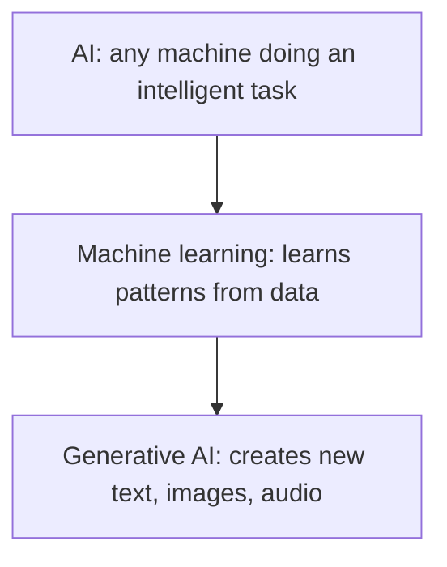

# Instructor Reference: Session 1.1 — What AI, ML and GenAI Are

Duration: 110 min teaching + 2 × 5-min breaks = 120 min
Domain: Conceptual with no-code hands-on | Tools: ChatGPT (Free plan), Claude (Free plan), Gemini (Free plan) | Prior: None, first session | Next: How Machines Learn from Examples | Visual load: Low

**Goal:** Give professionals a precise vocabulary for AI, machine learning, and generative AI, and let them compare three chatbots safely on one real work task.

**Student profile:** Working professionals from non-technical functions (operations, marketing, finance, HR) who use chatbots casually but cannot say what the terms mean or what is safe to paste.

**Key outcome:** By the end, every learner can place AI, ML, and GenAI in the right order, name three work tasks where GenAI gives a useful first draft, list what must never be pasted into a public tool, and compare three tools' answers to one task.

| Block | Minutes |
|---|---|
| Segment 1 — AI, machine learning, and generative AI: what each term covers | 18 |
| Segment 2 — Everyday uses of generative AI at work | 18 |
| Break 1 | 5 |
| Segment 3 — What never to paste into a public AI tool | 18 |
| Segment 4 — Hands-on: one task through three tools | 18 |
| Break 2 | 5 |
| Segment 5 — Comparing the three answers and naming each trade-off | 18 |
| Segment 6 — Common Mistakes | 12 |
| Segment 7 — Session Recap | 8 |
| **Total** | **120** |

**Setup (before class):** Each learner needs a free account on ChatGPT, Claude, and Gemini, and three browser tabs ready. Free plans, limits, and menus change often, so open all three yourself the day before. Print or share the supplied task in Segment 4 (it has names and figures removed). No files or installs are needed.

---

## SEGMENT 1 — AI, Machine Learning, and Generative AI: What Each Term Covers `(18 min)`

> Instructor note: This is the first session of the course. There is no prior session to reference.

**Hook-in** `(30 sec)`

"Raise a hand if you have used a chatbot this month. Now keep it up if you could explain, in one sentence, the difference between AI, machine learning, and generative AI. Most hands go down, and that is exactly what we fix in the next ten minutes."

**Concept** `(4 min)`

Analogy: Think of Russian nesting dolls. The biggest doll is "AI", any machine doing something that looks intelligent. Inside it sits a smaller doll, "machine learning", AI that learns its behaviour from examples instead of rules someone typed. Inside that sits the smallest doll, "generative AI", machine learning that creates new text, images, or audio.

**Artificial intelligence (AI) is any system that performs a task we would call intelligent, machine learning (ML) is AI that learns patterns from data instead of following hand-written rules, and generative AI (GenAI) is ML that produces new content such as text, images, or audio.**

Why it matters: When a vendor says "AI-powered", you can now ask which doll they mean, and what it was trained to do.

**Visual** `(visual only, no extra time)`



> **Say while pointing:** "Each box sits inside the one above it, so every GenAI tool is ML and every ML system is AI, but not the other way round."

**Implementation / Demonstration** `(8 min)`

Run a sorting game on the whiteboard or a shared slide. Read each example aloud and ask learners to call out the smallest doll that fits.

| Example | AI | ML | GenAI | Smallest doll that fits |
|---|---|---|---|---|
| A thermostat rule: "if below 22°C, turn heating on" | Yes (a simple rule) | No | No | Rule-based, barely AI |
| A spam filter that learned from millions of marked emails | Yes | Yes | No | Machine learning |
| A bank model that scores loan risk from past repayments | Yes | Yes | No | Machine learning |
| A chatbot that drafts a reply email for you | Yes | Yes | Yes | Generative AI |
| A tool that creates a product photo from a text description | Yes | Yes | Yes | Generative AI |
| A phone that unlocks by recognising your face | Yes | Yes | No | Machine learning |

Expected:
```
Learners agree on the last column for all six rows. The thermostat is the debate: it is "intelligent-looking" but follows a typed rule, so it learns nothing.
```

Say: "Notice the test. Ask two questions: did it learn from examples, and does it create new content? Learned, no new content: ML. Learned, creates content: GenAI. Neither: a rule. The face unlock is a favourite trap: it recognises, it does not create, so it is ML, not GenAI."

**Key point**

**Every GenAI tool is machine learning, every ML system is AI, but most AI in business today is not generative.**

**Room check** `(30 sec)`

> **Ask:** "A system learned from past invoices to flag suspicious ones. AI, ML, or GenAI?"
>
> **Answer:** ML (and therefore AI): it learned patterns from data, but it does not create new content.

**Student try** `(3 min)`

Write down one product from your own workplace that you think uses AI, then decide which doll fits and why, using the two questions.

Success: Each learner states the doll and justifies it with "learned from examples" or "creates new content".

---

## SEGMENT 2 — Everyday Uses of Generative AI at Work `(18 min)`

**Hook-in** `(30 sec)`

"Now we know GenAI is the doll that creates content. So where in a normal working day does creating content save you time?"

**Concept** `(4 min)`

Analogy: A very fast junior colleague who has read a vast amount but has never worked at your company. They write a decent first draft in seconds, but they do not know your clients, and they sometimes sound sure about things that are wrong. You would review their work before it goes out.

**A good GenAI task is one where a useful first draft, summary, or answer saves you time and a human can check the result before it is used.**

Why it matters: The skill is picking tasks where the draft helps and the checking is cheap, not asking AI to do everything.

**Implementation / Demonstration** `(8 min)`

Show the three kinds of "useful first output" with one example each from different functions, then ask learners to match their own day.

| Kind of output | Example at work | What the human still does |
|---|---|---|
| First draft | A polite reply to a delayed-delivery complaint | Check facts, add the order number, adjust tone |
| Summary | Five bullet points from a long meeting transcript | Confirm nothing important was dropped |
| Answer | "What are common reasons for a rise in staff attrition?" | Test the ideas against your own data |

Then run a 5-minute "my day" exercise: each learner lists the tasks in a normal working day (6 to 8 lines) and circles the three where a draft, summary, or answer would help.

Expected:
```
Typical circled tasks: drafting emails, summarising reports or calls, preparing meeting notes, brainstorming campaign ideas, rewriting text in a different tone, explaining a spreadsheet formula.
Tasks usually NOT circled: signing off a payment, deciding a hiring offer, anything where an unchecked error is costly.
```

Say: "Look at what the circled tasks share: the output is text, a person can read it quickly, and a mistake is caught before it does harm. The tasks left uncircled are decisions with serious consequences. That line, draft versus decision, is the line we will keep returning to all course."

**Key point**

**Use GenAI for drafts, summaries, and answers a human will check, not for decisions nobody reviews.**

**Room check** `(30 sec)`

> **Ask:** "Is 'approve this supplier invoice for payment' a good first task for GenAI?"
>
> **Answer:** No. It is a decision with real cost if wrong; GenAI can help summarise the invoice, but a person approves it.

**Student try** `(3 min)`

Pick one of your circled tasks and write one sentence: what the AI drafts, and what you check before using it.

Success: The sentence names both the AI's output and a specific human check.

---

## Break 1 `(5 min)`

Re-entry hook: "After the break: the part that protects your job and your company, what you must never paste into a public AI tool."

---

## SEGMENT 3 — What Never to Paste into a Public AI Tool `(18 min)`

**Hook-in** `(30 sec)`

"Your draft email is only as safe as what you typed to get it. Let us decide, before we touch any tool, what is allowed in the box."

**Concept** `(4 min)`

Analogy: A public chatbot is like speaking on a crowded train. Anything you say may be overheard, remembered, or repeated. You would not read a client's contract out loud there, however convenient it feels.

**Information unsafe to paste into a public AI chatbot includes personal data about people, confidential business figures, client or employee details, passwords and keys, and anything covered by a contract or law; the safe habit is to remove names and figures first.**

Why it matters: Text you paste may be stored and, depending on the plan and settings, used to improve the service, and you cannot take it back.

**Implementation / Demonstration** `(8 min)`

Run a "safe or unsafe" sorting round on these eight snippets. Learners hold up a green card (safe) or a red card (unsafe).

| # | What you want to paste | Safe? | Why |
|---|---|---|---|
| 1 | "A customer wrote that her order arrived late and the box was damaged. Draft a polite apology." | Safe | No names or identifiers |
| 2 | An email thread with a client's full name, phone number, and order history | Unsafe | Personal data about a real person |
| 3 | Next quarter's unreleased revenue forecast by product | Unsafe | Confidential business figures |
| 4 | "Explain what churn means in simple words" | Safe | General knowledge, nothing private |
| 5 | A spreadsheet of employee salaries and names | Unsafe | Personal and sensitive HR data |
| 6 | Your system password, so the tool can "help log in" | Unsafe | Credentials must never be shared |
| 7 | The same complaint as row 2, with name, phone, and order numbers replaced by [CUSTOMER], [PHONE], [ORDER] | Safe | Identifiers removed, meaning kept |
| 8 | A confidential contract clause under a non-disclosure agreement | Unsafe | Covered by a legal duty |

Expected:
```
Rows 1, 4, and 7 are safe. Rows 2, 3, 5, 6, and 8 are unsafe.
Row 7 versus row 2 is the lesson: the same task becomes safe once names and figures are removed.
```

Say: "Rows 2 and 7 are the same email. In row 7 we kept the situation and removed the people. That is the habit: replace names with labels like [CUSTOMER], replace exact figures with ranges or round numbers, and check your company's AI policy first. Some companies buy business plans with stricter data terms; free plans are for non-sensitive text."

Also worth knowing: Chatbot settings, such as turning off chat history or training use, differ by tool and change over time, so check the current setting yourself.

**Key point**

**If you would not read it aloud on a crowded train, do not paste it into a free chatbot: remove names and figures first.**

**Room check** `(30 sec)`

> **Ask:** "How can you keep the usefulness of a customer complaint while making it safe to paste?"
>
> **Answer:** Replace names, phone numbers, and order numbers with labels, and keep only the situation.

**Student try** `(3 min)`

Take this line and rewrite it so it is safe to paste: "Priya Nair from Pune says invoice 88421 for Rs 1,86,000 was charged twice."

Success: The rewrite contains no name, city, invoice number, or exact amount, for example: "[CUSTOMER] says an invoice of about [AMOUNT] was charged twice."

---

## SEGMENT 4 — Hands-on: One Task Through Three Tools `(18 min)`

**Hook-in** `(30 sec)`

"Time to use what we have learned. One safe task, three chatbots, one comparison. Everything you paste has been cleaned already."

**Concept** `(4 min)`

Analogy: Hiring three freelancers for the same small job and comparing their work before choosing. You learn more from the comparison than from any single result.

**A fair tool comparison uses the identical prompt in every tool, in a fresh chat, and judges the answers on the same four criteria: accuracy, tone, detail, and what each does best.**

Why it matters: Chatbots differ in style and strengths, and a fair test prevents choosing a tool on a first impression.

**Implementation / Demonstration** `(8 min)`

Share the supplied task. Learners may use this one or replace it with a task from their own work that has names and figures removed.

Supplied task (copy exactly into all three tools, in a new chat each time):

```
Below is a customer email with identifying details removed.

"Hello, I ordered a [PRODUCT] on [DATE] and it was supposed to arrive in 3 days. It is now day 9 and the tracking page has not changed for a week. When I called, I was told someone would call me back, but nobody did. I want to know what is happening and I would like compensation for the delay."

Do two things:
1. Summarise the customer's complaint in exactly 3 bullet points.
2. Write a polite reply of under 120 words that apologises, explains the next step, and does not promise anything we have not confirmed.
```

Steps:
1. Open ChatGPT, Claude, and Gemini in three tabs, each in a new chat.
2. Paste the identical text into each and send.
3. Copy each answer into a three-column note or sheet, with the tool's name at the top of each column.
4. Do not edit or re-ask yet.

Expected:
```
Each tool returns two parts: three bullets and a short reply.
Reasonable bullets cover: late delivery (day 9 against 3 days), stalled tracking, an unanswered callback, and a compensation request.
Wording, length, and structure will differ between tools and between runs.
If a tool's reply promises a refund or a date, that breaks the instruction "does not promise anything we have not confirmed".
```

Say: "Outputs vary every time you run them; that is normal, so do not worry if yours differs from a neighbour's. What we care about is that the instruction was identical. Count the words of each reply, and check each against all four parts of the instruction: exactly three bullets, under 120 words, an apology, and no unconfirmed promise."

**Key point**

**Compare tools with the same prompt in a fresh chat each, and check every answer against the instruction line by line.**

**Room check** `(30 sec)`

> **Ask:** "Why must the prompt be identical and each chat new?"
>
> **Answer:** So differences come from the tools, not from different wording or earlier conversation.

**Student try** `(3 min)`

For each tool, count the bullets and the words in the reply, and mark whether it kept the "no promise" rule.

Success: A small table with three rows (one per tool) showing bullet count, word count, and a yes or no for the rule.

---

## Break 2 `(5 min)`

Re-entry hook: "After the break: you have three answers in front of you. Now we judge them properly instead of picking the one that sounds nicest."

---

## SEGMENT 5 — Comparing the Three Answers and Naming Each Trade-off `(18 min)`

**Hook-in** `(30 sec)`

"In Segment 4 you collected three answers. A good-sounding answer is not always a correct one, so we score them on four criteria."

**Concept** `(4 min)`

Analogy: Judging a cooking contest. You do not say "I like the second one". You score taste, presentation, and portion size on the same sheet, and then you know why a dish won and what each cook does best.

**Every AI tool has trade-offs, such as accuracy against speed, brevity against detail, or a formal tone against a warm one, and naming each tool's trade-off for a given task is more useful than naming a winner.**

Why it matters: Choosing a tool for a task, and knowing its weak side, is a core part of using AI responsibly at work.

**Implementation / Demonstration** `(8 min)`

Use this scoring sheet. Learners score each tool from 1 (weak) to 3 (strong) on each criterion, then write one best-at and one weakness note.

| Criterion | What to check | ChatGPT | Claude | Gemini |
|---|---|---|---|---|
| Accuracy | Bullets match the email; no invented facts or promises | | | |
| Tone | Polite, calm, suitable for a customer | | | |
| Detail | Covers all four complaint points without padding | | | |
| Followed instructions | Exactly 3 bullets, under 120 words | | | |
| **Best at** | One phrase | | | |
| **Trade-off** | One phrase | | | |

Expected:
```
No single tool wins every row. Typical findings: one reply is warmer but runs long, one is concise but a little cold, one adds a detail that was never in the email. Totals differ by learner and by run.
```

Say: "Look for the invented detail: a promised refund, a made-up date, or a policy that is not in the email. That is the accuracy problem we will study properly in a later module. Then fill the last two rows in your own words, for example 'best at: concise structure; trade-off: ignored the word limit'. The point is a sentence you could tell a colleague tomorrow."

Close with a 2-minute round: each learner reads out one trade-off they found.

**Key point**

**There is rarely one best tool: name what each does best and where it trades off for the task at hand.**

**Room check** `(30 sec)`

> **Ask:** "One tool's reply is warm and detailed but promises a refund the email never offered. How do you score its accuracy?"
>
> **Answer:** Low: it invented a commitment that was not confirmed, even though the tone is good.

**Student try** `(3 min)`

Write two sentences: which tool you would use for this type of task and why, and one thing you would always check before sending the reply.

Success: The answer names a tool, a reason tied to the scoring sheet, and a specific check.

---

## SEGMENT 6 — Common Mistakes `(12 min)`

### Mistake 1: Treating AI, ML, and GenAI as the same thing

**Wrong:**
"Our fraud model is generative AI."

**Right:**
"Our fraud model is machine learning; it scores transactions but does not create content."

**Why it matters:** Vendors blur the terms, and using them correctly lets you ask the right questions about cost, data, and risk.

### Mistake 2: Pasting real names and figures into a free chatbot

**Wrong:**
Pasting "Priya Nair from Pune says invoice 88421 for Rs 1,86,000 was charged twice."

**Right:**
Pasting "[CUSTOMER] says an invoice of about [AMOUNT] was charged twice."

**Why it matters:** Pasted text can be stored, and you cannot retrieve it.

### Mistake 3: Comparing tools with different prompts

**Wrong:**
Asking ChatGPT in detail and Gemini in one line, then saying "ChatGPT is better".

**Right:**
Using the identical prompt in a fresh chat for every tool.

**Why it matters:** The difference you see may come from your wording, not the tool.

### Mistake 4: Trusting the most confident-sounding answer

**Wrong:**
"This one sounds the most sure, so it must be right."

**Right:**
Checking each claim against the source, such as the email.

**Why it matters:** Chatbots write fluently even when wrong, so tone says nothing about accuracy.

### Mistake 5: Using GenAI for decisions nobody will review

**Wrong:**
Letting a chatbot decide whether a customer gets compensation.

**Right:**
Letting it draft the options, and having a person decide.

**Why it matters:** An unchecked error in a decision is costly, while an error in a draft is caught on review.

**Live room check:**

> **Ask:** "A colleague says, 'It is just a chatbot, I will paste the whole client contract so it can summarise.' What do you say?"
>
> **Answer:** Do not paste it: it is confidential. Remove names and figures, or use an approved company tool.

---

## SEGMENT 7 — Session Recap `(8 min)`

| Learning Outcome | What to Remember |
|---|---|
| Compare AI, machine learning and generative AI by what each term covers | AI is the widest term, ML is AI that learns from data, and GenAI is ML that creates new content. |
| Identify three tasks in a working day where generative AI produces a useful first draft, summary or answer | Drafts, summaries, and answers that a human can check quickly are good tasks; unchecked decisions are not. |
| Identify information unsafe to paste into a public AI chatbot | Personal data, confidential figures, credentials, and contract text stay out; remove names and figures first. |
| Compare the output of one task run through three AI tools and name the trade-off of each | Use an identical prompt, score accuracy, tone, detail, and instruction-following, and name each tool's best-at and trade-off. |

Quick fire (2 min, cold-call): "Which doll is a spam filter? Name one safe and one unsafe thing to paste. Why use the same prompt in all three tools? What is the line between draft and decision?"

**Path forward:**
How Machines Learn from Examples — You now know what the terms mean. Next, we look inside the "ML" doll: how a machine moves from hand-written rules to learning from examples, and you will train a small image classifier yourself.

---

## SECTION 11: Instructor Companion Appendix

### Instructor Notes

- Tool interfaces, free-plan limits, and data settings change frequently. Open all three tools on the morning of the session and note any change.
- Learners will want to paste real work. Repeat the rule in Segment 3 each time, and offer the cleaned supplied task as the safe default.
- AI outputs are not repeatable. Never promise learners they will see a particular answer; grade them on method (identical prompt, scoring sheet), not on matching yours.

### Materials Checklist

- [ ] Free accounts for ChatGPT, Claude, and Gemini for every learner
- [ ] The supplied task text shared in chat or on a slide
- [ ] Green and red cards, or a poll, for the safe or unsafe round
- [ ] The scoring sheet as a shared document or printout

### Timing Contingencies

- Running short: Skip the sorting game in Segment 1 beyond three rows, and use five of the eight snippets in Segment 3.
- Running ahead: Ask each tool to rewrite its reply in a different tone and compare again.

### Answer Key

- S1 Student try: Judge by two questions: learned from examples, and creates new content.
- S2 Student try: Any sentence naming an AI output and a human check, such as "AI drafts the reply; I verify the order number and policy."
- S3 Student try: "[CUSTOMER] says an invoice of about [AMOUNT] was charged twice."
- S4 Student try: A table with bullet count (target 3), reply word count (target under 120), and the no-promise check per tool.
- S5 Student try: A tool choice tied to scores, plus a check such as "confirm every fact against the original email".

### Glossary

- **AI:** Systems that perform tasks we would call intelligent.
- **Machine learning (ML):** AI that learns patterns from data instead of following typed rules.
- **Generative AI (GenAI):** ML that creates new content such as text, images, or audio.
- **Chatbot:** A conversational tool, here powered by a large language model.
- **Prompt:** The instruction or question you give an AI tool.
- **Confidential data:** Information that must not be shared outside those who are allowed to see it.
