# What AI, ML and GenAI Are

```mermaid
%%{init: {"flowchart": {"nodeSpacing": 45, "rankSpacing": 65, "diagramPadding": 20}} }%%
flowchart TB
  subgraph Foundation["Where You're Starting From"]
    P1(["Program Entry Point<br/><b>Day One &mdash; No Prior Coursework</b><br/><i>&#40;Curiosity, Motivation&#41;</i><br/>Beginning the journey from zero to confidently leading AI adoption at work"])
  end
  CS{{Current Session<br/><b>What AI, ML and GenAI Are</b><br/><i>Learn what each term really covers and try three chatbots safely on one real task</i><br/>AI &middot; Machine Learning &middot; Generative AI &middot; Safe Use}}
  subgraph Value["Why This Matters"]
    CV(["Course Value<br/><b>One Shared Vocabulary</b><br/>Every later session, from prompts to agents to governance, uses these terms, so getting them straight now saves confusion for the whole course."])
    RV(["Real-Life Value<br/><b>Hear Through the Hype</b><br/>When a vendor says AI-powered, you can ask which kind it is, what it learned from, and what is safe to share with it."])
  end
  subgraph Future["Where This Leads Next"]
    F1(["Upcoming Session<br/><b>How Machines Learn from Examples</b><br/><i>&#40;Training, Inference&#41;</i><br/>Shows how a machine moves from typed rules to learning from examples."])
    F2(["Upcoming Session<br/><b>Supervised Learning: Predicting from Examples</b><br/><i>&#40;Features, Target&#41;</i><br/>Uses labelled examples to predict outcomes such as customers leaving."])
    F3(["Upcoming Module<br/><b>Module 2: Generative AI for the Enterprise</b><br/><i>&#40;Prompts, Documents&#41;</i><br/>Covers how large language models work and how to use them reliably at work."])
  end
  P1 ==>|&nbsp;Begin&nbsp;| CS
  CS ==>|&nbsp;Course Path&nbsp;| CV
  CS ==>|&nbsp;Real-Life Use&nbsp;| RV
  CS ==>|&nbsp;Look Inside ML&nbsp;| F1
  F1 ==>|&nbsp;Predict&nbsp;| F2
  F2 ==>|&nbsp;Use GenAI&nbsp;| F3
  classDef previous fill:#eef4ff,stroke:#4f7ccf,color:#111827,stroke-width:2px;
  classDef current fill:#fff4d6,stroke:#d9a321,color:#111827,stroke-width:3px;
  classDef value fill:#eaf8ef,stroke:#3f9f63,color:#111827,stroke-width:2px;
  classDef future fill:#f4ecff,stroke:#8a61d1,color:#111827,stroke-width:2px;
  class P1 previous;
  class CS current;
  class CV,RV value;
  class F1,F2,F3 future;
  linkStyle default stroke-width:3px
```



---

## What You'll Learn

In this pre-read, you'll discover:

- Why AI, machine learning, and generative AI are three nested ideas and not three names for the same thing
- Where in an ordinary working day a chatbot gives you a genuinely useful first draft, and where it should never be trusted alone
- The simple test for what is safe, and unsafe, to paste into a free AI tool
- How to compare several chatbots fairly instead of choosing the one that merely sounds best

---

## Detailed Explanation

### AI, ML, and GenAI — three nested ideas, not three separate things

Think of Russian nesting dolls. The biggest doll is **artificial intelligence (AI)**: any system that does a task we would call intelligent. Inside it is **machine learning (ML)**: AI that learns patterns from data instead of following rules someone typed. Inside that is **generative AI (GenAI)**: ML that creates new content such as text, images, or audio.

```
AI                     any machine doing an "intelligent" task
 └─ Machine learning   learns its behaviour from examples
     └─ Generative AI  creates NEW text, images, audio
```

Two questions sort almost any product:

```
Did it learn from examples?     No  ->  a plain rule (a thermostat, a fixed checklist)
Does it create new content?     No  ->  machine learning (spam filter, loan-risk score, face unlock)
                                Yes ->  generative AI (a chatbot, an image generator)
```

> **Key mental model:** Every GenAI tool is ML, and every ML system is AI, but most of the AI already running inside businesses, such as fraud scores and recommendations, is not generative.

---

### Where GenAI helps in a working day

A useful way to think of a chatbot is as a very fast junior colleague who has read an enormous amount but has never worked at your company. They produce a decent first draft in seconds, but they do not know your clients and they can be confidently wrong, so you review before it goes out.

Three kinds of output are usually worth having:

```
First draft   a reply to a late-delivery complaint
Summary       five bullets from a long meeting transcript
Answer        common reasons staff attrition rises
```

The pattern is the same each time: a **person can check the result quickly**. Tasks like approving a payment or deciding a hire are different. A mistake there is costly and nobody may catch it, so AI can prepare information but a person decides.

> **Habit worth building:** Before using AI on a task, ask "who checks this, and how fast?" If you cannot answer, it is not a good first task.

---

### What never to paste into a public AI tool

A free public chatbot is like speaking on a crowded train: anything you say might be overheard, kept, or repeated. Text you paste may be stored, and you cannot take it back.

```
Unsafe to paste                          Safer version
Priya Nair, Pune, invoice 88421,         [CUSTOMER] says an invoice of about
Rs 1,86,000 charged twice                [AMOUNT] was charged twice
```

Unsafe categories include personal data about real people (names, phone numbers, addresses), confidential business figures such as unreleased forecasts, employee records, passwords and keys, and any text covered by a contract or law. The practical fix is to replace names with labels like `[CUSTOMER]` and exact figures with ranges or placeholders, and to check your company's AI policy, which may approve specific paid tools with stricter data terms.

> **Rule of thumb:** If you would not read it aloud on a crowded train, do not paste it into a free chatbot.

---

### Comparing chatbots fairly

If three freelancers do the same small job, you compare their work on the same checklist rather than by first impression. A fair comparison of ChatGPT, Claude, and Gemini follows the same discipline:

```
1. Use the identical prompt in each tool
2. Start a fresh chat for each, so earlier conversation does not leak in
3. Score each answer on the same criteria:
      accuracy     do claims match the source? any invented facts?
      tone         suitable for the reader?
      detail       complete without padding?
      instructions did it obey limits such as "3 bullets, under 120 words"?
4. Write down what each does best, and its trade-off
```

Outputs are not repeatable: the same prompt can give different answers on different runs, so judge your method, not whether you match a classmate. In the live session you will run one cleaned-up customer complaint through all three tools and fill in a scoring sheet.

> **Common misconception:** "The answer that sounds the most confident is the most correct." Chatbots write fluently whether or not they are right, so tone tells you nothing about accuracy.

---

### Bringing it together: a safe, fair first experiment

```
1. Pick a task where a draft, summary, or answer helps and a person will check it
2. Remove names, figures, and anything confidential
3. Run the identical prompt in each tool, in a fresh chat
4. Score accuracy, tone, detail, and instruction-following
5. Name each tool's strength and trade-off, and record what you must verify
```

> **Forward connection:** In the next session we open the "ML" doll and see how a machine learns from examples, which is the same idea behind every chatbot you will have just tested.

---

## Practice Exercises

**1. Pattern Recognition — Which doll is it?**

Decide whether each is a plain rule, machine learning, or generative AI:

- A. A tool that writes a draft job advertisement from three bullet points
- B. A payroll system that adds 5% to pay when tenure passes ten years
- C. A model that learned from past sales to forecast next month's demand
- D. An app that creates a poster image from a sentence

---

**2. Spot The Error — The risky prompt**

A colleague writes: "Summarise this email from Rohan Mehta at Tata Capital about our unreleased Q3 pricing: [full email pasted]." Name at least three things wrong with pasting this, and rewrite the request safely.

---

**3. Real-Life Application — Your own working day**

List six tasks you do in a normal week. Mark two where GenAI could give a useful first draft, summary, or answer, and for each say what you would check before using the output. Mark one where you would not use AI alone, and say why.

---

**4. Concept Detective — The confident wrong answer**

You ask a chatbot for last year's attrition figure for your own company and it replies with a precise number and a polished explanation. You know the number is not in anything you gave it. Explain what likely happened, and what this tells you about trusting a confident tone.

---

**5. Planning Ahead — A tool comparison checklist**

You are asked to pick one chatbot for your team to draft customer replies. Write a short checklist of at least five steps you would follow to compare three tools fairly, including how you would score the results and how you would keep customer data safe during the test.
