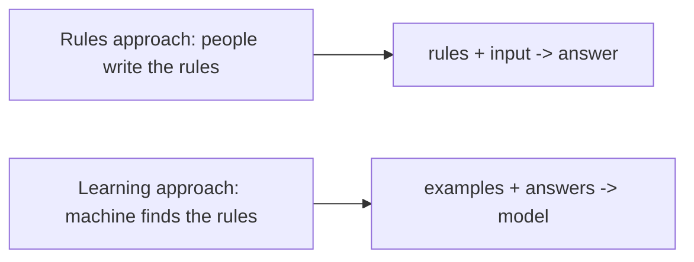
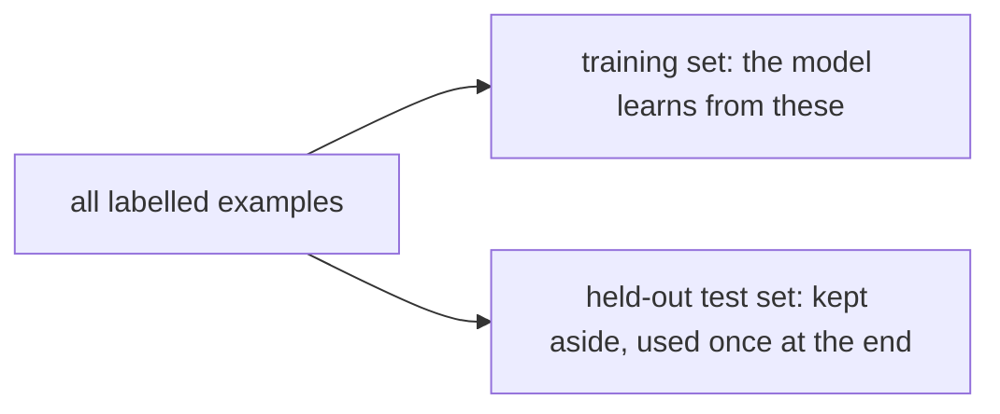

# Instructor Reference: Session 1.2 — How Machines Learn from Examples

Duration: 110 min teaching + 2 × 5-min breaks = 120 min
Domain: Conceptual with no-code hands-on | Tools: Teachable Machine (free, in the browser), supplied `shapes/` images | Prior: What AI, ML and GenAI Are | Next: Supervised Learning: Predicting from Examples | Visual load: Medium

**Goal:** Show learners how machine learning replaced hand-written rules with learning from examples, and let them train and fairly test an image classifier without writing code.

**Student profile:** Non-technical professionals who now know the AI, ML, and GenAI vocabulary but have never seen what "training" a model actually involves.

**Key outcome:** By the end, every learner can explain rules versus learning, separate a training run from an inference call, explain why results must be reported on held-out data, and has trained and tested a classifier in Teachable Machine.

| Block | Minutes |
|---|---|
| Segment 1 — From hand-written rules to learning from examples | 18 |
| Segment 2 — Training a model versus using it (inference) | 18 |
| Break 1 | 5 |
| Segment 3 — Why a model is tested on data it has not seen | 18 |
| Segment 4 — Hands-on: train an image classifier | 18 |
| Break 2 | 5 |
| Segment 5 — Hands-on: test on unseen photos and report honestly | 18 |
| Segment 6 — Common Mistakes | 12 |
| Segment 7 — Session Recap | 8 |
| **Total** | **120** |

**Setup (before class):** Learners need a laptop with Chrome or a similar browser and the page `teachablemachine.withgoogle.com`. The webcam is optional. From `data/shapes/` give each learner the folders `train/circle`, `train/square`, `train/triangle` (20 images each) and `test/circle`, `test/square`, `test/triangle` (6 each, kept separate). Generate them by running `python make_data.py` in `data/` (needs the Pillow library). Teachable Machine's menus change, so open it yourself the day before.

---

## SEGMENT 1 — From Hand-Written Rules to Learning from Examples `(18 min)`

> Instructor note: 1.1 gave the vocabulary: ML is AI that learns from data. Name it, do not reteach it.

**Hook-in** `(30 sec)`

"Last session we said machine learning learns from examples. Today we open that box. How does a machine go from a pile of examples to a skill?"

**Concept** `(4 min)`

Analogy: Teaching a child to recognise a dog. You could hand over a rulebook ("four legs, fur, a tail, barks") and the child fails on a hairless breed or a puppy. Or you could point at many dogs and say "dog" until the child just gets it. Early AI used the rulebook. Modern AI uses the pointing.

**Early AI followed hand-written rules that people typed, while machine learning finds the pattern itself from many examples, and the pattern it finds is called a model.**

Why it matters: Rules break on cases nobody thought of, while a model learned from varied examples copes with variety.

**Visual** `(visual only, no extra time)`



> **Say while pointing:** "On top, a person writes the rules and the computer applies them. On the bottom the computer is given examples with their answers and works out the rules itself, and what it works out is the model."

**Implementation / Demonstration** `(8 min)`

Run a whiteboard exercise: "Write the rules for a spam email."

1. Ask the room to shout rules ("contains 'FREE'", "many exclamation marks", "unknown sender").
2. Write each on the board, then test them on these four emails, read aloud:

| Email | Looks like | Rule "contains FREE" says | Truth |
|---|---|---|---|
| "FREE gift, click now!!!" | Spam | Spam | Spam |
| "Free to join the 3 pm review?" | Normal | Spam | Not spam |
| "Y0ur acc0unt needs verificati0n" | Spam | Not spam | Spam |
| "Invoice attached for September" | Normal | Not spam | Not spam |

Expected:
```
The rule gets 2 of 4 emails right and fails on both a normal email containing "free" and a spam email with spelling tricks.
Rules also keep growing: every failure demands a new rule.
```

Say: "Two of four. And the spammers read our rules and change their spelling. A learning system would instead be shown thousands of emails each marked spam or not spam, and would find patterns we never thought of. We give it examples with answers, and it produces the model."

**Key point**

**Rules are typed by people and break on unseen cases; a model is the pattern a machine learns from examples.**

**Room check** `(30 sec)`

> **Ask:** "In the learning approach, what goes in and what comes out of training?"
>
> **Answer:** Examples with their answers go in, and a model comes out.

**Student try** `(3 min)`

In pairs, write three rules for deciding whether a customer complaint is urgent, then write one complaint that your rules would get wrong.

Success: Each pair has three rules and a counter-example that shows a rule failing.

---

## SEGMENT 2 — Training a Model Versus Using It (Inference) `(18 min)`

**Hook-in** `(30 sec)`

"The model comes out of training. But what do we do with it afterwards, and is that the same activity? It is not, and the difference drives most AI costs."

**Concept** `(4 min)`

Analogy: Going to cooking school versus cooking dinner. Cooking school is long, expensive, and happens once: you practise on many dishes. Cooking dinner afterwards is quick and uses what you learned. Training is the school, inference is the dinner.

**Training is the slow, costly process of building a model from many labelled examples, and inference is using the finished model to make a prediction on new data.**

Why it matters: Companies pay once (or occasionally) for training and then pay a small amount every time the model is used, and the two bills behave very differently.

**Implementation / Demonstration** `(8 min)`

Show this comparison, then walk through a simple "email spam" example in both modes.

| | Training | Inference |
|---|---|---|
| What happens | The model learns from labelled examples | The model answers about one new item |
| Input | Thousands of examples with answers | One new email, no answer given |
| Output | A finished model | A prediction, such as "spam, 94% sure" |
| How often | Once, then occasionally to refresh | Every time someone uses it |
| Cost and time | High and slow | Low and fast |

Worked example with numbers: A spam model is trained once on 50,000 emails and takes 3 hours. It is then used on 2,000,000 incoming emails a day, each judged in a fraction of a second.

Expected:
```
Training runs: 1 (about 3 hours).
Inference calls: 2,000,000 per day.
The training happened before the first user email; every later email is inference.
```

Say: "Every time you type into a chatbot, that is inference. The training happened months ago on enormous data. Keep the split in mind: when a vendor quotes a price, ask whether it is for building the model or for each use of it."

**Key point**

**Training builds the model once at high cost; inference uses it many times at low cost per use.**

**Room check** `(30 sec)`

> **Ask:** "You upload a photo to a phone app and it says 'cat'. Training or inference?"
>
> **Answer:** Inference: the finished model is judging a new photo.

**Student try** `(3 min)`

Label each as training or inference: (a) a bank builds a model from five years of loan data; (b) the same model scores today's applicant; (c) a chatbot answers your question.

Success: (a) training, (b) inference, (c) inference.

---

## Break 1 `(5 min)`

Re-entry hook: "After the break: a model can look perfect and still fail in real life. The reason is how we test it."

---

## SEGMENT 3 — Why a Model Is Tested on Data It Has Not Seen `(18 min)`

**Hook-in** `(30 sec)`

"Imagine a student who memorises last year's exam paper word for word. Give them that exact paper and they score 100%. Does that mean they understand the subject?"

**Concept** `(4 min)`

Analogy: The memorising student. If we test them only on questions they have already seen, we measure memory, not understanding. A fair exam uses new questions. A model is the same: it must be judged on examples it never saw during training.

**A model must be evaluated on held-out data that played no part in training, because performance on the examples it learned from overstates how well it will work on new cases.**

Why it matters: A model can score near perfect on its training data and still fail in the real world, and a vendor who quotes only the training score is hiding that.

**Visual** `(visual only, no extra time)`



> **Say while pointing:** "We split the labelled data. The model sees only the top box while learning, and the bottom box stays hidden until we check how it does on cases it has never met."

**Implementation / Demonstration** `(8 min)`

Work through two reports of the same model from a vendor.

| Report | Data used to score | Correct | Total | Accuracy |
|---|---|---|---|---|
| Vendor slide | The 900 examples it was trained on | 891 | 900 | 99.0% |
| Honest check | 100 examples held out from training | 78 | 100 | 78.0% |

Compute together: accuracy = correct / total, so 891 / 900 = 0.99 and 78 / 100 = 0.78.

Expected:
```
Training accuracy 99.0%, held-out accuracy 78.0%.
The 21-point gap shows the model partly memorised its training examples.
The honest number to report is 78%.
```

Say: "Both numbers are real, but only one predicts tomorrow. A large gap between the two is called overfitting, a model that learned its examples too closely. When someone quotes you accuracy, your first question is always: on which data?"

**Key point**

**Report performance on held-out data, never on the examples the model learned from.**

**Room check** `(30 sec)`

> **Ask:** "A model scores 95% on its training data and 70% on held-out data. Which figure do you quote to the CEO?"
>
> **Answer:** 70%, the held-out figure.

**Student try** `(3 min)`

A model got 45 of 50 held-out cases right. Compute its held-out accuracy.

Success: 45 / 50 = 0.90, so 90%.

---

## SEGMENT 4 — Hands-on: Train an Image Classifier `(18 min)`

**Hook-in** `(30 sec)`

"Enough theory. You will now train a real model, in your browser, with no code. You teach it to tell circles, squares, and triangles apart."

**Concept** `(4 min)`

Analogy: Showing a toddler flashcards. You show many cards for each label and the toddler builds an internal picture of each. Teachable Machine does the same: you provide labelled images for each class, and it trains a small image model.

**An image classifier is a model that sorts pictures into labels (classes), and a no-code tool like Teachable Machine trains one from the labelled example images you upload or capture.**

Why it matters: Seeing training happen on your own examples makes the terms "examples", "labels", and "model" concrete.

**Implementation / Demonstration** `(8 min)`

Steps (menu names may differ slightly):

1. Open `teachablemachine.withgoogle.com`, choose **Get Started**, then **Image Project**, then **Standard image model**.
2. Rename Class 1 to `circle`, Class 2 to `square`. Use **Add a Class** to create `triangle`.
3. In each class, choose **Upload** and add the 20 images from the matching `train/` folder (or use the webcam to hold up drawn shapes).
4. Click **Train Model** and keep the tab open until it finishes.
5. When training ends, use the **Preview** panel but do not test the `test/` folder yet.

Expected:
```
Each class shows "20 Image Samples". Training finishes in under a minute on a normal laptop.
The Preview panel shows a bar for each class that moves when you give it an image.
Nothing from the test/ folder has been used so far.
```

Say: "You have just done training. The 60 labelled images were the examples, the class names were the answers, and the result is a model sitting in your browser. Keep the test folder closed, it is our hidden exam. If the tool lets you adjust epochs or batch size, leave the defaults: those are settings for specialists."

Fallback if upload fails: use the webcam and hold up hand-drawn circles, squares, and triangles on paper, 15 samples each.

**Key point**

**Training needs labelled examples per class; keep your test examples out of it.**

**Room check** `(30 sec)`

> **Ask:** "Why do we keep the `test/` folder unopened until training is done?"
>
> **Answer:** They must stay unseen, so the final score measures real learning and not memory.

**Student try** `(3 min)`

Confirm each class shows 20 samples and that training completed.

Success: Three classes with 20 samples each and a trained model in the Preview panel.

---

## Break 2 `(5 min)`

Re-entry hook: "After the break: the moment of truth. Does your model work on shapes it has never seen?"

---

## SEGMENT 5 — Hands-on: Test on Unseen Photos and Report Honestly `(18 min)`

**Hook-in** `(30 sec)`

"Your model has learned from 60 images. Now the exam: 18 new images it has never seen."

**Concept** `(4 min)`

Analogy: The surprise exam after revision. Each new question is one inference call, and your marks are the held-out accuracy.

**Testing means running inference on held-out examples, recording each prediction against the known answer, and reporting accuracy as the share correct.**

Why it matters: This is the exact routine used to judge any model, from a tiny classifier to a bank's risk model.

**Implementation / Demonstration** `(8 min)`

1. In the Preview panel, set **Input** to **File** and upload one image from `test/circle`.
2. Read the top prediction and its percentage. Record it in the table below.
3. Repeat for all 6 images in each of the three `test/` folders (18 in total).

Recording table (one row per image):

| Test image | True class | Model's top guess | Confidence | Correct? |
|---|---|---|---|---|
| circle_test_01 | circle | | | |
| circle_test_02 | circle | | | |
| ... | ... | | | |
| triangle_test_06 | triangle | | | |

Compute: correct / 18. For example, if 16 are right, accuracy = 16 / 18 = 0.889, about 89%.

Expected:
```
Most learners get high accuracy (often 15 to 18 of 18) because the shapes are simple.
Any wrong guess is worth examining: look at its image and at the confidence the model reported.
Exact results vary between learners and runs.
```

Then run the experiment that makes the lesson stick:

1. Delete 15 of the 20 training images from each class, leaving 5 each, and retrain.
2. Test the same 18 images and compute accuracy again.

Expected:
```
With fewer examples, accuracy usually drops or confidence falls, and mistakes appear on unusual shapes, sizes, or colours.
```

Say: "Write down both numbers: with 20 examples per class and with 5. This is the most important practical rule in ML: more varied examples usually mean a better model. Also look at confidence: a model can be 98% sure and wrong, so confidence is not accuracy. Report your honest held-out number, not how many you got right at a glance on the training images."

Finish with a 2-minute share: each learner states their held-out accuracy and one image the model got wrong or was unsure about.

**Key point**

**Test on unseen examples, report correct divided by total, and expect more varied examples to improve results.**

**Room check** `(30 sec)`

> **Ask:** "The model is 97% confident but wrong on a triangle. What does that tell you?"
>
> **Answer:** Confidence is not accuracy; a model can be sure and wrong, so you must test on held-out data.

**Student try** `(3 min)`

Fill in the 18-row table and compute your held-out accuracy as a percentage, then compare with the 5-example version.

Success: Two accuracy figures, each equal to correct divided by 18, with a one-line comment on the difference.

---

## SEGMENT 6 — Common Mistakes `(12 min)`

### Mistake 1: Thinking AI follows rules someone typed

**Wrong:**
"The AI knows a cat has pointy ears because someone coded that in."

**Right:**
"The model found the pattern from many labelled cat photos."

**Why it matters:** It explains why data quality, not programming, decides how good a model is.

### Mistake 2: Confusing training with inference

**Wrong:**
"Every time I ask the chatbot, it retrains itself on my question."

**Right:**
"My question is inference on a finished model; training happened earlier."

**Why it matters:** It affects how you think about cost, privacy, and why models do not instantly know yesterday's news.

### Mistake 3: Quoting accuracy on the training data

**Wrong:**
"Our model is 99% accurate" (measured on the examples it learned from).

**Right:**
"Our model is 78% accurate on 100 held-out cases."

**Why it matters:** Training accuracy overstates real-world performance.

### Mistake 4: Letting test examples leak into training

**Wrong:**
Uploading the `test/` images to the classes and then testing on them.

**Right:**
Keeping the test images aside until the model is trained.

**Why it matters:** The score becomes meaningless because the model has seen the answers.

### Mistake 5: Reading confidence as accuracy

**Wrong:**
"The model says 99%, so it must be right."

**Right:**
"The model reports 99% confidence, but I check accuracy on a held-out set."

**Why it matters:** A model can be highly confident and wrong, especially on cases unlike its training data.

**Live room check:**

> **Ask:** "A vendor demo shows 100% accuracy on their own sample photos. What do you ask?"
>
> **Answer:** "Was that data used for training, and what is the accuracy on held-out cases?"

---

## SEGMENT 7 — Session Recap `(8 min)`

| Learning Outcome | What to Remember |
|---|---|
| Explain how AI moved from following hand-written rules to learning from examples | Early AI used typed rules that break on new cases; ML learns the pattern, called a model, from labelled examples. |
| Describe the difference between a training run and an inference call on new data | Training builds the model once at high cost; inference uses it on each new item at low cost. |
| Explain why model performance must be reported on data held out from training | Training-data accuracy overstates real performance; report correct divided by total on unseen examples. |
| Train an image classifier on your own examples in a no-code tool | Create labelled classes, add example images, train, then test on a separate folder. |

Quick fire (2 min, cold-call): "What is a model? Is a chatbot reply training or inference? Which accuracy do you quote? Does high confidence mean correct?"

**Path forward:**
Supervised Learning: Predicting from Examples — Today you trained a model that put pictures into labels. Next, we apply the same idea to business data: using past customers who stayed or left to predict who will leave, and learning the words features, target, regression, and classification.

---

## SECTION 11: Instructor Companion Appendix

### Instructor Notes

- Teachable Machine runs training in the browser, so a very old laptop may be slow. Pair learners if needed.
- The supplied shapes are simple on purpose, so many learners will get near-perfect results. The fewer-examples experiment is what shows the effect; do not skip it.
- The webcam fallback needs paper with hand-drawn shapes and decent light.
- Never promise a specific accuracy: results depend on the learner's uploads and on tool updates.

### Materials Checklist

- [ ] Chrome or similar browser with internet access to Teachable Machine
- [ ] `shapes/train/` and `shapes/test/` folders distributed (made by `data/make_data.py`)
- [ ] A recording table printed or shared (18 rows)
- [ ] Optional: webcam and paper shapes

### Timing Contingencies

- Running short: Test only 3 images per class (9 total) and skip the fewer-examples retrain.
- Running ahead: Add a fourth class using a photo of an everyday object and discuss what the model does with a shape it was not trained on.

### Answer Key

- S1 Student try: Any three rules plus a counter-example, such as "contains 'urgent'" failing on "Not urgent, just FYI".
- S2 Student try: (a) training, (b) inference, (c) inference.
- S3 Student try: 45 / 50 = 90%.
- S4 Student try: Three classes of 20 samples and a trained model.
- S5 Student try: Accuracy = correct / 18, for both the 20-example and 5-example models.

### Glossary

- **Rule:** An instruction typed by a person.
- **Model:** The pattern a machine learns from examples.
- **Training:** Building a model from labelled examples.
- **Inference:** Using a finished model on new data.
- **Held-out data:** Examples kept aside from training to test fairly.
- **Overfitting:** A model that learned its training examples too closely and does worse on new ones.
- **Class / label:** One of the categories a model sorts items into.
