# How Machines Learn from Examples

```mermaid
%%{init: {"flowchart": {"nodeSpacing": 45, "rankSpacing": 65, "diagramPadding": 20}} }%%
flowchart TB
  subgraph Foundation["Where You're Starting From"]
    P1(["Previous Session<br/><b>What AI, ML and GenAI Are</b><br/><i>&#40;AI, GenAI&#41;</i><br/>You learned that GenAI sits inside ML, which sits inside AI, and what is safe to paste into a chatbot."])
  end
  CS{{Current Session<br/><b>How Machines Learn from Examples</b><br/><i>See how learning from examples replaced typed rules, and train a small classifier yourself</i><br/>Models &middot; Training &middot; Inference &middot; Held-out Testing}}
  subgraph Value["Why This Matters"]
    CV(["Course Value<br/><b>The Idea Behind Everything</b><br/>Every later topic, from prediction to chatbots, is a model trained on examples and then used, so this is the foundation."])
    RV(["Real-Life Value<br/><b>Ask the Right Question About Accuracy</b><br/>When a vendor quotes 99% accuracy, you can ask which data it was measured on, which protects you from overselling."])
  end
  subgraph Future["Where This Leads Next"]
    F1(["Upcoming Session<br/><b>Supervised Learning: Predicting from Examples</b><br/><i>&#40;Features, Target&#41;</i><br/>Applies learning from examples to business data such as customers who stayed or left."])
    F2(["Upcoming Session<br/><b>Unsupervised Learning: Finding Groups</b><br/><i>&#40;Clusters, Segments&#41;</i><br/>Finds natural groups in data that has no answers attached."])
    F3(["Upcoming Module<br/><b>Module 2: Generative AI for the Enterprise</b><br/><i>&#40;Prompts, Documents&#41;</i><br/>Covers how large language models work and how to use them reliably at work."])
  end
  P1 ==>|&nbsp;Look Inside ML&nbsp;| CS
  CS ==>|&nbsp;Course Path&nbsp;| CV
  CS ==>|&nbsp;Real-Life Use&nbsp;| RV
  CS ==>|&nbsp;Predict&nbsp;| F1
  F1 ==>|&nbsp;Find Groups&nbsp;| F2
  F2 ==>|&nbsp;Use GenAI&nbsp;| F3
  classDef previous fill:#eef4ff,stroke:#4f7ccf,color:#111827,stroke-width:2px;
  classDef current fill:#fff4d6,stroke:#d9a321,color:#111827,stroke-width:3px;
  classDef value fill:#eaf8ef,stroke:#3f9f63,color:#111827,stroke-width:2px;
  classDef future fill:#f4ecff,stroke:#8a61d1,color:#111827,stroke-width:2px;
  class P1 previous;
  class CS current;
  class CV,RV value;
  class F1,F2,F3 future;
  linkStyle default stroke-width:3px
```



---

## What You'll Learn

In this pre-read, you'll discover:

- Why writing rules by hand stops working, and what machine learning does instead
- What a "model" really is, in one plain sentence
- The difference between training a model and using it, and why the two bills are so different
- Why a model that scores 99% can still disappoint, and the simple habit that exposes it
- What you will do in the live session: train an image classifier in your browser with no code

---

## Detailed Explanation

### From typed rules to learning from examples

Teaching a child to recognise a dog with a rulebook ("four legs, fur, tail, barks") fails on a hairless breed or a puppy. Pointing at many dogs and saying "dog" works far better. Early AI used the rulebook. Modern machine learning uses the pointing.

```
Rules approach      people write rules      rules + input   -> answer
Learning approach   machine finds the rules examples + answers -> MODEL
```

Take spam. A rule such as "contains the word FREE" wrongly flags "Free to join the 3 pm review?" and misses "Y0ur acc0unt needs verificati0n". Each failure needs a new rule, and spammers adapt. A learning system is shown thousands of emails marked spam or not spam and finds patterns no one wrote down.

A **model** is the pattern a machine learns from examples. It is what comes out when training ends.

> **Key mental model:** You do not tell a machine learning system the answer rules. You give it examples with answers, and it produces the rules.

---

### Training versus inference

Cooking school is long, costly, and happens once; cooking dinner afterwards is quick and uses what you learned. Training is the school. Inference is the dinner.

```
                Training                      Inference
Input           thousands of labelled         one new item, no answer
                examples
Output          a finished model              a prediction ("spam, 94% sure")
How often       once, then occasionally       every time someone uses it
Cost per run    high and slow                 low and fast
```

A spam model might be trained once on 50,000 emails in three hours, then judge 2,000,000 incoming emails a day. Every email after training is inference. When you type into a chatbot, that is inference too; the training happened months earlier on enormous data.

> **Habit worth building:** When a vendor quotes a price, ask whether it is for building the model or for each use of it. They behave very differently as your volume grows.

---

### Why a model must be tested on data it has not seen

A student who memorises last year's exam paper scores 100% on that exact paper. That measures memory, not understanding. A fair exam uses new questions, and so must a model.

```
all labelled examples
   ├─ training set    the model learns from these
   └─ held-out set    kept aside, used once at the end
```

Compare two reports of the same model:

```
Vendor slide    scored on the 900 examples it trained on   891 / 900 = 99.0%
Honest check    scored on 100 held-out examples             78 / 100 = 78.0%
```

Accuracy is simply correct divided by total. The 21-point gap shows the model partly memorised its examples, which is called **overfitting**. The 78% is the number that predicts tomorrow.

> **Common misconception:** "A high score means a good model." A high score on the data the model learned from only proves it can remember. Always ask: on which data?

---

### What a classifier is, and what you will do in class

An **image classifier** sorts pictures into labels, called classes. In the live session you will use Teachable Machine, a free browser tool, to train one that tells circles, squares, and triangles apart.

```
1. Create a class for each label       circle, square, triangle
2. Add 20 example images to each       these are the labelled examples
3. Train                                the tool builds the model
4. Test on 18 images it has never seen  six per class, kept separate
5. Report accuracy = correct / 18
```

You will also retrain with only 5 examples per class and compare. Fewer and less varied examples usually give a worse model, which is why data matters as much as the tool.

Also note the **confidence** number a classifier shows beside each guess. Confidence is how sure the model says it is, not how often it is right. A model can be 98% sure and wrong.

> **Forward connection:** The same split of "examples to learn from" and "unseen cases to test on" returns in the next session, when you predict which customers will leave from a sheet of past customers.

---

### Bringing it together: the learning loop

```
1. Gather labelled examples
2. Split off a held-out set and do not touch it
3. Train a model on the rest              (training: slow, once)
4. Test on the held-out set               (honest accuracy)
5. Use it on new items                    (inference: fast, many times)
```

Every AI product you meet, from a spam filter to a chatbot, follows this loop in some form. Knowing it lets you ask sharp questions of vendors and of your own team.

---

## Practice Exercises

**1. Pattern Recognition — Training or inference?**

Label each as training or inference:

- A. A retailer builds a model from three years of purchase history
- B. The same model is asked whether today's visitor will buy
- C. A camera app recognises a face as you hold up your phone
- D. A company retrains its model every quarter on new data

---

**2. Spot The Error — The impressive slide**

A vendor slide says: "Our fraud model is 99.5% accurate!" A footnote reads: "Measured on the data used to build the model." What is wrong with the claim, and what two questions would you ask the vendor?

---

**3. Real-Life Application — Rules versus learning in your function**

Choose one decision in your own work that is currently made by a fixed rule or a checklist. Say why the rule might fail on unusual cases, what labelled examples you would need to teach a model instead, and who would have to supply the answers.

---

**4. Concept Detective — The confident mistake**

An image classifier shows "triangle, 98% confident" on a picture of a square. How can a model be so sure and yet wrong? What check would reveal how often this happens?

---

**5. Planning Ahead — Plan a fair test**

You have 500 labelled customer-complaint emails and want to build a model that marks each as urgent or not. Write a short plan: how you would split the 500 emails, what you would train on, what you would report, and what a worrying result would look like.
