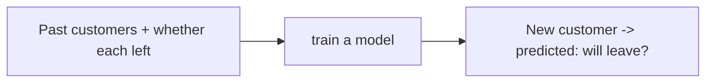

# Instructor Reference: Session 2.1 — Supervised Learning: Predicting from Examples

Duration: 110 min teaching + 2 × 5-min breaks = 120 min
Domain: Conceptual with no-code hands-on | Tools: ChatGPT (Free plan, file upload and data analysis), Google Sheets (free), supplied `customers_*.csv` | Prior: How Machines Learn from Examples | Next: Unsupervised Learning: Finding Groups | Visual load: Medium

**Goal:** Teach supervised learning as learning from examples that carry the right answer, and let learners build and check a churn prediction with an AI data tool.

**Student profile:** Non-technical professionals who know that a model is a pattern learned from examples and that results must be judged on held-out data.

**Key outcome:** By the end, every learner can explain supervised learning with a business example, name the features and the target in a described dataset, classify a problem as regression or classification, and has checked an AI tool's predictions against known answers.

| Block | Minutes |
|---|---|
| Segment 1 — Supervised learning: examples that carry the right answer | 18 |
| Segment 2 — Features and target | 18 |
| Break 1 | 5 |
| Segment 3 — Predicting a number or a category | 18 |
| Segment 4 — Hands-on: read the labelled customer sheet and set a baseline | 18 |
| Break 2 | 5 |
| Segment 5 — Hands-on: AI predicts ten held-back customers and we check | 18 |
| Segment 6 — Common Mistakes | 12 |
| Segment 7 — Session Recap | 8 |
| **Total** | **120** |

**Setup (before class):** Generate the supplied files with `python make_data.py` in `data/`. Give learners `customers_labelled.csv` (60 past customers, with the answer column `churned`) and `customers_heldback.csv` (10 customers with no answer). Keep `customers_heldback_ANSWERS.csv` with the instructor until Segment 5. Free ChatGPT plans limit file uploads and data analysis per day, so test it the day before and have a second tool (or paired learners) ready. The 70 customers are invented practice data.

---

## SEGMENT 1 — Supervised Learning: Examples That Carry the Right Answer `(18 min)`

> Instructor note: 1.2 showed learning from examples and held-out testing. Name them, do not reteach.

**Hook-in** `(30 sec)`

"In the last session your classifier learned shapes because each training image came with a label. Today we use the same idea on business data: past customers, each marked as stayed or left."

**Concept** `(4 min)`

Analogy: Learning to price used cars by studying a thousand past sales. For every car you see its details and the price it really sold for. After enough of these, you can look at a new car and estimate its price. The past sales, each with a known answer, are your teachers.

**Supervised learning is machine learning from labelled examples, where every example comes with the right answer, so the model learns to predict that answer for new cases.**

Why it matters: Most business prediction, such as loan default, customer churn, and demand, is supervised learning.

**Visual** `(visual only, no extra time)`



> **Say while pointing:** "Past cases with answers go in on the left. The model learns the pattern in the middle. On the right it answers for a customer whose outcome we do not yet know."

**Implementation / Demonstration** `(8 min)`

Show three business examples and ask learners to name what the "right answer" is in each.

| Business question | Past examples (labelled) | The right answer in each example |
|---|---|---|
| Will this borrower default? (not repay a loan) | Past loans with details | Repaid, or defaulted |
| Will this customer churn? (stop using the service) | Past customers with details | Stayed, or left |
| How many units will we sell next week? (demand) | Past weeks with details | Units actually sold |

Expected:
```
Learners name the answer column for each: repaid or defaulted, stayed or left, units sold.
Every row of past data has one. If the answers are missing, it is not supervised learning.
```

Say: "The word 'supervised' means a teacher has marked each example with the answer. Where do those answers come from in real life? From what happened: the loan was or was not repaid, the customer did or did not leave. That is why this is so common in business: we usually already have the history."

**Key point**

**Supervised learning needs past examples where the right answer is already known.**

**Room check** `(30 sec)`

> **Ask:** "You have 5,000 past orders with the delivery time recorded. Can you do supervised learning to predict delivery time?"
>
> **Answer:** Yes: each past order carries the right answer, the actual delivery time.

**Student try** `(3 min)`

Write one business example from your own work: what you want to predict, and what the past examples with answers would look like.

Success: A question, a source of past records, and the known answer for each record.

---

## SEGMENT 2 — Features and Target `(18 min)`

**Hook-in** `(30 sec)`

"A model needs two ingredients: what it looks at, and what it predicts. We give them names."

**Concept** `(4 min)`

Analogy: A doctor diagnosing flu. The doctor looks at symptoms (temperature, cough, tiredness) and gives one answer (flu or not). The symptoms are the inputs, the diagnosis is the answer.

**Features are the input columns the model looks at, the target is the single column it learns to predict, and each row is one example.**

Why it matters: Naming features and target precisely is the first step of every ML project and the most common point of confusion with data teams.

**Implementation / Demonstration** `(8 min)`

Open `customers_labelled.csv` in Google Sheets (File, Import, Upload). Show the first rows.

```
customer_id | tenure_months | monthly_spend_rs | support_tickets_last_90d | churned
C001        | ...           | ...              | ...                      | Yes or No
```

Ask learners to label every column.

| Column | Role | Why |
|---|---|---|
| customer_id | Neither (an identifier) | A label for the row; it does not describe behaviour |
| tenure_months | Feature | How long the customer has been with us |
| monthly_spend_rs | Feature | What the customer pays each month |
| support_tickets_last_90d | Feature | How many times they complained recently |
| churned | Target | The answer we want to predict: left or stayed |

Expected:
```
Features: tenure_months, monthly_spend_rs, support_tickets_last_90d (3 columns).
Target: churned (1 column).
Not used: customer_id.
Rows: 60 examples. One row is one customer.
```

Say: "Notice customer_id. It looks like data but it is just a name tag. Feeding it as a feature would invite the model to memorise individuals. Also notice what is NOT here: we cannot use a column that is only known after the customer leaves, such as the reason for leaving, because at prediction time we would not have it."

**Key point**

**Features are what the model looks at, the target is what it predicts, and identifiers and after-the-fact columns are not features.**

**Room check** `(30 sec)`

> **Ask:** "A table has: age, city, plan, loan_amount, repaid. You want to predict whether a new borrower repays. Which is the target?"
>
> **Answer:** repaid; the other four are features.

**Student try** `(3 min)`

A hospital table has: patient_id, age, blood_pressure, smoker, readmitted_within_30_days. Name the target, the features, and the column you would leave out.

Success: Target `readmitted_within_30_days`; features age, blood_pressure, smoker; leave out `patient_id`.

---

## Break 1 `(5 min)`

Re-entry hook: "After the break: two kinds of answer, a number and a category, and why the type of answer decides the kind of model."

---

## SEGMENT 3 — Predicting a Number or a Category `(18 min)`

**Hook-in** `(30 sec)`

"Look at the three business questions again: repaid or defaulted, stayed or left, units sold. Two of them are labels, one is a number. That difference has a name."

**Concept** `(4 min)`

Analogy: A weather forecaster can say "Tomorrow's temperature will be 31 degrees" or "Tomorrow will be rainy or dry". One is a number on a scale, the other is a choice from a short list. They are different questions and need different kinds of model.

**Regression predicts a number on a scale, such as units sold or a house price, while classification predicts a category, such as churn or no churn; the type of the target column decides which one it is.**

Why it matters: Choosing the wrong type leads to the wrong tool and the wrong way of measuring success.

**Implementation / Demonstration** `(8 min)`

Classify each problem by looking at its target. Ask learners to vote before you reveal.

| Problem | Target | Type |
|---|---|---|
| Will the customer churn? | Yes or No | Classification |
| What will next month's sales be in rupees? | A number | Regression |
| Is this email spam? | Spam or not spam | Classification |
| How many days will this delivery take? | A number of days | Regression |
| Which of 4 plans will the customer choose? | One of 4 plans | Classification |
| What salary should we offer this candidate? | A number in rupees | Regression |

Expected:
```
Classification: churn, spam, plan choice.
Regression: next month's sales, delivery days, salary.
Rule: look at the target. A number on a scale means regression; a label from a list means classification.
```

Say: "A trap: a number is not always regression. The plan choice could be coded 1, 2, 3, 4, but those are labels, not quantities on a scale: plan 4 is not 'twice' plan 2. Ask whether the numbers can be added and averaged meaningfully. If not, it is classification. Another trap: 'a score between 0 and 1' that says how likely churn is can come from a classification model, but the final answer is still a category."

**Key point**

**A numeric target on a scale means regression; a label from a list means classification.**

**Room check** `(30 sec)`

> **Ask:** "Predicting whether a loan will default, or predicting the rupee amount a customer will spend next year: which is classification?"
>
> **Answer:** Default or not is classification; the rupee amount is regression.

**Student try** `(3 min)`

Classify each: (a) predicting the number of calls a centre receives tomorrow; (b) predicting whether a patient will miss an appointment; (c) predicting the credit grade A, B, or C of a company.

Success: (a) regression; (b) classification; (c) classification.

---

## SEGMENT 4 — Hands-on: Read the Labelled Customer Sheet and Set a Baseline `(18 min)`

**Hook-in** `(30 sec)`

"Before we let an AI tool predict anything, we need to know what a lazy guess scores. If a fancy model cannot beat the lazy guess, it is worthless."

**Concept** `(4 min)`

Analogy: A football pundit who says "the home team always wins" will be right about half the time without knowing anything. A new prediction method is only impressive if it beats that.

**A baseline is the simplest possible prediction, such as always guessing the most common answer, and any model is judged by whether it beats the baseline on held-out data.**

Why it matters: With 33% churners, always guessing "stays" is already about two-thirds right, so a model must do better to be worth anything.

**Implementation / Demonstration** `(8 min)`

In Google Sheets with `customers_labelled.csv`:

1. In an empty cell, count churners: `=COUNTIF(E2:E61,"Yes")`.
2. Count total customers: `=COUNTA(A2:A61)`.
3. Churn rate: `=B1/B2` (adjust the cell references to where you typed the formulas).
4. Churn rate by group: add a column `ticket_group` with `=IF(D2>=3,"3+",IF(D2=2,"2","0-1"))`, then build a pivot table with `ticket_group` in Rows and `churned` as a count in Values.

Expected:
```
Churners: 20 of 60 customers = 33.3%.
Always guessing "No (stays)" would be right for 40 of 60 = 66.7%.
By tickets in the last 90 days (the three groups from the formula):
  0 or 1 tickets: 23 customers, 2 churned (about 9%)
  2 tickets:       8 customers, 1 churned (about 13%)
  3 or more:      29 customers, 17 churned (about 59%)
```

Say: "Read the pivot like a detective. Customers with 3 or more tickets churn at about 59%, while those with 0 or 1 churn at about 9%. That is a pattern a model can learn. Also try tenure: customers with 6 months or less have 8 churners out of 9, about 89%, against 12 of 51, about 24%, for longer-tenure customers. And monthly spend: the Rs 299 plan has 9 churners out of 18, 50%, while Rs 999 has 1 of 12, about 8%. The baseline to beat on the ten held-back customers is simple: guess 'stays' for all."

**Key point**

**Always compute the baseline first: guessing the most common answer sets the bar any model must clear.**

**Room check** `(30 sec)`

> **Ask:** "20 of 60 customers churned. What accuracy does 'everyone stays' get?"
>
> **Answer:** 40 of 60, which is 66.7%.

**Student try** `(3 min)`

Compute the churn rate for customers with tenure of 6 months or less versus more than 6 months.

Success: 8 of 9 (88.9%) for 6 months or less, and 12 of 51 (23.5%) for longer tenure.

---

## Break 2 `(5 min)`

Re-entry hook: "After the break: we ask an AI tool to predict ten customers whose answers we are hiding, and then we open the envelope."

---

## SEGMENT 5 — Hands-on: AI Predicts Ten Held-Back Customers and We Check `(18 min)`

**Hook-in** `(30 sec)`

"Ten customers, no answers. The tool has the 60 solved examples. Let us see how many it gets right, and whether that beats the lazy baseline of seven out of ten."

**Concept** `(4 min)`

Analogy: A student studies 60 solved practice problems and then sits a 10-question quiz. The quiz is only fair if the questions were not in the practice set, and the teacher marks the answers afterwards.

**Predicting held-back cases and then checking them against the hidden answers is the honest way to judge a prediction, and the score must be compared with the baseline.**

Why it matters: It is the same fair test as in 1.2, now on business data.

**Implementation / Demonstration** `(8 min)`

Steps in ChatGPT (free plan with file upload and data analysis):

1. Start a new chat and upload `customers_labelled.csv`.
2. Send this prompt, then upload `customers_heldback.csv` when asked or in a second message:

```
The first file has 60 past customers with a column "churned" (Yes/No). Use the columns tenure_months, monthly_spend_rs and support_tickets_last_90d to learn what predicts churn. Then predict churned (Yes or No) for each of the 10 customers in the second file. Show a table with customer_id, your prediction, and a one-line reason for each. Do not use customer_id as a predictor.
```

3. Copy the table into a new Google Sheet with columns `customer_id` and `prediction`.
4. The instructor now shares `customers_heldback_ANSWERS.csv`. Learners add the true `churned` values next to the predictions and add a column `correct?`.
5. Count correct predictions and compare with 7 of 10, the baseline.

Expected:
```
The true answers for the ten held-back customers are: C061 No, C062 No, C063 No, C064 No, C065 No, C066 Yes, C067 Yes, C068 No, C069 No, C070 Yes. So 3 customers churned and 7 stayed.
The baseline "everyone stays" scores 7 of 10.
A tool's score varies by run and by learner. Scores of 7 to 9 of 10 are common; one possible sensible pattern gets C066 right and misses C067 and C070.
```

Reference point for the instructor: a hand rule built from the sheet, "predict Yes if tickets are 2 or more AND (tenure is 6 months or less OR spend is Rs 299)", scores 86.7% on the 60 labelled customers and 8 of 10 on the held-back ten, catching C066 and missing C067 and C070.

Say: "Look at how many you got right, and then at who you missed. Ten customers is a tiny test, so one customer swings the score by ten points; that is why serious teams test on hundreds. Compare with seven of ten for the lazy guess. If you scored seven, your model is no better than 'everyone stays', despite sounding clever. Check the reasons the tool gave: do they use tickets, tenure, and spend, or something invented?"

If the file upload limit is hit: pair learners, or paste the 60 rows and 10 rows as text in the prompt.

**Key point**

**Judge a prediction against hidden answers and against the baseline; a tiny test set gives a shaky score.**

**Room check** `(30 sec)`

> **Ask:** "Your tool got 7 of 10 right. Is that impressive?"
>
> **Answer:** Not by itself: guessing 'everyone stays' also gets 7 of 10, so it has not beaten the baseline.

**Student try** `(3 min)`

Fill in the `correct?` column, count your correct predictions, and write one sentence comparing your score with the baseline of 7.

Success: A score out of 10 and a sentence such as "8 of 10, one better than the baseline, but only 10 customers so I am cautious."

---

## SEGMENT 6 — Common Mistakes `(12 min)`

### Mistake 1: Using an identifier as a feature

**Wrong:**
Feeding `customer_id` to the model as an input.

**Right:**
Leaving identifiers out and using behaviour columns only.

**Why it matters:** A unique id invites the model to memorise individual customers instead of learning a pattern.

### Mistake 2: Including a column known only after the outcome

**Wrong:**
Predicting churn using "reason for cancelling".

**Right:**
Using only columns available before the customer decides.

**Why it matters:** At prediction time that column does not exist, so the model would look brilliant in testing and be useless in use.

### Mistake 3: Skipping the baseline

**Wrong:**
"The tool got 7 of 10, that is 70%, great."

**Right:**
"Everyone stays also gets 7 of 10, so the tool added nothing."

**Why it matters:** Without a baseline, an unimpressive result looks impressive.

### Mistake 4: Treating labels coded as numbers as regression

**Wrong:**
Calling plan choice (coded 1, 2, 3, 4) a regression problem.

**Right:**
Recognising it as classification because the numbers are labels.

**Why it matters:** You would average plan codes, which has no meaning.

### Mistake 5: Trusting a score from a very small test

**Wrong:**
"It got 9 of 10, so it is 90% accurate."

**Right:**
"It got 9 of 10 on a tiny sample; I need a larger held-out set."

**Why it matters:** With ten cases, one customer moves the score by ten points.

**Live room check:**

> **Ask:** "A colleague's churn table includes a column 'cancellation_date'. Why is it a problem as a feature?"
>
> **Answer:** It is only known after the customer has left, so it would not exist when you need to predict.

---

## SEGMENT 7 — Session Recap `(8 min)`

| Learning Outcome | What to Remember |
|---|---|
| Explain supervised learning as learning from examples that carry the right answer, with one business example | Past records with known outcomes teach a model to predict that outcome, as in churn, default, or demand. |
| Identify the features and the target in a described dataset | Features are the inputs, the target is the single answer column; leave out identifiers and after-the-fact columns. |
| Classify a supervised problem as regression or classification from its target variable | A number on a scale is regression; a label from a list is classification. |
| Build a prediction from labelled examples with an AI data tool | Upload labelled data, predict held-back cases, check against the hidden answers, and compare with the baseline. |

Quick fire (2 min, cold-call): "What makes learning 'supervised'? Name the target in a churn table. Is predicting sales in rupees regression or classification? What baseline do you check first?"

**Path forward:**
Unsupervised Learning: Finding Groups — Today every example came with an answer. Next, we handle data with no answers at all, such as 60 support tickets, and ask an AI tool to find the groups hiding inside it.

---

## SECTION 11: Instructor Companion Appendix

### Instructor Notes

- The practice data was generated with a built-in pattern plus some randomness, so no tool will be perfect. That is the point: real prediction is never perfect.
- Do not release the answers file until every learner has written down their predictions.
- If free-plan limits block uploads, learners can follow along with the hand rule from Segment 5 in Sheets to see how a simple pattern performs.

### Materials Checklist

- [ ] `customers_labelled.csv` and `customers_heldback.csv` for every learner
- [ ] `customers_heldback_ANSWERS.csv` kept by the instructor
- [ ] Google Sheets access; ChatGPT with file upload, or a paired fallback
- [ ] The Segment 5 prompt as shared text

### Timing Contingencies

- Running short: Do the baseline in Segment 4 on the whole table only and skip the pivot by tickets.
- Running ahead: Ask the tool to explain which feature mattered most and test the claim against the pivot table.

### Answer Key

- S1 Student try: Any business question with past records and a known answer, such as "will this invoice be paid late?".
- S2 Student try: Target `readmitted_within_30_days`; features age, blood_pressure, smoker; leave out `patient_id`.
- S3 Student try: (a) regression; (b) classification; (c) classification.
- S4 Student try: 6 months or less: 8 of 9 churned (88.9%). More than 6 months: 12 of 51 (23.5%).
- S5 Student try: A score out of 10, compared with the baseline of 7.

### Glossary

- **Supervised learning:** Learning from examples that carry the right answer.
- **Label:** The known right answer attached to an example.
- **Feature:** An input column the model looks at.
- **Target:** The column the model learns to predict.
- **Regression:** Predicting a number on a scale.
- **Classification:** Predicting a category.
- **Baseline:** The simplest guess that a model must beat.
- **Churn:** A customer stopping their use of a service.
