# Supervised Learning: Predicting from Examples

```mermaid
%%{init: {"flowchart": {"nodeSpacing": 45, "rankSpacing": 65, "diagramPadding": 20}} }%%
flowchart TB
  subgraph Foundation["Where You're Starting From"]
    P1(["Previous Session<br/><b>How Machines Learn from Examples</b><br/><i>&#40;Training, Inference&#41;</i><br/>You saw that a model is a pattern learned from examples, and that it must be tested on data it never saw."])
  end
  CS{{Current Session<br/><b>Supervised Learning: Predicting from Examples</b><br/><i>Use past cases with known answers to predict the answer for new ones</i><br/>Features &middot; Target &middot; Regression &middot; Classification}}
  subgraph Value["Why This Matters"]
    CV(["Course Value<br/><b>The Most Common Kind of ML</b><br/>Churn, fraud, demand, and credit risk are all supervised problems, so this vocabulary appears in almost every business case ahead."])
    RV(["Real-Life Value<br/><b>Speak the Data Team's Language</b><br/>Naming the target and features precisely is how you brief a data team, and checking a baseline is how you spot an overhyped model."])
  end
  subgraph Future["Where This Leads Next"]
    F1(["Upcoming Session<br/><b>Unsupervised Learning: Finding Groups</b><br/><i>&#40;Clusters, Segments&#41;</i><br/>Finds natural groups in data that has no answers attached."])
    F2(["Upcoming Session<br/><b>Machine Learning Behind Everyday Business Decisions</b><br/><i>&#40;Predict, Group, Recommend&#41;</i><br/>Matches business problems to the right type of ML."])
    F3(["Upcoming Module<br/><b>Module 2: Generative AI for the Enterprise</b><br/><i>&#40;Prompts, Documents&#41;</i><br/>Covers how large language models work and how to use them reliably at work."])
  end
  P1 ==>|&nbsp;Apply to Data&nbsp;| CS
  CS ==>|&nbsp;Course Path&nbsp;| CV
  CS ==>|&nbsp;Real-Life Use&nbsp;| RV
  CS ==>|&nbsp;No Answers&nbsp;| F1
  F1 ==>|&nbsp;Match Problems&nbsp;| F2
  F2 ==>|&nbsp;Use GenAI&nbsp;| F3
  classDef previous fill:#eef4ff,stroke:#4f7ccf,color:#111827,stroke-width:2px;
  classDef current fill:#fff4d6,stroke:#d9a321,color:#111827,stroke-width:3px;
  classDef value fill:#eaf8ef,stroke:#3f9f63,color:#111827,stroke-width:2px;
  classDef future fill:#f4ecff,stroke:#8a61d1,color:#111827,stroke-width:2px;
  class P1 previous;
  class CS current;
  class CV,RV value;
  class F1,F2,F3 future;
  linkStyle default stroke-width:3px
```



---

## What You'll Learn

In this pre-read, you'll discover:

- Why "supervised" simply means every past example comes with the right answer attached
- The two words data teams use all the time, features and target, and how to spot them in any table
- How to tell, from the answer column alone, whether a problem is regression or classification
- Why a lazy guess can score two-thirds correct, and why a prediction is only impressive if it beats that

---

## Detailed Explanation

### Learning from examples that carry the answer

Imagine learning to price used cars by studying a thousand past sales. For each car you see its details and the price it really sold for. After enough of these you can estimate the price of a car you have never seen. The past sales, each with a known answer, are the teachers.

```
Past customers + whether each left   ->  train a model  ->  new customer: will they leave?
```

**Supervised learning** is machine learning from labelled examples, where each example includes the right answer. It is the most common kind in business because the history usually already exists:

```
Will this borrower default?       past loans              repaid or defaulted
Will this customer churn?         past customers          stayed or left
How many units sell next week?    past weeks              units actually sold
```

(Churn means a customer stops using a service; default means a borrower does not repay.) If the answers are missing, it is not supervised learning.

> **Key mental model:** "Supervised" means a teacher has marked every example. The teacher is simply what actually happened.

---

### Features and target

A doctor diagnosing flu looks at symptoms and gives one answer. The symptoms are the inputs; the diagnosis is the answer. Data teams use two words for this:

```
Features   the input columns the model looks at
Target     the single column the model learns to predict
Row        one example
```

Here is a small slice of a customer table:

```
customer_id  tenure_months  monthly_spend_rs  support_tickets_last_90d  churned
C001         3              299               4                         Yes
C002         30             999               0                         No
```

```
tenure_months, monthly_spend_rs, support_tickets_last_90d   -> features
churned                                                      -> target
customer_id                                                  -> neither
```

`customer_id` is only a name tag. If you gave it to a model as a feature, the model could memorise individuals instead of learning a pattern. Be just as careful with columns that are only known after the outcome, such as "reason for cancelling": at prediction time you would not have it.

> **Habit worth building:** For any dataset, say in one breath: "The target is ___, the features are ___, one row is ___."

---

### Predicting a number or a category

A forecaster can say "tomorrow will be 31 degrees" (a number) or "tomorrow will be rainy or dry" (a choice from a short list). They are different questions.

```
Regression       the target is a number on a scale      next month's sales, delivery days, salary
Classification   the target is a category from a list  churn or stay, spam or not, plan A/B/C
```

The type of the **target column** decides it. A trap: labels coded as numbers are still categories. If a customer picks one of four plans, coded 1 to 4, plan 4 is not "twice" plan 2, so it is classification. A useful test is whether adding and averaging the values makes sense.

> **Common misconception:** "Any number means regression." Only a number on a meaningful scale does. Codes for categories do not.

---

### The baseline: beat the lazy guess

Suppose 20 of 60 past customers churned. If a model simply guesses "stays" for everyone, it is right for 40 of 60, which is 66.7%, without learning anything.

```
Churn rate          20 / 60 = 33.3%
"Everyone stays"    40 / 60 = 66.7% correct
```

That lazy guess is the **baseline**. A model is only worth something if it beats the baseline on held-out data. Looking at the data also reveals patterns a model can learn. In the practice sheet, customers with three or more support tickets in 90 days churn at about 59%, against about 9% for customers with at most one ticket, and customers in their first six months churn at about 89%.

> **Rule of thumb:** First compute the baseline. If a clever tool cannot beat "guess the most common answer", it has added nothing.

---

### Bringing it together: a fair prediction test

In the live session you will give an AI data tool 60 past customers with answers, ask it to predict ten held-back customers, and then check its predictions against hidden answers.

```
1. Name the target, the features, and what one row is
2. Decide: regression or classification?
3. Compute the baseline
4. Ask the tool to predict held-back cases without seeing their answers
5. Compare its score with the baseline, and look at which cases it missed
```

Ten customers is a very small test: one customer moves the score by ten points. Serious teams test on hundreds or thousands, but the method is identical.

> **Forward connection:** Everything here assumed the answers exist. In the next session we handle data with no answers at all, such as a pile of support tickets, and ask what groups hide inside it.

---

## Practice Exercises

**1. Pattern Recognition — Regression or classification?**

Classify each problem:

- A. Predicting the rupee value of a customer's purchases next year
- B. Predicting whether an invoice will be paid late
- C. Predicting which of three loan products a customer will choose
- D. Predicting how many hours a repair will take

---

**2. Spot The Error — The leaky column**

A team builds a churn model using these columns: tenure_months, monthly_spend_rs, support_tickets_last_90d, cancellation_reason, customer_id. Which two columns should be removed, and why?

---

**3. Real-Life Application — Your own prediction question**

Pick a prediction you would like for your function (for example late payments, absent staff, or stock-outs). State the target, three possible features, what one row represents, and whether it is regression or classification. Say where the past answers would come from.

---

**4. Concept Detective — The unimpressive 70%**

A tool predicts churn for ten held-back customers and gets 7 right. Seven of the ten actually stayed. Explain why this result is not impressive, and what you would ask for next.

---

**5. Planning Ahead — Brief a data team**

Write a six-line brief for a data team that wants to predict which loan applicants will default. Include the target, features you would offer, what you would exclude and why, how the test data will be held back, and the baseline they must beat.
