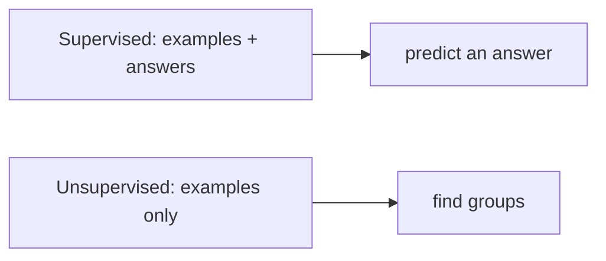

# Instructor Reference: Session 2.2 — Unsupervised Learning: Finding Groups

Duration: 110 min teaching + 2 × 5-min breaks = 120 min
Domain: Conceptual with no-code hands-on | Tools: ChatGPT (Free plan, file upload), supplied `support_tickets.csv` | Prior: Supervised Learning: Predicting from Examples | Next: Machine Learning Behind Everyday Business Decisions | Visual load: Medium

**Goal:** Teach unsupervised learning as finding groups or patterns in data with no answers attached, through customer segments, recommendations, and a hands-on clustering of 60 support tickets.

**Student profile:** Non-technical professionals who now know that supervised learning needs labelled examples, features, and a target.

**Key outcome:** By the end, every learner can explain unsupervised learning, describe how customers are grouped into segments and how a recommender ranks what to show next, and has clustered 60 tickets with an AI tool and checked the result by hand.

| Block | Minutes |
|---|---|
| Segment 1 — Unsupervised learning: groups with no answers | 18 |
| Segment 2 — Customer segmentation by shared behaviour | 18 |
| Break 1 | 5 |
| Segment 3 — Recommendations from past behaviour | 18 |
| Segment 4 — Hands-on: cluster 60 support tickets with an AI tool | 18 |
| Break 2 | 5 |
| Segment 5 — Hands-on: name the groups and check five tickets by hand | 18 |
| Segment 6 — Common Mistakes | 12 |
| Segment 7 — Session Recap | 8 |
| **Total** | **120** |

**Setup (before class):** Generate `support_tickets.csv` (60 tickets, columns `ticket_id` and `text`) with `python make_data.py` in `data/`. Give learners only that file. Keep `support_tickets_ANSWERS.csv` (the true theme of each ticket) with the instructor. The tickets are invented. Free ChatGPT plans limit file upload; test the day before, and keep the option of pasting the 60 lines as text.

---

## SEGMENT 1 — Unsupervised Learning: Groups with No Answers `(18 min)`

> Instructor note: 2.1 used labelled examples with a target. Name it; today there is no target.

**Hook-in** `(30 sec)`

"Last session every customer came marked 'stayed' or 'left'. What if nobody marked anything? You have 60 support tickets and no categories. Can a machine still help?"

**Concept** `(4 min)`

Analogy: Sorting a pile of unmarked photographs from a family event. Nobody tells you the categories. You notice that some are food, some are dancing, some are group portraits, and you make piles. You found the groups yourself from the pictures alone.

**Unsupervised learning finds groups or patterns in data that has no answers attached, and the groups it finds are called clusters.**

Why it matters: Much business data has no label, such as what customers have in common or what tickets are about, and grouping it reveals structure people had not seen.

**Visual** `(visual only, no extra time)`



> **Say while pointing:** "The top path needs answers and predicts one; the bottom path has no answers and discovers groups. Same data tools, different question."

**Implementation / Demonstration** `(8 min)`

Show a side-by-side and sort six tasks by hand.

| Task | Answers available? | Supervised or unsupervised |
|---|---|---|
| Predict which customers will leave (past leavers are known) | Yes | Supervised |
| Group customers by how they shop (no categories given) | No | Unsupervised |
| Predict next month's sales (past sales known) | Yes | Supervised |
| Find themes across 5,000 survey comments | No | Unsupervised |
| Decide which products tend to be bought together | No | Unsupervised |
| Predict whether a loan will be repaid (history known) | Yes | Supervised |

Expected:
```
Supervised: leave prediction, next month's sales, loan repayment.
Unsupervised: shopping groups, survey themes, products bought together.
Test: is there a known right answer column to learn from? If not, the job is to find structure.
```

Say: "One honest warning about unsupervised results: because there are no answers, there is no score to say 'you got 90% right'. A person has to judge whether the groups make sense and are useful. We will practise that judging today with the tickets."

**Key point**

**Unsupervised learning finds groups in data with no answer column, and a person judges whether the groups are useful.**

**Room check** `(30 sec)`

> **Ask:** "You have customer purchase histories but no labels. You want natural groups of shoppers. Supervised or unsupervised?"
>
> **Answer:** Unsupervised: there is no answer column, only structure to find.

**Student try** `(3 min)`

Write one unsupervised question from your own work, where you have data but no labels.

Success: A question about groups or patterns, and a note that no answer column exists.

---

## SEGMENT 2 — Customer Segmentation by Shared Behaviour `(18 min)`

**Hook-in** `(30 sec)`

"The most famous unsupervised job in business: grouping customers so each group can be treated differently."

**Concept** `(4 min)`

Analogy: A shopkeeper who has watched customers for years: the daily regulars who buy small things, the occasional big spenders, the window shoppers. The shopkeeper has segments in their head. A machine builds them from numbers, for thousands of customers at once.

**Customer segmentation groups customers by shared behaviour, such as how often they buy and how much they spend, so each segment can get a different offer or service.**

Why it matters: One offer for everyone wastes money, while a tailored offer for each group reaches the right people.

**Implementation / Demonstration** `(8 min)`

Use this tiny table of eight customers. Ask learners to draw circles around natural groups on a whiteboard chart (orders per month on one axis, average basket in rupees on the other).

| Customer | Orders per month | Average basket (Rs) |
|---|---|---|
| A | 1 | 250 |
| B | 2 | 300 |
| C | 1 | 280 |
| D | 8 | 350 |
| E | 9 | 400 |
| F | 2 | 1,800 |
| G | 1 | 2,000 |
| H | 3 | 1,900 |

Expected:
```
Three natural groups appear:
  Group 1 (A, B, C): rare small orders, about 1 to 2 per month at Rs 250 to 300.
  Group 2 (D, E): frequent small orders, 8 to 9 per month at Rs 350 to 400.
  Group 3 (F, G, H): occasional big baskets, 1 to 3 per month at Rs 1,800 to 2,000.
Monthly spend per group, roughly: Group 1 ~ Rs 400, Group 2 ~ Rs 3,200, Group 3 ~ Rs 3,800.
```

Say: "Nobody told us there were three groups or what to call them. We looked at two behaviours, and groups appeared. Then comes the human work: name each segment and decide the action. Group 2, frequent small, might get a loyalty reward. Group 3, big baskets, might get premium service. Group 1 might get a first-purchase nudge. The machine proposes groups; the business gives them meaning."

Worked check: Group 2's monthly spend is about 8 × 350 = Rs 2,800 for D and 9 × 400 = Rs 3,600 for E. Group 3 is 2 × 1,800 = Rs 3,600 for F, 1 × 2,000 = Rs 2,000 for G, and 3 × 1,900 = Rs 5,700 for H. Group 1: 250, 600, and 280.

**Key point**

**Segmentation groups customers by shared behaviour, and the business names each segment and decides what to do for it.**

**Room check** `(30 sec)`

> **Ask:** "After a model produces three customer groups, whose job is it to name them and choose actions?"
>
> **Answer:** People's: the model finds the groups, the business interprets them.

**Student try** `(3 min)`

Which segment would you offer a free-delivery membership, and which one a premium concierge service, and why?

Success: Free-delivery membership for frequent small orders (Group 2); concierge for occasional big baskets (Group 3), with a reason tied to behaviour.

---

## Break 1 `(5 min)`

Re-entry hook: "After the break: how Netflix-style suggestions work without anyone telling the system what you like."

---

## SEGMENT 3 — Recommendations from Past Behaviour `(18 min)`

**Hook-in** `(30 sec)`

"'People who bought this also bought that.' Nobody labelled products as related. The system noticed from behaviour."

**Concept** `(4 min)`

Analogy: A friendly bookseller who remembers what each customer bought. When you buy a cookbook, the bookseller says "others who bought this also liked this baking book", because that happened often. A recommendation system does this for millions of customers.

**A recommendation system uses past behaviour to rank what to show next, for example by counting which items are often bought together.**

Why it matters: Recommendations drive a large share of purchases and views on shopping and streaming platforms.

**Implementation / Demonstration** `(8 min)`

Use six customers' baskets.

| Customer | Bought |
|---|---|
| C1 | phone, case, charger |
| C2 | phone, case |
| C3 | phone, charger, earbuds |
| C4 | laptop, mouse |
| C5 | laptop, mouse, bag |
| C6 | phone, case, earbuds |

Step 1: Find customers who bought a phone: C1, C2, C3, C6, so 4 customers.
Step 2: Among them, count how many also bought each other item.

| Item | Phone buyers who also bought it | Share of the 4 |
|---|---|---|
| case | 3 (C1, C2, C6) | 75% |
| charger | 2 (C1, C3) | 50% |
| earbuds | 2 (C3, C6) | 50% |
| laptop | 0 | 0% |

Expected:
```
For a customer who just bought a phone, rank suggestions: case (75%), then charger and earbuds (50% each).
For a customer who bought a laptop (C4, C5), the mouse appears 2 of 2 times = 100%.
```

Say: "No labels, no teacher: just past behaviour. Real systems do this at scale and with more signals, like what you viewed and when. Two cautions: a recommender can only suggest things related to past behaviour, so new users with no history are hard, and it can trap people in a narrow bubble."

**Key point**

**A recommender ranks what to show next from patterns in what people did before.**

**Room check** `(30 sec)`

> **Ask:** "In the table, a customer buys a laptop. What do you suggest first, and with what share?"
>
> **Answer:** A mouse: both laptop buyers (100%) also bought one.

**Student try** `(3 min)`

A customer just bought earbuds. Using the baskets, which items do other earbuds buyers also have, and which would you suggest first?

Success: Earbuds buyers are C3 and C6; both bought a phone (100%); then charger (1 of 2) and case (1 of 2), so suggest the phone first, or accessories at 50% each.

---

## SEGMENT 4 — Hands-on: Cluster 60 Support Tickets with an AI Tool `(18 min)`

**Hook-in** `(30 sec)`

"A support manager has 60 tickets, no categories, and a meeting in an hour. Let us see how fast an AI tool can find the themes."

**Concept** `(4 min)`

Analogy: Handing a stack of unsorted letters to a very fast assistant and saying "make piles by topic and tell me what each pile is about". You then spot-check a few letters in each pile before trusting the sorting.

**Clustering with an AI tool means giving it unlabelled items and asking it to group them and describe each group, after which you verify the grouping instead of assuming it is right.**

Why it matters: This is a realistic, fast way to find themes in text, but only if you check the work.

**Implementation / Demonstration** `(8 min)`

Steps in ChatGPT:

1. Open a new chat and upload `support_tickets.csv`.
2. Send this prompt:

```
The attached file has 60 customer support tickets, with ticket_id and text. Group the tickets into themes based only on what they say. Choose the number of groups yourself, and tell me how many you chose and why. For each group, give a short name, a one-sentence description, and the list of ticket_ids in it. Make sure every ticket appears in exactly one group.
```

3. Copy the result into a note or sheet: group name, description, ticket count.
4. Do not look at the instructor's answers yet.

Expected:
```
The tool returns a number of groups (commonly 4 to 6), a name and description for each, and ticket ids per group.
Counts across groups should add up to 60. If they do not, ask the tool to fix it.
Names and exact groupings vary from run to run and learner to learner.
```

Say: "First check the arithmetic: do the group sizes add up to 60, and does every ticket appear once? AI tools sometimes drop or double-count items. Then read the group names. Do they make sense to a support manager? 'Account access problems' is useful; 'Miscellaneous' for twenty tickets is a sign of a weak grouping."

**Key point**

**Ask for names, descriptions, and ticket ids, then check that the groups add up to the whole.**

**Room check** `(30 sec)`

> **Ask:** "The group sizes add up to 57, not 60. What do you do?"
>
> **Answer:** Ask the tool to find and assign the missing three tickets; do not trust a grouping that drops items.

**Student try** `(3 min)`

List your groups with their counts and confirm they add up to 60.

Success: A list of groups with counts totalling 60 (or a note of how you corrected it).

---

## Break 2 `(5 min)`

Re-entry hook: "After the break: how do we know the AI's groups are any good? We check five tickets ourselves."

---

## SEGMENT 5 — Hands-on: Name the Groups and Check Five Tickets by Hand `(18 min)`

**Hook-in** `(30 sec)`

"There is no accuracy score for clustering, so the check is human: pick a few tickets and ask whether they belong where the AI put them."

**Concept** `(4 min)`

Analogy: A restaurant inspector does not taste every dish. They sample five and judge the kitchen. Spot-checking is how you decide whether to trust a whole batch.

**A spot check samples tickets from each group, reads them, and judges whether they truly share a theme, and whether the group name and the neighbouring groups are sensible.**

Why it matters: With no answer key in real life, a careful human sample is the quality control for unsupervised results.

**Implementation / Demonstration** `(8 min)`

1. Pick five tickets: ids 5, 17, 26, 38, 51. For each, record the AI's group and read the text.
2. Fill in this table.

| Ticket id | Ticket text (short) | AI's group name | Fits the group? (Yes / No / Unsure) | Better group, if any |
|---|---|---|---|---|
| 5 | | | | |
| 17 | | | | |
| 26 | | | | |
| 38 | | | | |
| 51 | | | | |

3. Count how many fit. Fit rate = fits / 5.
4. Ask the tool to improve: "Ticket X in group Y does not belong there because ___. Re-check the groups and fix this."

Expected:
```
The tickets were written around five real themes of 12 tickets each: Billing, Login, Delivery, App bug, and Feature request. A good AI grouping typically finds themes close to these.
Example text and theme for ticket 5: "The discount on my renewal was not applied." is a Billing ticket.
Ambiguous cases exist on purpose: "I keep getting signed out of the app" is a Login problem but could be placed with App bug. Disagreement there is normal, not an error.
```

Instructor reveal: share `support_tickets_ANSWERS.csv` (true theme per ticket) once everyone has finished spot checks. Learners compare their 5 checks with the true themes, and the whole room can compute agreement: count of tickets where the AI's group maps to the true theme, divided by 60.

Say: "Notice two kinds of disagreement. One is a real mistake: a billing complaint in a delivery group. The other is a naming choice: the AI merged Login and App bug into one 'App access' group, which can be reasonable. The judgement is: is this grouping useful for the support manager's decision? If you are routing tickets to teams, merging login and bug tickets might not help. If you are reporting on volumes, it may be fine."

Finish with each learner naming one group and writing one action the support manager could take from it, for example "Billing tickets: add a clearer refund policy page".

**Key point**

**Spot-check clusters by hand and judge them against the decision they must support.**

**Room check** `(30 sec)`

> **Ask:** "The AI put 'I keep getting signed out' in an 'App bugs' group. Is it wrong?"
>
> **Answer:** It is debatable: it could be login or a bug. Whether it matters depends on how you will route the tickets.

**Student try** `(3 min)`

Complete the five-ticket table, state your fit rate, and write one action for one group.

Success: A table with five judgements, a fit rate out of 5, and an action tied to a group.

---

## SEGMENT 6 — Common Mistakes `(12 min)`

### Mistake 1: Expecting an accuracy score from clustering

**Wrong:**
"The model found five groups, with 92% accuracy."

**Right:**
"The model proposed five groups; I checked a sample and judged them useful."

**Why it matters:** With no answer column there is nothing to score against, so quality is a human judgement.

### Mistake 2: Treating the number of groups as a fact

**Wrong:**
"There are exactly four customer types."

**Right:**
"Four groups was a reasonable choice for this purpose; three or five might also work."

**Why it matters:** The number of groups is a choice, and different choices can all be useful.

### Mistake 3: Accepting group names without reading members

**Wrong:**
Trusting the label "Billing issues" without opening a ticket.

**Right:**
Reading a sample from each group before using its name.

**Why it matters:** A neat name can hide a mixed group.

### Mistake 4: Not checking the counts add up

**Wrong:**
Using a grouping whose sizes total 57 of 60 tickets.

**Right:**
Asking the tool to account for every item exactly once.

**Why it matters:** Silently dropped items bias the analysis.

### Mistake 5: Stopping at the groups

**Wrong:**
Presenting "five clusters" as the result.

**Right:**
Naming each group and attaching an action.

**Why it matters:** Groups only create value when someone decides what to do differently for each.

**Live room check:**

> **Ask:** "Your clustering of 5,000 survey comments gave a group called 'Other' with 1,800 comments. What do you do?"
>
> **Answer:** Treat it as a weak result: look inside, split it into themes, or change the grouping, because over a third of the data is unexplained.

---

## SEGMENT 7 — Session Recap `(8 min)`

| Learning Outcome | What to Remember |
|---|---|
| Explain unsupervised learning as finding groups or patterns in data that has no answers attached | No answer column; the model finds structure, and a person judges it. |
| Describe how a company groups customers into segments by shared behaviour | Group by behaviours such as frequency and basket size, then name each segment and choose an action. |
| Describe how a recommendation system uses past behaviour to rank what to show next | Count what is often bought or viewed together and rank suggestions by how often they co-occur. |
| Cluster a supplied set of support tickets into named groups with an AI tool | Ask for names, descriptions, and ids, check the counts add to 60, then spot-check by hand. |

Quick fire (2 min, cold-call): "Does clustering have an answer column? Who names the segments? What did the phone buyers also buy most? How do you check an AI's groups?"

**Path forward:**
Machine Learning Behind Everyday Business Decisions — You have now met prediction and grouping. Next, we put all the types side by side, add learning by trial and reward, and practise matching real business problems at companies like Amazon, Netflix, and Swiggy to the right type of ML.

---

## SECTION 11: Instructor Companion Appendix

### Instructor Notes

- The tickets were written from five themes with light variation, so a good AI grouping lands close to five groups. Real tickets are messier; say so.
- Do not reveal the true themes before learners finish their spot checks.
- If the tool refuses a file, paste the 60 lines directly as text.

### Materials Checklist

- [ ] `support_tickets.csv` for every learner
- [ ] `support_tickets_ANSWERS.csv` held by the instructor
- [ ] ChatGPT with file upload, or text-paste fallback
- [ ] The eight-customer and six-basket tables on a slide

### Timing Contingencies

- Running short: Skip the recommendation counting beyond the phone example.
- Running ahead: Ask the tool to regroup into exactly three groups and compare usefulness with the five-group version.

### Answer Key

- S1 Student try: Any question about groups or patterns with no answer column.
- S2 Student try: Free-delivery membership for Group 2 (frequent, small); premium concierge for Group 3 (occasional, big baskets).
- S3 Student try: Earbuds buyers are C3 and C6; suggest the phone first (both bought it), then charger and case.
- S4 Student try: Groups with counts that total 60.
- S5 Student try: Five-row table, fit rate out of 5, and one action.
- Tickets: Billing, Login, Delivery, App bug, Feature request, 12 each. Ticket 5 is Billing.

### Glossary

- **Unsupervised learning:** Finding groups or patterns in data with no answers attached.
- **Cluster:** A group of similar items found by a model.
- **Segment:** A cluster of customers given a business meaning.
- **Recommendation system:** A system that ranks what to show next from past behaviour.
- **Spot check:** Reading a small sample to judge a whole batch.
