# Unsupervised Learning: Finding Groups

```mermaid
%%{init: {"flowchart": {"nodeSpacing": 45, "rankSpacing": 65, "diagramPadding": 20}} }%%
flowchart TB
  subgraph Foundation["Where You're Starting From"]
    P1(["Previous Session<br/><b>Supervised Learning: Predicting from Examples</b><br/><i>&#40;Features, Target&#41;</i><br/>You predicted an answer using past examples that each carried the right answer."])
  end
  CS{{Current Session<br/><b>Unsupervised Learning: Finding Groups</b><br/><i>Discover natural groups in data that has no answers, from customers to support tickets</i><br/>Clusters &middot; Segments &middot; Recommendations &middot; Spot Checks}}
  subgraph Value["Why This Matters"]
    CV(["Course Value<br/><b>The Other Half of ML</b><br/>Together with prediction, grouping completes the core ML toolkit used in the marketing and customer-experience modules later in the course."])
    RV(["Real-Life Value<br/><b>Make Sense of Piles of Data</b><br/>Segmenting customers or sorting thousands of comments into themes turns a mass of records into decisions a team can act on."])
  end
  subgraph Future["Where This Leads Next"]
    F1(["Upcoming Session<br/><b>Machine Learning Behind Everyday Business Decisions</b><br/><i>&#40;Predict, Group, Recommend&#41;</i><br/>Matches real business problems to the right type of ML."])
    F2(["Upcoming Session<br/><b>Deep Learning and Neural Networks</b><br/><i>&#40;Layers, Neural Networks&#41;</i><br/>Shows how networks of simple units handle images, speech, and language."])
    F3(["Upcoming Module<br/><b>Module 2: Generative AI for the Enterprise</b><br/><i>&#40;Prompts, Documents&#41;</i><br/>Covers how large language models work and how to use them reliably at work."])
  end
  P1 ==>|&nbsp;Remove the Answers&nbsp;| CS
  CS ==>|&nbsp;Course Path&nbsp;| CV
  CS ==>|&nbsp;Real-Life Use&nbsp;| RV
  CS ==>|&nbsp;Match Problems&nbsp;| F1
  F1 ==>|&nbsp;Go Deeper&nbsp;| F2
  F2 ==>|&nbsp;Use GenAI&nbsp;| F3
  classDef previous fill:#eef4ff,stroke:#4f7ccf,color:#111827,stroke-width:2px;
  classDef current fill:#fff4d6,stroke:#d9a321,color:#111827,stroke-width:3px;
  classDef value fill:#eaf8ef,stroke:#3f9f63,color:#111827,stroke-width:2px;
  classDef future fill:#f4ecff,stroke:#8a61d1,color:#111827,stroke-width:2px;
  class P1 previous;
  class CS current;
  class CV,RV value;
  class F1,F2,F3 future;
  linkStyle default stroke-width:3px
```



---

## What You'll Learn

In this pre-read, you'll discover:

- What machine learning can still do when nobody has marked the right answers
- How companies split customers into segments from nothing but their behaviour
- How a "people who bought this also bought" suggestion is built from simple counting
- Why grouping results cannot be scored for accuracy, and the human check that replaces a score

---

## Detailed Explanation

### Finding structure when there are no answers

Picture a pile of unmarked photographs from a family event. Nobody gives you categories, but you notice food, dancing, and group portraits and make piles. You found the groups from the pictures alone.

**Unsupervised learning** does this with data: it finds groups or patterns in data that has no answer column. The groups it finds are called **clusters**.

```
Supervised     examples + answers   ->  predict an answer
Unsupervised   examples only         ->  find groups
```

A quick test: is there a column holding the known right answer? If yes, the job is supervised. If no, the job is to find structure. Common unsupervised jobs include grouping shoppers by behaviour, finding themes in survey comments, and discovering which products sell together.

> **Key mental model:** Supervised learning predicts an answer. Unsupervised learning discovers groups, and a person decides whether they are useful.

---

### Customer segmentation: groups by shared behaviour

A shopkeeper who has watched customers for years knows the daily regulars, the occasional big spenders, and the browsers. A machine builds such **segments** from numbers for thousands of customers at once.

```
Customer   Orders/month   Average basket (Rs)
A          1              250
B          2              300
C          1              280
D          8              350
E          9              400
F          2              1,800
G          1              2,000
H          3              1,900
```

Plot these two behaviours and three groups appear without anyone naming them:

```
A, B, C   rare, small orders          (1-2 a month, Rs 250-300)
D, E      frequent, small orders      (8-9 a month, Rs 350-400)
F, G, H   occasional, big baskets     (1-3 a month, Rs 1,800-2,000)
```

The machine proposes the groups; the business names each and chooses an action: perhaps a loyalty reward for the frequent shoppers and premium service for the big baskets.

> **Habit worth building:** After any segmentation, ask for each group: what do we call it, and what would we do differently for it? A segment with no action attached is just a chart.

---

### Recommendations from past behaviour

A bookseller who remembers purchases says "others who bought this cookbook also liked this baking book". A **recommendation system** does the same at scale, ranking what to show next from what people did before.

Take six customers' baskets:

```
C1  phone, case, charger        C4  laptop, mouse
C2  phone, case                 C5  laptop, mouse, bag
C3  phone, charger, earbuds     C6  phone, case, earbuds
```

Four customers bought a phone (C1, C2, C3, C6). Of those four, three bought a case, two a charger, two earbuds:

```
Phone buyers also bought:   case 3/4 = 75%    charger 2/4 = 50%    earbuds 2/4 = 50%
```

So for someone who just bought a phone, rank the case first. No one labelled these items as related; counting past behaviour did it. Real systems use many more signals, but the idea is the same.

> **Watch out:** Recommenders only know past behaviour. A brand-new customer with no history is hard to serve, and the system can trap people in a narrow bubble of similar suggestions.

---

### Judging groups when there is no answer key

Clustering has no "92% correct" score because there is no answer column to compare with. Quality is a human judgement, and the practical tool is a **spot check**: sample a few items from each group, read them, and ask whether they really share a theme and whether the group name fits.

```
Do the group sizes add up to the whole?      (60 tickets in, 60 out)
Do the names make sense to the person who will use them?
Does a sample of items fit each group?
Is there a big "Other" group?                (a sign of weak grouping)
```

In the live session you will give an AI tool 60 support tickets with no categories, ask it to group them and name the groups, and check five tickets by hand. Some tickets are genuinely ambiguous, for example "I keep getting signed out of the app" could be a login problem or an app bug. Disagreement there is normal, and what matters is whether the grouping supports the decision, such as routing tickets to teams.

> **Common misconception:** "The AI found the true groups." There is no single true set of groups. The number and shape of groups are choices, and several can be useful.

---

### Bringing it together: from pile to action

```
1. Confirm there is no answer column
2. Choose the behaviours or text to group on
3. Let the tool propose groups
4. Check the counts add up and spot-check members
5. Name each group, and attach one action to it
```

> **Forward connection:** Next session puts prediction, grouping, and recommendation side by side, adds learning by trial and reward, and practises choosing the right one for a business problem.

---

## Practice Exercises

**1. Pattern Recognition — Supervised or unsupervised?**

Decide for each:

- A. Predict which invoices will be paid late, using past invoices marked paid on time or late
- B. Find groups of employees with similar working patterns, with no labels
- C. Find topics across 3,000 customer reviews
- D. Predict next quarter's revenue from past quarters

---

**2. Spot The Error — The overconfident report**

A report says: "Our clustering model found four customer segments with 94% accuracy." Explain what is wrong with the claim and how the report should be reworded.

---

**3. Real-Life Application — Segments for a gym**

A gym has data on visits per week and spend on add-ons for 2,000 members. Describe three plausible segments, give each a name, and suggest one action per segment.

---

**4. Concept Detective — The surprising suggestion**

A recommender keeps suggesting phone cases to someone who bought a phone a year ago and never bought a case. Using what you know about how recommendations are built, explain why this happens and one way to improve it.

---

**5. Planning Ahead — Sort 500 comments**

You have 500 open-ended employee survey comments and a meeting tomorrow. Write a plan for using an AI tool to find themes: what you will ask for, three checks you will run on its answer, and what would make you distrust the result.
