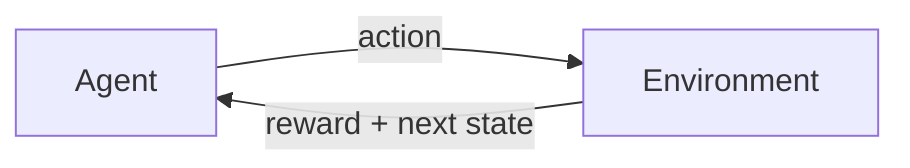
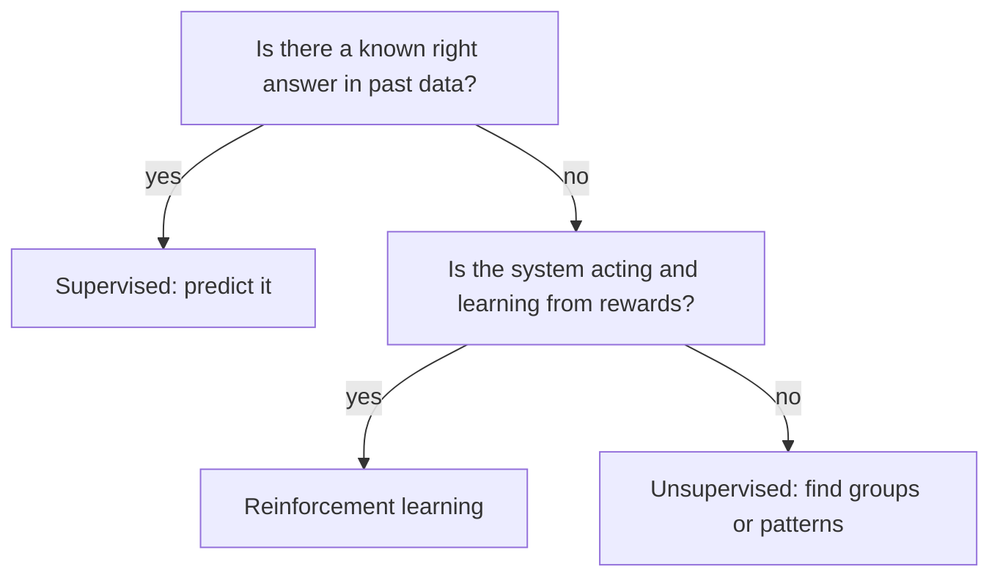

# Instructor Reference: Session 3.1 — Machine Learning Behind Everyday Business Decisions

Duration: 110 min teaching + 2 × 5-min breaks = 120 min
Domain: Conceptual with no-code hands-on | Tools: Gemini (Free plan, with Google Search), Google Sheets (free) | Prior: Unsupervised Learning: Finding Groups | Next: Deep Learning and Neural Networks | Visual load: Medium

**Goal:** Help learners recognise which type of machine learning sits behind a business decision and turn a business goal into a precise ML question.

**Student profile:** Non-technical professionals who have met supervised and unsupervised learning separately and now need to choose between them for real business problems.

**Key outcome:** By the end, every learner can list the common ML task types with an example, describe the reinforcement-learning loop, classify a problem as supervised, unsupervised, or reinforcement learning, and convert a business question into a target, features, and unit of analysis.

| Block | Minutes |
|---|---|
| Segment 1 — Common ML tasks in business: predicting, grouping, recommending | 18 |
| Segment 2 — Reinforcement learning: learning by trial and reward | 18 |
| Break 1 | 5 |
| Segment 3 — Matching a business problem to the right type of learning | 18 |
| Segment 4 — Turning a business goal into an ML question | 18 |
| Break 2 | 5 |
| Segment 5 — Hands-on: build a company use-case map and make a recommendation | 18 |
| Segment 6 — Common Mistakes | 12 |
| Segment 7 — Session Recap | 8 |
| **Total** | **120** |

**Setup (before class):** Learners need Gemini (free) with Google Search grounding, or any browser search, and Google Sheets. Prepare a blank sheet with the headers in Segment 5. Company descriptions below come from publicly described, widely known uses. Learners should verify any detail they cite from a current source, because companies change what they do.

---

## SEGMENT 1 — Common ML Tasks in Business: Predicting, Grouping, Recommending `(18 min)`

> Instructor note: 2.1 and 2.2 taught prediction and grouping, and recommendations appeared in 2.2. Name them, then widen the picture.

**Hook-in** `(30 sec)`

"You now have three verbs: predict, group, recommend. Almost every ML feature you meet at work is one of them wearing a different costume."

**Concept** `(4 min)`

Analogy: A restaurant manager asks three kinds of question of the data: "How many guests tomorrow?" (predict), "What kinds of diners do we have?" (group), and "What should I suggest to this table?" (recommend). Different questions, different tools.

**The three common ML tasks in business are predicting an outcome from past examples, grouping similar items with no labels, and recommending what to show next from past behaviour.**

Why it matters: Naming the task is the first step in judging whether a proposed AI project makes sense.

**Implementation / Demonstration** `(8 min)`

Fill this table together on screen, adding one example from the room for each row.

| Task | Plain question | Business example | Needs labelled answers? |
|---|---|---|---|
| Predict a number | How much, how many? | Forecast tomorrow's orders | Yes |
| Predict a category | Which one, yes or no? | Will this customer churn? Is this payment fraud? | Yes |
| Group | What natural types exist? | Customer segments | No |
| Recommend | What next for this person? | Suggested films, products, restaurants | No (uses past behaviour) |

Expected:
```
Learners add examples such as: delivery time estimate (number), loan default (category), shopper types (group), "you may also like" (recommend).
Three of the four rows are everyday features in apps they already use.
```

Say: "Two of the four tasks need labelled answers, and two do not. That one column, 'needs labelled answers?', is how you will later decide what data you must collect before a project can start."

**Key point**

**Most business ML is predicting, grouping, or recommending; name which one before discussing tools.**

**Room check** `(30 sec)`

> **Ask:** "A system estimates the time a food order will arrive. Which task is it?"
>
> **Answer:** Predicting a number: delivery time.

**Student try** `(3 min)`

Write one example from your own function for each of predict, group, and recommend.

Success: Three examples, each matching its task.

---

## SEGMENT 2 — Reinforcement Learning: Learning by Trial and Reward `(18 min)`

**Hook-in** `(30 sec)`

"There is a third family of ML with no labelled examples and no fixed dataset at all: the system learns by trying things and seeing what happens."

**Concept** `(4 min)`

Analogy: Training a puppy. You do not show it a thousand labelled photos of "sit". It tries things, and when it sits you give a treat. Over time it repeats what earned treats. The puppy is the agent, your living room is the environment, and the treat is the reward.

**Reinforcement learning is learning by trial and reward: an agent observes a state, takes an action, receives a reward, and moves to a next state, and over many rounds it learns which actions earn the most reward.**

Why it matters: It suits decisions that unfold over time, such as pricing, routing, bidding, and game play, where each choice changes what happens next.

**Visual** `(visual only, no extra time)`



> **Say while pointing:** "The agent acts, the environment answers with a reward and a new situation, and the agent uses that to act better next time. Round and round."

**Implementation / Demonstration** `(8 min)`

Walk through a banner-choice example. A website can show one of three banners. Each time, the reward is 1 if the visitor clicks and 0 if not.

| Banner | Times shown | Clicks | Click rate (reward per show) |
|---|---|---|---|
| A | 100 | 12 | 12 / 100 = 12% |
| B | 100 | 20 | 20 / 100 = 20% |
| C | 20 | 6 | 6 / 20 = 30% |

Expected:
```
Banner C has the best rate (30%) but only 20 trials, so it may be luck. Banner B has a solid 20% on 100 trials.
A learner that only repeats the best rate so far (exploits) might lock onto C too early; one that keeps trying other options (explores) learns more.
```

Say: "This is the core trade-off: exploit what seems best, or explore to learn. A reinforcement-learning system manages that balance automatically, for example by showing C a bit more to test whether 30% is real. Compare the three families: supervised learns from answers, unsupervised finds groups, reinforcement learns from consequences. The loop to remember is state, action, reward, next state."

Name each part for the banner example: state is the visitor and page context; action is the banner shown; reward is a click (1) or none (0); next state is the next visitor.

**Key point**

**Reinforcement learning learns from trial and reward through the loop of state, action, reward, and next state.**

**Room check** `(30 sec)`

> **Ask:** "In the banner example, what is the reward?"
>
> **Answer:** A click (1) or no click (0) after the banner is shown.

**Student try** `(3 min)`

A delivery app tries three ways to assign orders to riders and rewards each with the minutes saved. Name the agent, action, and reward.

Success: Agent is the assignment system; action is which rider is chosen; reward is minutes saved.

---

## Break 1 `(5 min)`

Re-entry hook: "After the break: a sorting game. Given a business problem, which of the three families fits?"

---

## SEGMENT 3 — Matching a Business Problem to the Right Type of Learning `(18 min)`

**Hook-in** `(30 sec)`

"You are the person in the meeting who hears 'let us use AI for this'. Your value is knowing which kind."

**Concept** `(4 min)`

Analogy: Choosing a vehicle for a trip. A lorry for goods, a bus for people, a bike for a short hop. Each fits a job. The three learning families are your three vehicles.

**To match a problem, ask three questions: is there a known right answer in past data (supervised), is the goal to discover groups (unsupervised), or does the system act and learn from the results of its own choices (reinforcement learning)?**

Why it matters: Picking the wrong type wastes months, because the data you need is different for each.

**Implementation / Demonstration** `(8 min)`

Use this decision guide, then sort the eight problems below.



> **Say while pointing:** "Start at the top. A known answer sends you left to supervised. No answer sends you down: if the system acts and gets rewards it is reinforcement learning, otherwise it is unsupervised."

| # | Business problem | Type |
|---|---|---|
| 1 | Predict which loans will default | Supervised (classification) |
| 2 | Group customers by purchasing habits | Unsupervised |
| 3 | Forecast next week's orders | Supervised (regression) |
| 4 | Learn the best price to show each hour, from sales results | Reinforcement learning |
| 5 | Discover themes in 2,000 employee comments | Unsupervised |
| 6 | Flag payments as fraud or not, using past confirmed fraud | Supervised (classification) |
| 7 | Choose which ad to show next, learning from clicks | Reinforcement learning |
| 8 | Recommend films from what people watched | Unsupervised-style (patterns in behaviour) |

Expected:
```
Supervised: 1, 3, 6. Unsupervised: 2, 5, 8. Reinforcement learning: 4, 7.
Row 8 is a debate: recommenders mix methods, but the core idea is learning from behaviour patterns without a labelled right answer.
```

Say: "Row 8 shows that real products blend the families. For this course, the useful skill is naming the main type and the data it needs. Note rows 4 and 7: any time the system's own choices change what data it sees next, think reinforcement learning."

**Key point**

**A known answer means supervised, no answer and no actions means unsupervised, and acting for rewards means reinforcement learning.**

**Room check** `(30 sec)`

> **Ask:** "A bot chooses discount levels and learns from the sales that follow each choice. Which family?"
>
> **Answer:** Reinforcement learning: it acts and learns from rewards.

**Student try** `(3 min)`

Classify three problems from your own work and justify each with one of the three questions.

Success: Three problems, each tagged supervised, unsupervised, or reinforcement learning, with a reason.

---

## SEGMENT 4 — Turning a Business Goal into an ML Question `(18 min)`

**Hook-in** `(30 sec)`

"Executives say 'reduce late deliveries'. A data team needs something sharper: what exactly do we predict, from what, and what is one row?"

**Concept** `(4 min)`

Analogy: An architect turning "I want a bright house" into a drawing with room sizes and window positions. A business goal needs the same translation before anyone can build.

**An ML question names the target to predict, the features to use, and the unit of analysis, meaning what one row of data stands for.**

Why it matters: A vague goal produces a vague project; a sharp ML question can be built, tested, and judged.

**Implementation / Demonstration** `(8 min)`

Work one example fully, then two for practice.

Worked example, goal: "Reduce late deliveries."

| Part | Answer |
|---|---|
| ML question | Will this order arrive late? |
| Type | Supervised classification |
| Unit of analysis (one row) | One delivery order |
| Target | late (yes or no), known after the order completes |
| Features | Distance, restaurant preparation time, hour of day, rain, rider load |
| What we do with it | Warn the customer or reassign the rider for orders predicted late |

Expected:
```
Learners can restate any goal in the same six lines.
Practice goal 1: "Keep more subscribers." -> Will this subscriber cancel in 30 days? One row = one subscriber. Target = cancelled (yes/no). Features: usage, plan, tickets.
Practice goal 2: "Understand our customers better." -> Group customers by behaviour. One row = one customer. No target. Features: orders per month, basket size.
```

Say: "Look at the unit of analysis. If one row is an order, we can say 'this order is likely late'. If we had chosen one row per restaurant, we could not. Many failed projects started with an unclear row. And the feature test again: could we know this at prediction time? Rider load at order time, yes; the final delivery time, no."

**Key point**

**Turn every goal into a target, features, and a unit of analysis before any building starts.**

**Room check** `(30 sec)`

> **Ask:** "For 'predict which invoices will be paid late', what is one row?"
>
> **Answer:** One invoice.

**Student try** `(3 min)`

Convert the goal "reduce staff attrition" into an ML question with a unit of analysis, target, and three features.

Success: One row is one employee; target is leaves within 12 months (yes or no); features such as tenure, manager rating, and salary band.

---

## Break 2 `(5 min)`

Re-entry hook: "After the break: you become the analyst. You will map how a real company uses ML, then advise an e-commerce leader."

---

## SEGMENT 5 — Hands-on: Build a Company Use-Case Map and Make a Recommendation `(18 min)`

**Hook-in** `(30 sec)`

"Amazon, Netflix, and Swiggy all use ML in ways you touch every week. Your task is to map what they predict, group, or recommend, and then choose for a stated goal."

**Concept** `(4 min)`

Analogy: A detective's evidence board. For each company, you pin up what the data is, what the system decides, and which of the three families it is, with a source for each claim.

**A use-case map links a company to specific ML uses, naming for each what is predicted, grouped, or recommended, using a source you can cite.**

Why it matters: Mapping real uses builds the habit of asking what a system actually does, rather than accepting "AI-powered".

**Implementation / Demonstration** `(8 min)`

Part A (5 minutes): build the map. In Google Sheets create these headers.

| Company | ML use | Predicts, groups, or recommends? | Type of learning | What is one row? | Source (link) |
|---|---|---|---|---|---|

1. Pick one company: Amazon, Netflix, or Swiggy, or one learners know well.
2. In Gemini with Google Search, ask: "Using public sources, list three ways [company] uses machine learning in its products or operations. For each give a source link. Mark anything you are unsure about."
3. Add three rows. Open each source and confirm the claim before keeping it.

Expected:
```
Typical publicly described uses (verify current sources): Amazon, product recommendations and demand forecasting; Netflix, title recommendations and personalised artwork; Swiggy, delivery-time estimates and restaurant or dish suggestions.
Each row should name predict, group, or recommend, and one row's meaning.
Any claim without a working source link must be removed or marked uncertain.
```

Part B (3 minutes): act as an e-commerce leader. The stated goal is "increase repeat purchases within 60 days." Choose one of prediction, segmentation, or recommendation, and write three lines.

| Option | What it would do | Fit for this goal |
|---|---|---|
| Prediction | Predict which first-time buyers will not return, so they get a nudge | Strong: it targets the goal directly |
| Segmentation | Group customers by behaviour, then tailor messages | Useful, but indirect |
| Recommendation | Show items likely to bring a buyer back | Strong: raises relevance of the next visit |

Expected:
```
Either prediction or recommendation can be defended; the key is the reason tied to the goal, such as "prediction because we can target a nudge only at those likely to lapse, saving cost".
A pick with no reason, or one that ignores the data required, is incomplete.
```

Say: "Hold your claim to the source. If Gemini says a company uses a technique and the source does not say it, the claim goes out. Your recommendation should also say what data you would need, for example past purchases with a flag for whether each buyer returned."

**Key point**

**Ground every company claim in a source, and justify an ML choice by the goal and the data it needs.**

**Room check** `(30 sec)`

> **Ask:** "The AI tool says a company uses technique X, but you cannot find a source. What do you do?"
>
> **Answer:** Remove it or mark it unverified: do not present an unsourced claim as fact.

**Student try** `(3 min)`

Finish your three-row map and your three-line recommendation.

Success: Three sourced rows and a recommendation that names the choice, the reason, and the data needed.

---

## SEGMENT 6 — Common Mistakes `(12 min)`

### Mistake 1: Using "AI" as the answer without naming the task

**Wrong:**
"We will use AI to improve retention."

**Right:**
"We will predict which subscribers cancel in 30 days (supervised classification)."

**Why it matters:** An unnamed task cannot be built, budgeted, or measured.

### Mistake 2: Confusing reinforcement learning with supervised learning

**Wrong:**
Calling a pricing bot that learns from sales "supervised".

**Right:**
Calling it reinforcement learning: it acts, and the results become its reward.

**Why it matters:** The data and the risks differ, since the system's own actions change what it sees.

### Mistake 3: An unclear unit of analysis

**Wrong:**
"We will predict churn" with no statement of whether a row is a customer, an account, or a month.

**Right:**
"One row is one customer at the end of each month."

**Why it matters:** Rows decide what the model can say and how the data must be prepared.

### Mistake 4: Choosing a type without checking the data exists

**Wrong:**
Choosing supervised prediction when no past outcomes were recorded.

**Right:**
Asking first whether labelled answers exist; if not, start collecting them or use grouping.

**Why it matters:** A supervised project without labels cannot start.

### Mistake 5: Repeating AI-generated company facts without sources

**Wrong:**
"Netflix does X" copied from a chatbot answer.

**Right:**
Keeping only claims you verified in a cited source.

**Why it matters:** AI tools can state plausible falsehoods.

**Live room check:**

> **Ask:** "A leader says, 'Let us use AI to understand our customers.' What three things do you ask to make it a project?"
>
> **Answer:** What is one row, what do we want to predict or group, and what data and labels do we already have?

---

## SEGMENT 7 — Session Recap `(8 min)`

| Learning Outcome | What to Remember |
|---|---|
| List common ML task types with a business example of each | Predict (number or category), group, and recommend, each with an everyday example. |
| Describe the agent-environment loop of state, action, reward and next state | The agent acts, the environment returns a reward and a new state, and the agent learns which actions earn more. |
| Classify a described problem as supervised, unsupervised or reinforcement learning | Known answer: supervised. No answer, no actions: unsupervised. Acting for rewards: reinforcement learning. |
| Convert a business question into an ML task naming target, features and unit of analysis | State the question, the unit of one row, the target, and the features known at prediction time. |

Quick fire (2 min, cold-call): "Name the loop in reinforcement learning. What does a known answer column tell you? What is a unit of analysis? Why source every company claim?"

**Path forward:**
Deep Learning and Neural Networks — You can now pick the right type of ML for a business problem. Next, we look inside the engine behind image, speech, and language AI: neural networks, which you will train and adjust yourself in a visual playground.

---

## SECTION 11: Instructor Companion Appendix

### Instructor Notes

- Company examples change. Check Segment 5 sources the day before and share two verified ones as a fallback.
- Learners often want the "best" answer in the e-commerce choice. Accept any defended answer; grade the reasoning and the data requirement.
- The banner numbers are invented to show the explore and exploit trade-off, not real results.

### Materials Checklist

- [ ] Gemini (free) with search, or any search engine
- [ ] A Google Sheet template with the Segment 5 headers
- [ ] The decision-guide flowchart on a slide
- [ ] A short list of verified company examples as backup

### Timing Contingencies

- Running short: Skip Part A's third row and the second practice goal in Segment 4.
- Running ahead: Ask learners to find one case where a company's AI use went wrong and classify its ML type.

### Answer Key

- S1 Student try: Any three examples matching predict, group, and recommend.
- S2 Student try: Agent is the assignment system, action is the rider chosen, reward is minutes saved.
- S3 Student try: Each problem tagged with a type and a reason from the three questions.
- S4 Student try: One row is one employee; target is leaves within 12 months; features include tenure, manager rating, salary band.
- S5 Student try: Three sourced rows; a recommendation naming prediction, segmentation, or recommendation, a reason, and the data needed.

### Glossary

- **Agent:** The decision-maker in reinforcement learning.
- **Environment:** What the agent acts on and gets feedback from.
- **Reward:** The score received after an action.
- **State:** The current situation the agent observes.
- **Unit of analysis:** What one row of data represents.
- **Exploit / explore:** Use what looks best, or try other options to learn.
