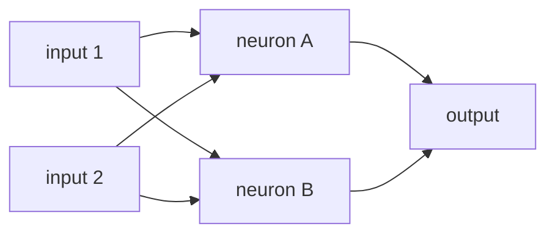
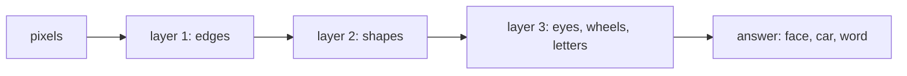

# Instructor Reference: Session 3.2 — Deep Learning and Neural Networks

Duration: 110 min teaching + 2 × 5-min breaks = 120 min
Domain: Conceptual with no-code hands-on | Tools: TensorFlow Playground (free, in the browser) | Prior: Machine Learning Behind Everyday Business Decisions | Next: Transformers and Today's LLMs | Visual load: High

**Goal:** Give learners an intuitive picture of a neural network as layers of simple units, explain when deep learning beats traditional ML, and let them train and reshape a small network in a visual playground.

**Student profile:** Non-technical professionals who know the three families of ML and now ask what a "neural network" actually is and why it dominates images, speech, and language.

**Key outcome:** By the end, every learner can describe a neural network as layers of simple units passing numbers forward, compare deep learning with traditional ML by data type, data volume, and compute, and has configured the layers and inputs of a small network and described what changed.

| Block | Minutes |
|---|---|
| Segment 1 — A neuron and a layer: simple units passing numbers forward | 18 |
| Segment 2 — Deep means many layers | 18 |
| Break 1 | 5 |
| Segment 3 — What deep learning does better, and what it costs | 18 |
| Segment 4 — Hands-on: meet the Playground and a network with no hidden layer | 18 |
| Break 2 | 5 |
| Segment 5 — Hands-on: add layers and inputs, and describe what changes | 18 |
| Segment 6 — Common Mistakes | 12 |
| Segment 7 — Session Recap | 8 |
| **Total** | **120** |

**Setup (before class):** Learners open `playground.tensorflow.org` in a browser (no account). The page works best on a laptop. Open it yourself the day before: its layout is stable but check the dataset thumbnails, the "Features" column, the "Hidden layers" controls, and the "Test loss" and "Training loss" readouts. Results depend on a random starting point, so two learners can see different numbers; this script gives patterns to look for, not exact values.

---

## SEGMENT 1 — A Neuron and a Layer: Simple Units Passing Numbers Forward `(18 min)`

> Instructor note: 3.1 matched problems to types of ML. Name it; today we look inside the engine used for the hardest ones.

**Hook-in** `(30 sec)`

"Behind photo tagging, voice assistants, and chatbots sits one design: a neural network. It sounds like a brain. It is actually much simpler, and today you will see the arithmetic."

**Concept** `(4 min)`

Analogy: A committee voting on a decision. Each member listens to some inputs, gives some of them more weight than others, adds up a score, and passes on a verdict. Several members form a row (a layer), and the next row listens to the first row's verdicts. No member is clever on their own; the structure is.

**A neural network is layers of simple units called neurons, where each neuron multiplies its inputs by weights, adds them up with a bias, applies a simple rule, and passes the result forward to the next layer.**

Why it matters: Every deep-learning system, from image tagging to chatbots, is built from this one repeating idea.

**Visual** `(visual only, no extra time)`



> **Say while pointing:** "Two inputs on the left feed two neurons in the middle, and their results feed one output on the right. Numbers flow left to right."

**Implementation / Demonstration** `(8 min)`

Calculate one neuron by hand with the room.

A neuron has inputs x1 = 2 and x2 = 3, weights w1 = 0.5 and w2 = -1, and bias b = 1.

Step 1: weighted sum = (x1 × w1) + (x2 × w2) + b = (2 × 0.5) + (3 × -1) + 1.
Step 2: = 1 + (-3) + 1 = -1.
Step 3: apply the simple rule ReLU: output = the sum if positive, otherwise 0. So output = max(0, -1) = 0.

Then change the inputs to x1 = 4 and x2 = 1: (4 × 0.5) + (1 × -1) + 1 = 2 - 1 + 1 = 2, ReLU gives 2.

Expected:
```
Input (2, 3) gives weighted sum -1 and output 0.
Input (4, 1) gives weighted sum 2 and output 2.
```

Count the numbers a small network must learn: 2 inputs, a hidden layer of 4 neurons, a second hidden layer of 2 neurons, and 1 output neuron.

```
Weights:  2*4 + 4*2 + 2*1 = 8 + 8 + 2 = 18
Biases:   4 + 2 + 1 = 7
Total learnable numbers (parameters): 25
```

Say: "Training means finding good values for those 25 numbers, the weights and biases, by trying many examples and nudging them to reduce mistakes. The rule that decides how a neuron fires, here ReLU, is called an activation function. Today's chatbots have the same structure but billions of these numbers, which is why they are expensive to build."

**Key point**

**A neuron is a weighted sum plus a simple rule, a layer is a row of neurons, and training is tuning the weights and biases.**

**Room check** `(30 sec)`

> **Ask:** "A neuron has inputs 1 and 2, weights 3 and 1, and bias -4. What is its weighted sum?"
>
> **Answer:** (1 × 3) + (2 × 1) + (-4) = 1.

**Student try** `(3 min)`

Compute the output of a ReLU neuron with inputs 5 and 2, weights 0.2 and 0.4, and bias -2.

Success: 5 × 0.2 = 1, 2 × 0.4 = 0.8, sum = 1 + 0.8 - 2 = -0.2, ReLU output 0.

---

## SEGMENT 2 — Deep Means Many Layers `(18 min)`

**Hook-in** `(30 sec)`

"One layer of the committee can only make simple decisions. Stack many layers and the committee can recognise a face. That stacking is the 'deep' in deep learning."

**Concept** `(4 min)`

Analogy: An assembly line for recognising a face. The first station spots tiny edges, the next combines edges into shapes like eyes and noses, the next combines those into a face. Each station builds on the one before it.

**Deep learning means neural networks with many layers, where early layers learn simple features and later layers combine them into more complex ones.**

Why it matters: Stacking layers lets the model discover for itself the useful features that people once had to design by hand.

**Visual** `(visual only, no extra time)`



> **Say while pointing:** "Each box feeds the next. The first layer sees the raw picture, and each later layer sees a richer summary of the one before."

**Implementation / Demonstration** `(8 min)`

Compare a shallow and a deep network on the whiteboard, using the parameter counts.

| Network | Layers | Neurons per layer | Parameters (weights + biases) |
|---|---|---|---|
| Shallow | 2 inputs, 1 hidden of 4, 1 output | 2, 4, 1 | (2×4 + 4×1) + (4 + 1) = 12 + 5 = 17 |
| Deeper | 2 inputs, 3 hidden of 6, 1 output | 2, 6, 6, 6, 1 | (2×6 + 6×6 + 6×6 + 6×1) + (6+6+6+1) = 90 + 19 = 109 |

Expected:
```
Shallow: 17 parameters. Deeper: 109 parameters.
Adding layers multiplies the capacity: more parameters can capture more complex patterns, and needs more data and compute to tune.
```

Say: "Do not memorise the numbers; notice the growth. A network with 109 numbers to tune needs far more examples than one with 17, or it simply memorises. This is the overfitting problem from 1.2 again. Modern systems go to billions of parameters, trained on enormous data, which connects to cost: that is a theme of 4.2."

Optionally show a pretrained image tagger recognising a photo and say that it was built from layers like these.

**Key point**

**Deep means many layers, early layers find simple features, later layers combine them, and more layers mean more parameters to train.**

**Room check** `(30 sec)`

> **Ask:** "What do the early layers of an image network typically learn, and what do the later layers do?"
>
> **Answer:** Early layers learn simple features like edges; later layers combine them into shapes and objects.

**Student try** `(3 min)`

Count the parameters of a network with 3 inputs, one hidden layer of 5 neurons, and 1 output.

Success: Weights 3×5 + 5×1 = 20, biases 5 + 1 = 6, total 26.

---

## Break 1 `(5 min)`

Re-entry hook: "After the break: when should a business use deep learning, and when is plain old ML the smarter choice?"

---

## SEGMENT 3 — What Deep Learning Does Better, and What It Costs `(18 min)`

**Hook-in** `(30 sec)`

"Deep learning won the world's attention on images, speech, and language. Does that mean every business problem needs it? Usually not."

**Concept** `(4 min)`

Analogy: A high-end professional camera and a phone camera. The professional camera takes stunning photographs but is heavy, costly, and needs skill. For a quick snapshot the phone is faster and good enough. Choosing the camera depends on the shot.

**Deep learning excels on unstructured data such as images, audio, and text, but it needs large amounts of data and heavy computing, while traditional ML often does as well or better on small, structured tables.**

Why it matters: Choosing deep learning when a simpler model would do wastes money and time.

**Implementation / Demonstration** `(8 min)`

Show and discuss this comparison.

| | Traditional ML | Deep learning |
|---|---|---|
| Best data type | Structured tables (rows and columns) | Images, audio, text, video |
| Data needed | Hundreds to thousands of rows can work | Often many thousands to millions of examples |
| Compute | A laptop is usually enough | Often needs powerful chips (GPUs) |
| Features | People choose and prepare them | The network learns them |
| Explaining a result | Often easier | Often harder |
| Typical business use | Churn, credit risk, demand | Photo tagging, voice assistants, chatbots, translation |

Then sort these six cases as traditional ML or deep learning, with a reason.

| Case | Choice | Reason |
|---|---|---|
| Predict churn from a 5,000-row customer table | Traditional ML | Small structured table |
| Identify damaged parcels from photos | Deep learning | Images |
| Transcribe call recordings to text | Deep learning | Audio |
| Forecast monthly sales from a spreadsheet of 36 months | Traditional ML | Tiny structured data |
| Summarise customer emails | Deep learning | Language |
| Score loan risk from 12 columns of applicant data | Traditional ML (usually) | Structured table, and regulators ask for explanations |

Expected:
```
Learners sort images, audio, and language to deep learning, and small tables to traditional ML.
The loan case prompts the explainability discussion: when a decision must be explained to a customer or regulator, simpler models are often preferred.
```

Say: "A good rule: look at the data. A table with rows and columns, start simple. Pictures, sound, or free text, deep learning is likely needed. And ask what it costs: more data, more computing, harder to explain. A common mistake is paying for a deep-learning project to do a spreadsheet's job."

**Key point**

**Choose deep learning for images, audio, and language with plenty of data; choose simpler ML for small structured tables.**

**Room check** `(30 sec)`

> **Ask:** "You have 800 rows of loan data in a spreadsheet. Deep learning or traditional ML?"
>
> **Answer:** Traditional ML: small, structured data does not need a deep network.

**Student try** `(3 min)`

For three tasks from your workplace, write deep learning or traditional ML and one reason each.

Success: Three tasks with choices justified by data type or data volume.

---

## SEGMENT 4 — Hands-on: Meet the Playground and a Network with No Hidden Layer `(18 min)`

**Hook-in** `(30 sec)`

"Time to watch a network learn. TensorFlow Playground draws it live: dots in two colours, and a network trying to separate them."

**Concept** `(4 min)`

Analogy: A teacher drawing a line on a map to separate two neighbourhoods. A straight line separates some maps well; for a map where one neighbourhood sits inside the other like a bullseye, no straight line works, and the teacher needs a curved boundary.

**In the Playground, each dot is an example with two inputs (its position) and a colour (its class), the network tries to colour the background so that it separates the dots, and the loss numbers show how wrong it is.**

Why it matters: You can see directly what layers and extra inputs add, with no code.

**Implementation / Demonstration** `(8 min)`

Part 1, learn the screen:

1. Open `playground.tensorflow.org`.
2. Under **DATA**, choose the **circle** dataset (an orange ring around a blue centre).
3. Under **FEATURES**, switch on only **X1** and **X2** (the two coordinates) and switch the others off.
4. Set **hidden layers** to **0** using the minus button.
5. Press the **play** button. Watch for a few seconds, then press pause.
6. Note the **Test loss** and **Training loss** shown at the top right (lower is better).

Expected:
```
With no hidden layer and only X1 and X2, the network can only draw a straight dividing line.
The circle dataset cannot be separated by a straight line, so the background stays muddled and the losses stay high (they sit near 0.5 and do not fall much).
Exact numbers vary; the pattern to see is "stuck at a high loss".
```

Part 2, a data-based fix:

7. Turn on the **X1²** and **X2²** features (the squares of the coordinates), keeping 0 hidden layers.
8. Press play again.

Expected:
```
The loss falls quickly and the background separates the ring from the centre.
A circle is described by x² + y², so giving the network the right inputs solved the problem without any hidden layer.
```

Say: "Lesson one: the inputs matter. A model with no layers could not do the job until we supplied squared inputs. In traditional ML, people design those inputs. In deep learning, the hidden layers are supposed to discover them for themselves. That is what we try next. Record the final test loss in each case on your sheet."

**Key point**

**A network with no hidden layer can only draw a straight boundary; the right inputs, or hidden layers, are what let it separate curved patterns.**

**Room check** `(30 sec)`

> **Ask:** "With only X1 and X2 and no hidden layer, why can't the network separate the circle dataset?"
>
> **Answer:** It can only draw a straight line, and the classes form a ring around a centre.

**Student try** `(3 min)`

Run Part 1 and Part 2 and record the test loss after each, noting which was lower.

Success: A two-line record where the squared-features run has the clearly lower test loss.

---

## Break 2 `(5 min)`

Re-entry hook: "After the break: remove the helpful inputs and let hidden layers do the work, then try the hardest dataset."

---

## SEGMENT 5 — Hands-on: Add Layers and Inputs, and Describe What Changes `(18 min)`

**Hook-in** `(30 sec)`

"Now we take away the hand-made inputs, X1² and X2², and ask a hidden layer to find the curve itself."

**Concept** `(4 min)`

Analogy: Instead of giving the teacher a curved ruler, you give them several straight rulers they can combine. Each neuron in a hidden layer draws a straight line, and the next layer combines them into curves and shapes.

**Hidden layers let a network combine many simple boundaries into a complex one, and more neurons or layers give it more capacity, at the risk of needing more data and training time.**

Why it matters: You can see capacity directly: too little cannot fit the pattern, and more fits harder patterns.

**Implementation / Demonstration** `(8 min)`

Experiment 1, one hidden layer:

1. Keep the **circle** dataset. Turn **off** X1² and X2², leaving X1 and X2.
2. Add **1 hidden layer** with **1 neuron**. Press play and note the test loss.
3. Increase that layer to **3 neurons**, then to **4 neurons**, pressing play each time (use the reset button first to restart).

Expected:
```
With 1 neuron the network still struggles (a single neuron draws one line).
With 3 or 4 neurons it usually separates the ring from the centre: the background forms a rounded shape and the loss falls.
```

Experiment 2, the hardest dataset:

4. Choose the **spiral** dataset (two interleaved spirals).
5. Switch on X1, X2, and extra features if you wish (such as sin X1 and sin X2).
6. Build a network with 2 hidden layers of 6 neurons each, press play, and let it run for 30 to 60 seconds.
7. If it is stuck, try 3 hidden layers or more neurons, or add features such as X1², X2².

Expected:
```
The spiral is much harder: a small network may not separate it, and larger or deeper networks often do better but take longer to train.
Results vary by random start, so two learners with the same settings can see different loss values.
```

Experiment 3, describe the changes. Complete this table for at least three settings you tried.

| Setting tried | Dataset | Test loss at the end | What the background looked like | One-line conclusion |
|---|---|---|---|---|
| 0 hidden layers, X1 and X2 | circle | | | |
| 1 hidden layer of 4 | circle | | | |
| 2 hidden layers of 6, extra features | spiral | | | |

Say: "Notice two things. More capacity helped on the hard dataset, but it took longer and sometimes still struggled. And on the easy dataset, extra layers were not needed once the inputs were good. That is the business lesson: match the model's capacity to the difficulty of the problem. Also check the gap between training loss and test loss: if training loss is low but test loss is higher, the network is memorising, which you know as overfitting."

Finish with each learner stating, in one sentence, what adding layers changed.

**Key point**

**Hidden layers and neurons add capacity to fit harder patterns, and results should be judged by test loss, not by how the picture looks.**

**Room check** `(30 sec)`

> **Ask:** "Training loss is very low but test loss is much higher. What is happening?"
>
> **Answer:** The network is memorising its training dots (overfitting) and will do worse on new ones.

**Student try** `(3 min)`

Complete the three-row table and write one sentence on what adding layers or neurons changed for you.

Success: Three recorded runs with test loss and a conclusion that mentions capacity or inputs.

---

## SEGMENT 6 — Common Mistakes `(12 min)`

### Mistake 1: Thinking a neural network is a digital brain

**Wrong:**
"The network understands the picture like a person does."

**Right:**
"The network computes weighted sums layer by layer and has tuned numbers that happen to work."

**Why it matters:** The brain idea hides the limits and encourages blind trust.

### Mistake 2: Using deep learning for every problem

**Wrong:**
Training a large neural network on a 500-row spreadsheet.

**Right:**
Starting with traditional ML for small structured data.

**Why it matters:** Deep learning needs lots of data and computing, and may do worse on small tables.

### Mistake 3: Believing more layers is always better

**Wrong:**
"Add layers until it works."

**Right:**
Add capacity only as the problem demands, and check test loss.

**Why it matters:** More capacity can memorise the training data and cost more to run.

### Mistake 4: Judging by the picture instead of test loss

**Wrong:**
"The background looks right, so it is good."

**Right:**
Reading the test loss as well as the picture.

**Why it matters:** A model can look good on the training dots and fail on new ones.

### Mistake 5: Expecting the same result every run

**Wrong:**
"My neighbour's loss was lower, so I must have done it wrong."

**Right:**
Knowing that random starting values give different runs, and repeating the experiment.

**Why it matters:** Single runs of neural networks are noisy, so compare patterns across runs.

**Live room check:**

> **Ask:** "A vendor proposes a deep neural network to predict customer churn from a 3,000-row spreadsheet. What do you ask?"
>
> **Answer:** "Why not a simpler model first? Do we have enough data, and can we explain the results?"

---

## SEGMENT 7 — Session Recap `(8 min)`

| Learning Outcome | What to Remember |
|---|---|
| Describe a neural network as layers of simple units that pass numbers forward | Each neuron computes a weighted sum plus bias and a simple rule, and layers pass results forward; training tunes the weights. |
| Compare deep learning with traditional ML by the data types each suits and the data and compute each needs | Deep learning suits images, audio, and text with lots of data and compute; traditional ML suits small structured tables. |
| Configure the layers and inputs of a small neural network in a visual playground | Add hidden layers and neurons, change input features, and judge the result by test loss. |

Quick fire (2 min, cold-call): "What does a neuron compute? What does 'deep' mean? Which data suits deep learning? Which loss matters, training or test?"

**Path forward:**
Transformers and Today's LLMs — Deep learning gave us networks for images and speech. Next, we meet the specific design that made chatbots possible: the transformer, and how training one on huge amounts of text produces today's large language models.

---

## SECTION 11: Instructor Companion Appendix

### Instructor Notes

- The Playground behaviour described is qualitative. Do not quote exact loss values; they depend on a random start and the Playground version.
- Keep the focus on the pattern: inputs matter, hidden layers add capacity, test loss is the honest score.
- The parameter counts are simple arithmetic and can be checked by hand; use them to demystify "billions of parameters".

### Materials Checklist

- [ ] A laptop with a browser for each learner, access to `playground.tensorflow.org`
- [ ] A sheet or table for recording loss values
- [ ] Whiteboard for the neuron arithmetic

### Timing Contingencies

- Running short: Skip the spiral experiment and keep only the circle dataset.
- Running ahead: Try the XOR dataset and compare the number of neurons needed.

### Answer Key

- S1 Student try: 5 × 0.2 + 2 × 0.4 - 2 = -0.2, so ReLU outputs 0.
- S2 Student try: 3×5 + 5×1 = 20 weights, 5 + 1 = 6 biases, 26 parameters.
- S3 Student try: Choices tied to data type and data volume.
- S4 Student try: Test loss is clearly lower with X1² and X2².
- S5 Student try: Three recorded runs with a conclusion about capacity or inputs.
- Parameter counts: 2-4-2-1 network is 25; 2-4-1 is 17; 2-6-6-6-1 is 109.

### Glossary

- **Neuron:** A unit that computes a weighted sum, adds a bias, and applies a simple rule.
- **Layer:** A row of neurons.
- **Weights and biases:** The numbers a network tunes during training.
- **Activation function:** The simple rule that decides a neuron's output, such as ReLU.
- **Deep learning:** Neural networks with many layers.
- **Loss:** A number measuring how wrong the network is; lower is better.
- **Parameters:** All the weights and biases of a network.
