# Deep Learning and Neural Networks

```mermaid
%%{init: {"flowchart": {"nodeSpacing": 45, "rankSpacing": 65, "diagramPadding": 20}} }%%
flowchart TB
  subgraph Foundation["Where You're Starting From"]
    P1(["Previous Session<br/><b>Machine Learning Behind Everyday Business Decisions</b><br/><i>&#40;Predict, Group, Recommend&#41;</i><br/>You matched business problems to supervised, unsupervised, or reinforcement learning."])
  end
  CS{{Current Session<br/><b>Deep Learning and Neural Networks</b><br/><i>Look inside the layered engine behind image, speech, and language AI, and reshape one yourself</i><br/>Neurons &middot; Layers &middot; Deep Learning &middot; Compute}}
  subgraph Value["Why This Matters"]
    CV(["Course Value<br/><b>The Engine Under GenAI</b><br/>Transformers and large language models, covered next, are neural networks, so this session gives them a concrete foundation."])
    RV(["Real-Life Value<br/><b>Choose the Right Tool</b><br/>Knowing that deep learning needs lots of data and computing, and suits images, audio, and text, stops you paying for it where a simple model would do."])
  end
  subgraph Future["Where This Leads Next"]
    F1(["Upcoming Session<br/><b>Transformers and Today's LLMs</b><br/><i>&#40;Transformers, LLMs&#41;</i><br/>Explains the design behind modern chatbots."])
    F2(["Upcoming Session<br/><b>Why AI Took Off</b><br/><i>&#40;GPUs, Cloud&#41;</i><br/>Shows why data, computing power, and better designs made modern AI practical."])
    F3(["Upcoming Module<br/><b>Module 2: Generative AI for the Enterprise</b><br/><i>&#40;Prompts, Documents&#41;</i><br/>Covers how large language models work and how to use them reliably at work."])
  end
  P1 ==>|&nbsp;Look Inside&nbsp;| CS
  CS ==>|&nbsp;Course Path&nbsp;| CV
  CS ==>|&nbsp;Real-Life Use&nbsp;| RV
  CS ==>|&nbsp;Language Models&nbsp;| F1
  F1 ==>|&nbsp;Why Now&nbsp;| F2
  F2 ==>|&nbsp;Use GenAI&nbsp;| F3
  classDef previous fill:#eef4ff,stroke:#4f7ccf,color:#111827,stroke-width:2px;
  classDef current fill:#fff4d6,stroke:#d9a321,color:#111827,stroke-width:3px;
  classDef value fill:#eaf8ef,stroke:#3f9f63,color:#111827,stroke-width:2px;
  classDef future fill:#f4ecff,stroke:#8a61d1,color:#111827,stroke-width:2px;
  class P1 previous;
  class CS current;
  class CV,RV value;
  class F1,F2,F3 future;
  linkStyle default stroke-width:3px
```



---

## What You'll Learn

In this pre-read, you'll discover:

- That a neural network is far simpler than a "digital brain", and you can compute a neuron by hand
- What the word "deep" actually means in deep learning
- Which kinds of data deep learning handles best, and when a plain spreadsheet model is the smarter choice
- What you will see and do in the live session with a free in-browser network playground

---

## Detailed Explanation

### A neuron is a weighted sum with a simple rule

Think of a committee voting on a decision. Each member listens to some inputs, trusts some more than others, adds up a score, and passes on a verdict. A single member is not clever. The structure is.

A **neuron** does exactly that with numbers:

```
Inputs x1 = 2, x2 = 3
Weights w1 = 0.5, w2 = -1     Bias b = 1

weighted sum = (2 × 0.5) + (3 × -1) + 1 = 1 - 3 + 1 = -1
rule (ReLU): output is the sum if positive, else 0   ->   output = 0
```

With inputs 4 and 1: (4 × 0.5) + (1 × -1) + 1 = 2, and the output is 2.

A **layer** is a row of neurons, and the next layer takes the previous layer's outputs as its inputs. The rule that decides a neuron's output is called an **activation function**.

> **Key mental model:** A neural network is arithmetic: weighted sums passed forward, layer by layer. Training is finding good values for the weights and biases.

---

### Counting what has to be learned

The numbers a network tunes are called **parameters**: the weights and the biases.

```
Network: 2 inputs -> 4 neurons -> 2 neurons -> 1 output
Weights:  2×4 + 4×2 + 2×1 = 18
Biases:   4 + 2 + 1       =  7
Parameters:                 25
```

A bigger network has many more:

```
2 -> 4 -> 1                 17 parameters
2 -> 6 -> 6 -> 6 -> 1      109 parameters
```

Today's chatbots follow the same structure with billions of parameters. More parameters can capture more complex patterns but need far more data and computing to tune, or the network simply memorises its training examples, the overfitting you met earlier.

> **Common misconception:** "A neural network works like a human brain." The name is a loose inspiration. What it really does is weighted arithmetic, which is why it can be confidently wrong in ways a person would not be.

---

### Deep means many layers

An assembly line for recognising a face has stations: the first spots edges, the next combines edges into shapes like eyes and noses, the next combines those into a face. **Deep learning** is a neural network with many such layers, where early layers learn simple features and later layers combine them into richer ones.

```
pixels -> edges -> shapes -> eyes, wheels, letters -> "face", "car", "word"
```

The key benefit: the network discovers useful features for itself, instead of people designing them by hand.

> **Rule of thumb:** More layers means more capacity, and also more data, time, and cost to train.

---

### When deep learning wins, and when it does not

A professional camera takes stunning photographs but is heavy and costly. For a quick snapshot, the phone is fine. Deep learning is the professional camera.

```
                      Traditional ML                 Deep learning
Best data             structured tables              images, audio, text, video
Data needed           hundreds to thousands of rows  often many thousands to millions
Compute               a laptop is usually enough     often powerful chips (GPUs)
Features              people prepare them            the network learns them
Explaining results    often easier                   often harder
Typical use           churn, credit risk, demand     photo tagging, voice, chatbots
```

Sorting cases: churn from a 5,000-row table is traditional ML; spotting damaged parcels from photos is deep learning; transcribing call recordings is deep learning; scoring loan risk from twelve columns is usually traditional ML, partly because a regulator may require an explanation.

> **Habit worth building:** Look at the data first. A table with rows and columns, start simple. Pictures, sound, or free text, expect deep learning.

---

### Bringing it together: the Playground session

In class you will use TensorFlow Playground, a free tool that shows a small network learning live. Dots of two colours sit on a plane, and the network tries to colour the background to separate them.

```
1. With no hidden layer and only X1, X2 as inputs, the network can only draw a straight line.
   On the ring-shaped "circle" data it gets stuck at a high loss.
2. Add the squared inputs X1², X2² and it separates the ring easily: the right inputs matter.
3. Remove those and add a hidden layer of 3-4 neurons: now the network finds the curve itself.
4. Try the "spiral" data: harder, needs more capacity and more training time.
```

Always read the **test loss** (lower is better) and not just the picture. Results vary from run to run because a network starts with random numbers.

> **Forward connection:** The chatbots from your first session are neural networks of this kind, built with a design called the transformer, which is the next topic.

---

## Practice Exercises

**1. Pattern Recognition — Deep learning or traditional ML?**

Choose for each case, with a reason:

- A. Predict loan default from 12 columns of applicant data
- B. Identify products from photos on a warehouse shelf
- C. Convert recorded customer calls into text
- D. Forecast monthly sales from 36 months of figures

---

**2. Spot The Error — The neuron sum**

A neuron has inputs 3 and 2, weights 0.5 and -1, and bias 1. A colleague says its ReLU output is 0.5 × 3 + (-1) × 2 = -0.5, so the output is -0.5. Find the two errors and give the correct answer.

---

**3. Real-Life Application — A vendor proposal**

A vendor proposes a deep neural network to predict which of your 3,000 customers will cancel, using a spreadsheet of 10 columns. Write three questions you would ask before agreeing, covering data volume, simpler alternatives, and explainability.

---

**4. Concept Detective — Stuck at a high loss**

In the Playground, a network with no hidden layer and only X1 and X2 stays stuck at a high loss on the ring-shaped dataset, but turning on the squared inputs fixes it at once. Explain why, in plain words.

---

**5. Planning Ahead — Count the parameters**

A network has 3 inputs, one hidden layer of 5 neurons, a second hidden layer of 3 neurons, and 1 output. Calculate the number of weights, biases, and total parameters, and say what would happen if you trained it on only 20 examples.
