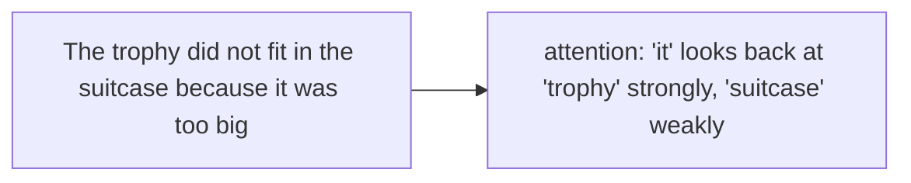
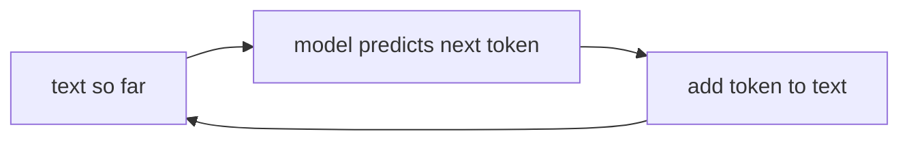

# Instructor Reference: Session 4.1 — Transformers and Today's LLMs

Duration: 110 min teaching + 2 × 5-min breaks = 120 min
Domain: Conceptual with no-code hands-on | Tools: ChatGPT (Free plan), Gemini (Free plan) | Prior: Deep Learning and Neural Networks | Next: Why AI Took Off | Visual load: Medium

**Goal:** Explain in plain language how a transformer reads text, how training one on vast amounts of text produced today's large language models, and how an LLM produces a response one piece at a time.

**Student profile:** Non-technical professionals who know that neural networks are layers of weighted arithmetic and use chatbots daily without knowing how they produce an answer.

**Key outcome:** By the end, every learner can describe how a transformer weighs the words of a whole sentence, explain how scale produced LLMs, list input types a multimodal model accepts, and describe next-token prediction as the mechanism behind a response.

| Block | Minutes |
|---|---|
| Segment 1 — How a transformer reads a whole sentence and weighs its words | 18 |
| Segment 2 — From transformers to large language models | 18 |
| Break 1 | 5 |
| Segment 3 — Next-token prediction: how a response is produced | 18 |
| Segment 4 — Beyond text: multimodal models | 18 |
| Break 2 | 5 |
| Segment 5 — Hands-on: guess the next word, then compare with a chatbot | 18 |
| Segment 6 — Common Mistakes | 12 |
| Segment 7 — Session Recap | 8 |
| **Total** | **120** |

**Setup (before class):** Learners need ChatGPT and Gemini free accounts open in two tabs. Print or share the five unfinished sentences in Segment 5. Chatbot behaviour and plan limits change often, so run the Segment 5 prompts yourself the day before. The probability figures used in Segment 3 are illustrative, chosen for teaching, not measured from any real model.

---

## SEGMENT 1 — How a Transformer Reads a Whole Sentence and Weighs Its Words `(18 min)`

> Instructor note: 3.2 introduced neural networks and layers. Name them; a transformer is one specific design of neural network.

**Hook-in** `(30 sec)`

"Last session a network read numbers layer by layer. Language is harder: the meaning of a word depends on other words, sometimes far away. The design that solved this is called the transformer."

**Concept** `(4 min)`

Analogy: Reading a sentence with a highlighter. For each word, you highlight the other words that help explain it. In "The trophy did not fit in the suitcase because it was too big", to understand "it" your eye jumps back to "trophy". A transformer does this highlighting for every word at once, and the strength of each highlight is called attention.

**A transformer reads a whole sentence at once and, for each word, weighs how much every other word matters to it, using a mechanism called attention.**

Why it matters: Earlier designs read left to right and lost track of distant words, while attention lets the model connect words however far apart they are.

**Visual** `(visual only, no extra time)`



> **Say while pointing:** "When the model processes the word it, the strongest highlight lands on trophy, because only the trophy can be too big to fit."

**Implementation / Demonstration** `(8 min)`

Run a live demonstration with the room.

Sentence A: "The trophy did not fit in the suitcase because it was too **big**."
Sentence B: "The trophy did not fit in the suitcase because it was too **small**."

Ask: what does "it" refer to in A, and in B?

Then show an illustrative attention table for the word "it" (values are teaching numbers, summing to 100%):

| Word attended to | Sentence A (too big) | Sentence B (too small) |
|---|---|---|
| trophy | 70% | 15% |
| suitcase | 15% | 70% |
| other words | 15% | 15% |

Expected:
```
A: "it" is the trophy (the trophy is too big to fit).
B: "it" is the suitcase (the suitcase is too small to hold it).
One word changed (big to small) and the reference flipped. A model that weighs the whole sentence can follow this; one that just looks at the previous word cannot.
```

Say: "Nobody typed a rule saying trophies are big. During training, the model saw so much text that it learned which words tend to matter to which. The weights in the table are what training tunes, the same weights from 3.2. The important idea for you: the model uses the whole context, which is why the exact wording of your prompt matters so much."

**Key point**

**A transformer weighs every word against every other word in the sentence, which is how it captures context.**

**Room check** `(30 sec)`

> **Ask:** "What does the mechanism called attention do?"
>
> **Answer:** For each word, it weighs how much every other word in the sentence matters.

**Student try** `(3 min)`

Write one sentence of your own where changing a single word changes what a pronoun like "it" or "they" refers to.

Success: Two sentences differing by one word, with different references for the pronoun.

---

## SEGMENT 2 — From Transformers to Large Language Models `(18 min)`

**Hook-in** `(30 sec)`

"A transformer is a design. A large language model, an LLM, is what you get when you train that design on a huge amount of text."

**Concept** `(4 min)`

Analogy: A child who reads every book in a very large library over many years. No one explains grammar rules. By reading so much, the child picks up grammar, facts, tone, and styles, and can then write fluently on almost any topic, though they may still mix up details.

**A large language model (LLM) is a very large transformer trained on enormous amounts of text to predict what comes next, and the scale of the data and the number of parameters are what give it broad abilities.**

Why it matters: This explains both why LLMs are so capable and why they can state wrong things fluently: they learned patterns of text, not a verified database of facts.

**Implementation / Demonstration** `(8 min)`

Compare three scales with round, illustrative figures (clearly marked as order-of-magnitude, not exact for any product).

| Model type | Parameters | Training text | What it can do |
|---|---|---|---|
| The tiny network from 3.2 | 25 | None, hand-made | Separate dots on a plane |
| A small language model | Millions | Millions of pages | Complete simple sentences |
| A modern LLM | Billions to trillions (varies by model) | A large share of public text, books, code | Draft, summarise, translate, reason about text |

Walk through the training story in four steps:

1. **Collect** a vast text collection (web pages, books, code).
2. **Train** the transformer to predict the next piece of text, over and over, adjusting its parameters when wrong. This is called pre-training.
3. **Refine** it with human feedback and instructions so it follows requests politely and safely.
4. **Use** it (inference): you type, it responds.

Expected:
```
Learners can restate: more data + more parameters + the transformer design = a model with broad language ability.
They connect the dots: training was a one-time, huge cost (1.2); each chat message is cheap inference.
```

Say: "Step 3 matters for your work: the raw model only continues text. The refining step is what turns it into an assistant that answers questions. Also notice what is missing from the list: a step where facts are checked. The model learned patterns in text. That is why it can be wrong with great confidence, a topic we cover in the next module."

**Key point**

**An LLM is a transformer trained on vast text to predict what comes next, and refined to follow instructions.**

**Room check** `(30 sec)`

> **Ask:** "Why can an LLM state something false in a confident tone?"
>
> **Answer:** It learned patterns of fluent text, not a checked list of facts, so it produces plausible wording whether or not it is true.

**Student try** `(3 min)`

In two sentences, explain to a colleague what an LLM is, using the words "transformer", "text", and "predict".

Success: A plain explanation that includes all three words correctly.

---

## Break 1 `(5 min)`

Re-entry hook: "After the break: the one-line mechanism behind every chatbot reply, and a game that lets you feel it."

---

## SEGMENT 3 — Next-Token Prediction: How a Response Is Produced `(18 min)`

**Hook-in** `(30 sec)`

"When a chatbot replies, it does not plan the whole answer and then write it. It writes one small piece at a time, each piece chosen because it looks likely to come next."

**Concept** `(4 min)`

Analogy: The autocomplete on your phone keyboard, suggesting the next word. An LLM is like autocomplete that has read much of the internet and can keep going for pages. It predicts one piece, adds it to the text, and then predicts the next piece from everything so far.

**Next-token prediction is the mechanism of an LLM: it splits text into tokens (small pieces of words), predicts the likely next token given all tokens so far, appends it, and repeats until the response is complete.**

Why it matters: This one mechanism explains fluent writing, wrong facts, and why the same prompt can give different answers.

**Visual** `(visual only, no extra time)`



> **Say while pointing:** "The loop runs round and round. Each pass adds one token, and the longer text feeds the next prediction."

**Implementation / Demonstration** `(8 min)`

Introduce tokens with an illustrative split. Real tokenisers differ between models, so treat this as a picture, not a fixed rule:

```
"Unbelievable results" might be pieces like:  Un | believ | able |  results
A common word like "results" is often one token; rare words split into several.
```

Now show an illustrative next-token table for the unfinished sentence "The capital of India is". The probabilities are teaching numbers, not real model output:

| Next token | Illustrative probability |
|---|---|
| New | 90% |
| Delhi | 4% |
| the | 3% |
| a | 1% |
| other | 2% |

Expected:
```
The model picks "New" most of the time. Then the text is "The capital of India is New", and the next prediction is "Delhi" with very high probability.
Probabilities sum to 100%: 90 + 4 + 3 + 1 + 2 = 100.
```

Say: "Two consequences. First, the model can be pushed to pick the top option every time, giving steady answers, or to pick among the likely options with some randomness, giving varied wording; that is why the same prompt can give different replies. Second, picking a likely-sounding next piece is not the same as checking truth. If the facts were rare in its training text, a plausible but wrong continuation can win."

Run a quick class game: pick a famous phrase, say it half-way, and have learners call out the likely next word. Notice how fast the group agrees on common phrases and how widely they differ on open ones.

**Key point**

**An LLM response is built one token at a time by repeatedly predicting a likely next token from everything so far.**

**Room check** `(30 sec)`

> **Ask:** "Why can the same prompt produce different answers on two runs?"
>
> **Answer:** The model chooses among likely next tokens with some randomness, so the path can differ.

**Student try** `(3 min)`

Complete in your head and write down the most likely next word: "Thank you for your email, I will get back to you as". Then write a second plausible word.

Success: Likely "soon" as first, and a second such as "quickly" or "early".

---

## SEGMENT 4 — Beyond Text: Multimodal Models `(18 min)`

**Hook-in** `(30 sec)`

"The chatbots you used on day one now also look at pictures, listen, and read your documents. That is not a new idea, but a wider set of inputs."

**Concept** `(4 min)`

Analogy: A colleague who used to work only from emails and can now also read charts, listen to voice notes, and look at photos of a whiteboard. Same colleague, more kinds of input.

**A multimodal model accepts more than one type of input, such as text, images, audio, and documents, by converting each into numbers the same kind of network can process.**

Why it matters: It opens tasks like reading a scanned invoice, describing a photo, or summarising a recorded call.

**Implementation / Demonstration** `(8 min)`

Show the table and match each to a workplace example.

| Input type | Example task at work | Typical caution |
|---|---|---|
| Text | Draft a reply to an email | Facts need checking |
| Image | Read a chart, or describe a damaged parcel photo | May misread small text or details |
| Audio | Transcribe and summarise a call | Accents and noise reduce accuracy |
| Document or PDF | Pull the due date and amount from an invoice | Check extracted numbers against the source |
| Video | Summarise a recorded training session | Often limited to short clips or frames |

Then run a live five-minute test with a harmless image, such as a photo of a whiteboard with a simple table, or a public chart. Upload it to one free chatbot and ask:

```
Describe what this image shows in two sentences, then list any numbers you can read from it.
```

Expected:
```
The chatbot describes the image and lists numbers. Check each number against the original: small or blurred figures are the most likely to be misread.
Features, upload limits, and supported file types vary by tool and plan.
```

Say: "Note what the model did: it converted the image to numbers and predicted a description, again one token at a time. So all the earlier cautions still apply. Treat extracted numbers as a draft and check them. And remember the privacy rule from day one: do not upload images that contain personal data or confidential material."

**Key point**

**Multimodal models accept text, images, audio, and documents, and all outputs still need checking against the source.**

**Room check** `(30 sec)`

> **Ask:** "A model reads the amount from a photographed invoice. What do you do before using it?"
>
> **Answer:** Check it against the original invoice: image reading can misread digits.

**Student try** `(3 min)`

List two tasks in your own work for which an image, audio, or document input would be useful, and name the check you would apply to each.

Success: Two tasks, each with an input type and a specific check.

---

## Break 2 `(5 min)`

Re-entry hook: "After the break: a contest between you and the machine on predicting the next word."

---

## SEGMENT 5 — Hands-on: Guess the Next Word, Then Compare with a Chatbot `(18 min)`

**Hook-in** `(30 sec)`

"Five unfinished sentences. First you guess, then the chatbot guesses. Where you agree, the text is predictable. Where you differ, the sentence is open."

**Concept** `(4 min)`

Analogy: Finishing each other's sentences. Close colleagues do it easily on routine phrases and disagree on open-ended ones. Predictability is exactly what a language model exploits.

**Comparing your own predictions with a chatbot's shows that LLMs do well where text is predictable and vary or err where it is open or rare.**

Why it matters: It makes next-token prediction something you have felt, not just read.

**Implementation / Demonstration** `(8 min)`

Step 1 (3 minutes): Write your single most likely next word for each, before using any tool.

| # | Unfinished sentence | My guess |
|---|---|---|
| 1 | "The capital of India is" | |
| 2 | "Please find the attached invoice and let me know if you have any" | |
| 3 | "After the meeting, the manager asked the intern to send the" | |
| 4 | "The bank refused the loan because the applicant's income was too" | |
| 5 | "I put the keys in the drawer, then walked to the kitchen. Later, I looked everywhere for the" | |

Step 2 (3 minutes): In a fresh chat in ChatGPT, then Gemini, send this prompt for each sentence:

```
Complete this sentence with only the single most likely next word, nothing else: "<sentence>"
```

Step 3 (2 minutes): Fill in the comparison.

| # | My guess | ChatGPT | Gemini | Agree? |
|---|---|---|---|---|

Expected:
```
Most likely continuations: 1 "New" (as in New Delhi), 2 "questions", 3 "minutes" or "notes" or "report", 4 "low", 5 "keys".
Sentences 1, 2, 4, and 5 are highly predictable, so you and both tools usually agree.
Sentence 3 is more open (minutes, notes, report, slides, summary), so disagreement there is normal.
Tools may reply with more than one word despite the instruction; note when that happens.
```

Say: "Predictable sentences gave agreement. The open sentence gave variety. Now run sentence 3 again in the same tool, in a new chat, three times, and see whether the word changes. If it does, you have just seen the randomness in token choice. Finally, notice sentence 1: the model needs two tokens, New and Delhi, so your single-word instruction really asks for the first piece."

Close with each learner stating one thing they learned about how predictable text is.

**Key point**

**LLMs are strongest where text is predictable and least reliable where it is open or rare, because they predict likely continuations.**

**Room check** `(30 sec)`

> **Ask:** "Why did everyone agree on sentence 2 but not sentence 3?"
>
> **Answer:** Sentence 2 has one overwhelmingly common ending; sentence 3 has many plausible endings.

**Student try** `(3 min)`

Run sentence 3 three times in new chats in one tool and record the three answers.

Success: Three recorded answers, noting whether they differ.

---

## SEGMENT 6 — Common Mistakes `(12 min)`

### Mistake 1: Thinking an LLM looks up answers in a database

**Wrong:**
"It searched its records and found the figure."

**Right:**
"It generated the likely next tokens; the figure came from patterns, not a checked record."

**Why it matters:** It explains why facts and figures must be verified.

### Mistake 2: Believing it plans the whole answer first

**Wrong:**
"The model writes the whole reply in its head and then types it."

**Right:**
"It produces one token at a time, each based on all earlier tokens."

**Why it matters:** Early wording can steer a response, which is why prompt wording matters.

### Mistake 3: Assuming the same prompt always gives the same answer

**Wrong:**
Treating one run as the model's definitive answer.

**Right:**
Knowing that randomness in token choice makes outputs vary, and re-running when it matters.

**Why it matters:** Single runs can mislead, especially on open questions.

### Mistake 4: Trusting multimodal reading blindly

**Wrong:**
Using a number read from a photo without checking.

**Right:**
Checking extracted digits against the original image or document.

**Why it matters:** Misread digits are a common failure that is easy to miss.

### Mistake 5: Mixing up the transformer and the LLM

**Wrong:**
"The transformer is the chatbot."

**Right:**
"The transformer is the design; the LLM is a very large model of that design trained on vast text."

**Why it matters:** The distinction helps when vendors talk about architectures and models.

**Live room check:**

> **Ask:** "A teammate says, 'The chatbot knows our policy because it read the internet.' What is wrong with that?"
>
> **Answer:** It has never seen your private policy, and it predicts likely text; you must give it the policy or check its claims.

---

## SEGMENT 7 — Session Recap `(8 min)`

| Learning Outcome | What to Remember |
|---|---|
| Describe how a transformer reads a whole sentence at once and weighs which words matter to each other | Attention weighs every word against every other, capturing context like what "it" refers to. |
| Explain how training a transformer on very large amounts of text produced today's large language models | Scale in data and parameters, plus refinement with human feedback, turns the transformer into an LLM. |
| Describe the input types a multimodal model accepts beyond text | Text, images, audio, documents, and sometimes video, all converted to numbers and checked against sources. |
| Describe next-token prediction as the mechanism that produces an LLM response | The model predicts one token at a time from all tokens so far, with some randomness. |

Quick fire (2 min, cold-call): "What does attention do? Why can an LLM be confidently wrong? What is a token? Why do answers vary between runs?"

**Path forward:**
Why AI Took Off — You now know how a modern chatbot works. Next, we ask why this became possible only in the last few years: more data, more computing power, and better designs, and who can afford to build them.

---

## SECTION 11: Instructor Companion Appendix

### Instructor Notes

- All probability tables here are teaching illustrations. Say so each time; do not let learners treat them as real model output.
- Tokenisation differs between models; the split shown is a picture of the idea.
- Chatbots often disobey "one word only". Treat that as an observation, not an error on the learner's part.
- Keep the multimodal test to harmless images with no personal data.

### Materials Checklist

- [ ] ChatGPT and Gemini free accounts open in two tabs
- [ ] The five unfinished sentences shared as text
- [ ] A harmless image or chart for the multimodal test
- [ ] The trophy and suitcase sentences on a slide

### Timing Contingencies

- Running short: Skip the multimodal live test and discuss the table only.
- Running ahead: Ask the tool to continue a sentence with a high-randomness, creative style and compare with a plain style.

### Answer Key

- S1 Student try: Any sentence pair whose pronoun reference flips with one word.
- S2 Student try: "An LLM is a transformer trained on vast text to predict what comes next."
- S3 Student try: "soon" and a second plausible word such as "quickly".
- S4 Student try: Two tasks with an input type and a check against the source.
- S5 Student try: Three recorded answers; differences indicate token-choice randomness.
- Teaching numbers: 90 + 4 + 3 + 1 + 2 = 100.

### Glossary

- **Transformer:** A neural network design that weighs all words in a text against each other.
- **Attention:** The mechanism that weighs how much each word matters to another.
- **LLM:** A very large transformer trained on vast text to predict what comes next.
- **Token:** A small piece of text, often part of a word.
- **Pre-training:** The first, huge training stage on raw text.
- **Multimodal model:** A model that accepts more than one type of input.
