# Transformers and Today's LLMs

```mermaid
%%{init: {"flowchart": {"nodeSpacing": 45, "rankSpacing": 65, "diagramPadding": 20}} }%%
flowchart TB
  subgraph Foundation["Where You're Starting From"]
    P1(["Previous Session<br/><b>Deep Learning and Neural Networks</b><br/><i>&#40;Layers, Parameters&#41;</i><br/>You saw a neural network as layers of weighted sums and counted the numbers it must learn."])
  end
  CS{{Current Session<br/><b>Transformers and Today's LLMs</b><br/><i>Understand how a transformer reads context and how scale turned it into the chatbots you use</i><br/>Attention &middot; LLMs &middot; Next-Token Prediction &middot; Multimodal}}
  subgraph Value["Why This Matters"]
    CV(["Course Value<br/><b>The Foundation of Module 2</b><br/>Prompting, document assistants, and agents later in the course all rely on how an LLM actually produces its answer."])
    RV(["Real-Life Value<br/><b>Why Chatbots Sound Right and Sometimes Are Wrong</b><br/>Knowing that an LLM predicts likely text explains confident mistakes and tells you what to check."])
  end
  subgraph Future["Where This Leads Next"]
    F1(["Upcoming Session<br/><b>Why AI Took Off</b><br/><i>&#40;GPUs, Cloud&#41;</i><br/>Shows why data, computing power, and better designs made modern AI practical."])
    F2(["Upcoming Session<br/><b>Assessing Your Organisation's AI Maturity</b><br/><i>&#40;Maturity, Readiness&#41;</i><br/>Moves from how AI works to how ready your organisation is for it."])
    F3(["Upcoming Module<br/><b>Module 2: Generative AI for the Enterprise</b><br/><i>&#40;Prompts, Documents&#41;</i><br/>Covers how large language models work and how to use them reliably at work."])
  end
  P1 ==>|&nbsp;Specific Design&nbsp;| CS
  CS ==>|&nbsp;Course Path&nbsp;| CV
  CS ==>|&nbsp;Real-Life Use&nbsp;| RV
  CS ==>|&nbsp;Why Now&nbsp;| F1
  F1 ==>|&nbsp;Apply to Business&nbsp;| F2
  F2 ==>|&nbsp;Use GenAI&nbsp;| F3
  classDef previous fill:#eef4ff,stroke:#4f7ccf,color:#111827,stroke-width:2px;
  classDef current fill:#fff4d6,stroke:#d9a321,color:#111827,stroke-width:3px;
  classDef value fill:#eaf8ef,stroke:#3f9f63,color:#111827,stroke-width:2px;
  classDef future fill:#f4ecff,stroke:#8a61d1,color:#111827,stroke-width:2px;
  class P1 previous;
  class CS current;
  class CV,RV value;
  class F1,F2,F3 future;
  linkStyle default stroke-width:3px
```



---

## What You'll Learn

In this pre-read, you'll discover:

- How a transformer decides which words in a sentence matter to each other, in one simple picture
- How a very large transformer trained on huge amounts of text became the chatbots you use
- Why a chatbot's answer is built one small piece at a time, and why that explains both its fluency and its mistakes
- Which kinds of input, beyond text, today's models accept
- What you will do in class: a guessing game against a chatbot

---

## Detailed Explanation

### How a transformer weighs the words in a sentence

Read a sentence with a highlighter and, for each word, mark the other words that help explain it. In "The trophy did not fit in the suitcase because it was too big", to understand "it" your eye jumps back to "trophy". Change one word and the answer flips:

```
"... because it was too BIG"     it = the trophy     (the trophy is too big)
"... because it was too SMALL"   it = the suitcase   (the suitcase is too small)
```

A **transformer** is a neural network design that does this highlighting for every word at once. The mechanism is called **attention**: for each word, the network weighs how much every other word in the sentence matters to it. Illustrative weights for the word "it":

```
                  too BIG    too SMALL
trophy            70%        15%
suitcase          15%        70%
all other words   15%        15%
```

No one typed a rule about trophies. Training on huge text tuned the weights so the model learned which words tend to matter to which.

> **Key mental model:** A transformer uses the whole context, which is why the exact wording of your prompt changes the answer.

---

### From transformer to large language model

A child who reads every book in a very large library picks up grammar, facts, and tone without anyone explaining the rules, and can then write fluently on almost any topic, though they may still mix up details.

A **large language model (LLM)** is a very large transformer trained on enormous amounts of text to predict what comes next. Its abilities come from scale in two ways: the amount of text and the number of parameters.

```
The tiny network from the last session     25 parameters       separates dots
A modern LLM                               billions or more    drafts, summarises, translates
```

The training story has four steps:

```
1. Collect     a vast text collection: web pages, books, code
2. Train       predict the next piece of text, over and over (pre-training)
3. Refine      use human feedback so it follows instructions politely and safely
4. Use         you type, it responds (inference)
```

Notice what is missing: no step checks facts. The model learned patterns in text, which is why it can sound sure and be wrong.

> **Common misconception:** "A chatbot looks things up in a database of facts." It generates likely text. Facts and figures must be checked.

---

### One token at a time

Your phone's autocomplete suggests the next word. An LLM is autocomplete that has read much of the internet and can keep going for pages. It works in small pieces called **tokens**, often parts of words.

```
"Unbelievable results"  might split as:  Un | believ | able |  results
(real tokenisers differ between models; this is only a picture)
```

The loop is simple:

```
text so far -> model predicts the likely next token -> add it to the text -> repeat
```

An illustrative prediction for "The capital of India is":

```
New 90%    Delhi 4%    the 3%    a 1%    other 2%     (sums to 100%)
```

Two consequences follow. First, the model can pick the top option every time for steady answers, or choose among likely options with some randomness for varied wording, so the same prompt can give different replies. Second, a likely-sounding continuation is not a verified one: if a fact was rare in its training text, a plausible but wrong continuation can win.

> **Habit worth building:** For anything that matters, re-run a question, or check the claim against a source, instead of trusting a single fluent reply.

---

### Beyond text: multimodal models

Imagine a colleague who used to work only from emails and now can also read charts, listen to voice notes, and look at whiteboard photos. A **multimodal model** accepts more than one kind of input by converting each into numbers the network can process.

```
Text        draft a reply                         check facts
Image       read a chart, describe a parcel photo misread small figures are possible
Audio       transcribe and summarise a call       accents and noise reduce accuracy
Document    pull the due date and amount from an invoice   check numbers against the source
```

The output is still produced token by token, so every earlier caution applies. Do not upload images or files containing personal or confidential data to a public tool.

> **Rule of thumb:** Treat any number a model reads from an image or document as a draft until you have checked it against the original.

---

### Bringing it together: the guessing game

In class you will write your own most likely next word for five unfinished sentences, then ask two chatbots for theirs:

```
"The capital of India is"
"Please find the attached invoice and let me know if you have any"
"After the meeting, the manager asked the intern to send the"
```

Where you and the tools agree, the text is predictable. Where you differ, the sentence is open. You will also run one open sentence three times to see the randomness yourself.

> **Forward connection:** The next session asks why this kind of AI became practical only recently, and what it costs to build and run.

---

## Practice Exercises

**1. Pattern Recognition — Which term fits?**

Match each to transformer, attention, token, LLM, or multimodal model:

- A. A small piece of text, such as part of a word
- B. The mechanism that weighs how much each word matters to another
- C. A very large transformer trained on vast text
- D. A model that accepts text, images, and audio

---

**2. Spot The Error — The lookup myth**

A manager says: "The chatbot searched its records and found our refund policy." Explain what is wrong with this view, and what to do before relying on the answer.

---

**3. Real-Life Application — A document-reading task**

Choose a document type from your function (invoice, contract summary, resume, report). Describe how a multimodal model could help, what could go wrong, and the specific check you would make before using its output.

---

**4. Concept Detective — Different answers, same prompt**

You send the same prompt twice and get two differently worded replies, one with a detail the other lacks. Using what you know about how a response is produced, explain why, and what you would do for an important task.

---

**5. Planning Ahead — Make a prompt hard to misread**

The sentence "She told her manager that she was late because she missed the bus" is ambiguous about who missed the bus. Using what you know about attention and context, rewrite a short instruction to a chatbot so that no word can be mistaken for the wrong person, and say why it helps.
