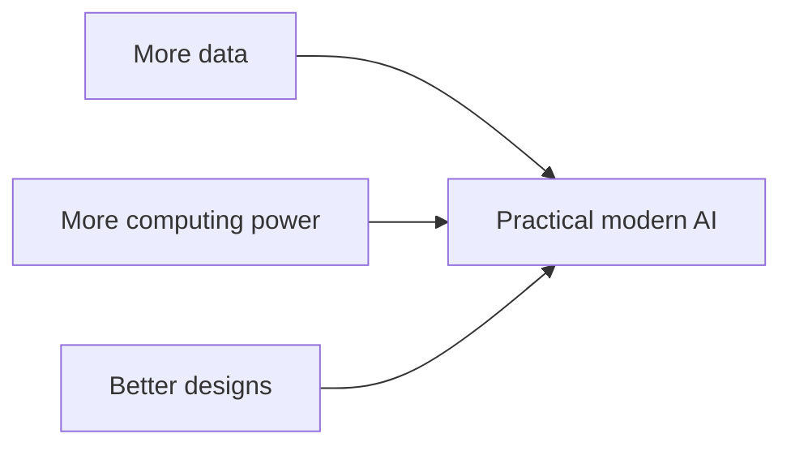

# Instructor Reference: Session 4.2 — Why AI Took Off

Duration: 110 min teaching + 2 × 5-min breaks = 120 min
Domain: Conceptual with no-code hands-on | Tools: Google Sheets (free), supplied `ai_cost_figures.csv` | Prior: Transformers and Today's LLMs | Next: Assessing Your Organisation's AI Maturity | Visual load: Medium

**Goal:** Explain why modern AI became practical when it did, what GPUs and cloud platforms do, and why access to chips and computing power decides who can build large models.

**Student profile:** Non-technical professionals who now understand how a chatbot works and ask why this happened only in recent years and what it costs.

**Key outcome:** By the end, every learner can name the three developments behind modern AI, describe the role of GPUs, trace the chain behind one AI answer, explain why computing access shapes who builds large models, and has compared a one-time training cost with a per-use cost in a sheet.

| Block | Minutes |
|---|---|
| Segment 1 — Three developments: data, computing power, better designs | 18 |
| Segment 2 — GPUs: many small calculations at once | 18 |
| Break 1 | 5 |
| Segment 3 — The chain behind one AI answer | 18 |
| Segment 4 — Who can afford to build large models, and why | 18 |
| Break 2 | 5 |
| Segment 5 — Hands-on: training cost versus cost per use in a sheet | 18 |
| Segment 6 — Common Mistakes | 12 |
| Segment 7 — Session Recap | 8 |
| **Total** | **120** |

**Setup (before class):** Give learners `ai_cost_figures.csv` from `data/` (or type the five figures from Segment 5 into a blank sheet). All cost figures are invented teaching numbers, not any real company's costs. State that on screen before the exercise. Learners need Google Sheets.

---

## SEGMENT 1 — Three Developments: Data, Computing Power, Better Designs `(18 min)`

> Instructor note: 4.1 explained how a transformer and an LLM work. Name it; today we ask why that became possible now.

**Hook-in** `(30 sec)`

"Neural networks were invented decades ago, yet useful chatbots arrived only recently. What changed?"

**Concept** `(4 min)`

Analogy: Baking bread at scale. The recipe existed for a long time. What turned a home hobby into a city bakery was lots of flour (ingredients), a big industrial oven (power), and a better method (technique). Modern AI needed all three at once.

**Modern AI became practical because of three developments arriving together: far more data, far more computing power, and better model designs.**

Why it matters: When someone predicts where AI goes next, each of the three is a lever you can ask about.

**Visual** `(visual only, no extra time)`



> **Say while pointing:** "All three arrows lead to the same box. Remove any one and progress slows sharply."

**Implementation / Demonstration** `(8 min)`

Walk through the three developments with a short "then and now" table.

| Development | Then | Now | Effect on AI |
|---|---|---|---|
| Data | Little digital text, few labelled images | Billions of web pages, photos, videos, and transactions | Models have enough examples to learn from |
| Computing power | Training took weeks on ordinary chips, or was impossible | Graphics chips (GPUs) and cloud rental run huge jobs in parallel | Training models with billions of parameters became feasible |
| Better designs | Models read text step by step and lost distant context | Transformers weigh all words at once | Language models scale and keep context |

Expected:
```
Learners can restate each line as "more examples, more muscle, smarter method".
They connect the third row to 4.1 (attention) and the first to 1.2 (learning from examples).
```

Say: "Ask which of the three is hardest for a company to copy. Data can be bought or gathered, designs are published in research papers, but computing power costs real money and depends on scarce chips. Keep that in mind for Segment 4."

**Key point**

**Data, computing power, and better designs together made modern AI practical.**

**Room check** `(30 sec)`

> **Ask:** "Which of the three developments is described by 'the transformer'?"
>
> **Answer:** Better designs.

**Student try** `(3 min)`

For one AI product you use, write one sentence for each of the three developments showing how it depends on them.

Success: Three sentences, one each on data, computing power, and design.

---

## SEGMENT 2 — GPUs: Many Small Calculations at Once `(18 min)`

**Hook-in** `(30 sec)`

"You have heard 'GPU' in every AI headline. What is it, and why can't an ordinary computer chip do the job?"

**Concept** `(4 min)`

Analogy: Marking 10,000 exam papers. One very smart examiner marks one paper at a time, quickly. A hall of 1,000 ordinary markers each marks ten papers at once. For this job, the large hall of simple markers wins, because the work splits into many small, identical tasks.

**A GPU (graphics processing unit) is a chip with thousands of simple cores that do many small calculations at the same time, which suits the repeated arithmetic of neural networks.**

Why it matters: Training and running AI models is millions of small multiplications and additions, so GPUs make it hundreds of times faster.

**Implementation / Demonstration** `(8 min)`

Work through the marking example with numbers.

Setup: 10,000 independent calculations; each takes 1 second.

| Worker | Number working at once | Time to finish |
|---|---|---|
| One fast worker | 1 | 10,000 seconds |
| 10 workers | 10 | 1,000 seconds |
| 1,000 simple workers | 1,000 | 10 seconds |

Compute: time = 10,000 / workers. For 1,000 workers: 10,000 / 1,000 = 10 seconds. If each simple worker is 5 times slower (5 seconds per calculation), time = (10,000 / 1,000) × 5 = 50 seconds, still 200 times faster than 10,000 seconds.

Expected:
```
One worker: 10,000 s (about 2.8 hours).
1,000 slower workers (5 s each): 50 s.
Speed-up: 10,000 / 50 = 200 times.
```

Say: "This is why GPUs matter, and the same arithmetic underlies neural networks: remember the 25 parameters from 3.2 where every neuron's sum can be computed at the same time. A billion-parameter model repeats that on a vast scale. GPUs do many things at once; an ordinary CPU does fewer things, but handles more varied jobs. Training a large model can use thousands of GPUs running for weeks."

**Key point**

**GPUs do thousands of small calculations at the same time, which is exactly the kind of work neural networks need.**

**Room check** `(30 sec)`

> **Ask:** "Why is a GPU a good fit for a neural network?"
>
> **Answer:** A network needs millions of small, similar calculations, and a GPU can do many of them at the same time.

**Student try** `(3 min)`

Compute the time for 6,000 independent 2-second calculations on 300 workers.

Success: (6,000 / 300) × 2 = 20 × 2 = 40 seconds.

---

## Break 1 `(5 min)`

Re-entry hook: "After the break: follow one AI answer back to the hardware that produced it."

---

## SEGMENT 3 — The Chain Behind One AI Answer `(18 min)`

**Hook-in** `(30 sec)`

"When you press enter on a chatbot, a long chain of companies and machines springs to work. Who is in it?"

**Concept** `(4 min)`

Analogy: Electricity at your plug. You flip a switch, but behind it sit power stations, grids, and companies. Few people think about the chain until the lights go out or the bill rises. AI has a similar chain.

**The chain behind one AI answer runs from chips, to data centres, to cloud platforms, to a model provider, to the app you use.**

Why it matters: Each link has costs, owners, and risks, and your organisation's choices (and bills) depend on which links it buys.

**Visual** `(visual only, no extra time)`


> **Say while pointing:** "Left to right, each link builds on the one before. Your question travels all the way back to the left and the answer comes forward again."

**Implementation / Demonstration** `(8 min)`

Fill this table together. Add real examples from the room's knowledge, labelled as examples and not endorsements.

| Link | What it does | Example type of company | What your organisation might pay for |
|---|---|---|---|
| Chips | Designs and manufactures GPUs and AI chips | Chip designers and factories | Nothing directly; it shows up in cloud prices |
| Data centres | Buildings full of servers, cooling, and power | Data-centre operators | Rarely; large firms may run their own |
| Cloud | Computers rented over the internet by the hour | Large cloud providers | Computing time and storage |
| Model provider | Trains and serves the model | AI labs | Per-use or subscription fees |
| App | The product you see | Chat apps, office tools | Seats or subscriptions |

Trace one answer: you type a question in a chat app (app) which sends it to a model provider, which runs the model on rented GPUs (cloud) in a data centre, using chips that a manufacturer made.

Expected:
```
Learners can name the five links in order, give a type of company for each, and say where their organisation pays.
Most organisations pay at the cloud, model provider, or app links.
```

Say: "Notice dependencies. If chips are scarce, cloud prices rise, which raises model prices, which raises app prices. And where does the data you type go? Through the model provider, which is why the data-safety rule from day one matters, and why companies check contract terms with providers."

**Key point**

**One AI answer travels a chain from app to model provider to cloud to data centre to chips, and every link has a cost and an owner.**

**Room check** `(30 sec)`

> **Ask:** "Your company uses a chat app built on a model provider's model running on rented cloud computers. Name the four links beyond the app."
>
> **Answer:** The model provider, the cloud platform, the data centre, and the chip maker.

**Student try** `(3 min)`

Pick an AI tool you use and name the likely link for each of: the app you see, the model underneath, and where it runs.

Success: Three links named in order, with a note if any is unknown and needs checking.

---

## SEGMENT 4 — Who Can Afford to Build Large Models, and Why `(18 min)`

**Hook-in** `(30 sec)`

"If the designs are published and data is plentiful, why do only a handful of organisations build the largest models?"

**Concept** `(4 min)`

Analogy: Building a steel plant. Anyone can read about how steel is made, but you need a huge amount of capital, special equipment, and years. Very few companies can, and those who can set the prices for everyone else.

**Training a large model needs thousands of scarce, expensive chips running for weeks, plus data and skilled people, so only organisations with large funding and access to chips can build frontier models, while most others use models through the cloud.**

Why it matters: It shapes your choices: most organisations buy or rent AI, rather than build it, and depend on a few providers.

**Implementation / Demonstration** `(8 min)`

Use an illustrative build-versus-buy comparison (teaching figures, not any company's actual costs).

| | Build a large model | Use a model through the cloud |
|---|---|---|
| One-time training cost | About Rs 400 crore (illustrative) | None for you |
| Chips needed | Thousands of GPUs for weeks | None; rented per use |
| People | Specialist research and engineering teams | A few staff who configure and test |
| Time to first use | Many months | Days |
| Risk | Huge up-front spend | Dependence on the provider; per-use bills |

Discuss three effects of unequal access to computing power:

1. **Concentration:** A few large providers supply models to many companies.
2. **Pricing power:** Scarce chips raise costs for everyone downstream.
3. **Strategy:** A company usually competes on how it applies AI, using its own data and processes, not on building the base model.

Expected:
```
Learners conclude that for most organisations the sensible default is to use existing models and add value through data, processes, and people.
They can name one dependence risk (price changes, outages, or terms of use set by the provider).
```

Say: "This links to strategy sessions ahead: when you judge an AI project, ask whether it builds a model (rarely sensible) or uses one (often sensible), and where your edge comes from. Your edge is typically your data and your workflow, not the chip count."

**Key point**

**Only well-funded organisations with chip access build frontier models; most others rent them and compete on how they apply them.**

**Room check** `(30 sec)`

> **Ask:** "A mid-sized firm wants a custom chatbot for its staff. Build a large model from scratch, or use an existing one?"
>
> **Answer:** Use an existing model through the cloud: building one is out of proportion to the need.

**Student try** `(3 min)`

State one dependence risk your organisation would take on by relying on a model provider, and one way to reduce it.

Success: A named risk (such as price changes) and a mitigation (such as contract terms or a backup option).

---

## Break 2 `(5 min)`

Re-entry hook: "After the break: put numbers on 'training is a huge one-off cost and use is a small repeated cost' in a sheet."

---

## SEGMENT 5 — Hands-on: Training Cost Versus Cost per Use in a Sheet `(18 min)`

**Hook-in** `(30 sec)`

"A model costs a fortune to train and a pittance per question. Which dominates depends on how many questions are asked. Let us build the comparison."

**Concept** `(4 min)`

Analogy: A restaurant that buys an expensive oven. If it cooks ten meals a day, the oven cost adds a lot to every meal. If it cooks ten thousand, the oven cost per meal almost disappears. The same maths applies to a model.

**The training cost per use equals the one-time training cost divided by the total number of uses, so it shrinks as volume grows, while the running cost per use stays roughly the same.**

Why it matters: This is the economic reason AI favours large platforms with many users.

**Implementation / Demonstration** `(8 min)`

All figures are illustrative teaching numbers. Import `ai_cost_figures.csv`, or type these into a sheet:

| Item | Value |
|---|---|
| One-time training cost | Rs 4,000,000,000 (Rs 400 crore) |
| Running cost per use | Rs 0.50 |
| Days per year | 365 |

Build the table with formulas. Put the scenario names in column A, uses per day in column B, and start the data in row 5:

| Scenario | Uses per day | Uses per year | Training cost per use (Rs) | Running cost per use (Rs) | Total cost per use (Rs) | Days for running cost to equal training cost |
|---|---|---|---|---|---|---|
| Niche product | 1,000,000 | `=B5*365` | `=4000000000/C5` | 0.5 | `=D5+E5` | `=4000000000/(B5*0.5)` |
| Popular product | 10,000,000 | | | | | |
| Mass-market assistant | 50,000,000 | | | | | |

Fill down for the other rows.

Expected:
```
Niche product:     365,000,000 uses a year;     training cost per use 10.96;  total per use 11.46;  days to match 8,000
Popular product:   3,650,000,000 uses a year;   training cost per use 1.10;   total per use 1.60;   days to match 800
Mass-market:       18,250,000,000 uses a year;  training cost per use 0.22;   total per use 0.72;   days to match 160
(rounded to two decimals)
```

Worked check for the mass-market row: 50,000,000 × 365 = 18,250,000,000 uses; 4,000,000,000 / 18,250,000,000 = 0.219; plus 0.50 gives about 0.72. Daily running cost = 50,000,000 × 0.50 = Rs 25,000,000 (Rs 2.5 crore) a day, so after 4,000,000,000 / 25,000,000 = 160 days, the running cost has equalled the training cost.

Say: "Look at the pattern. For the niche product, the training bill makes each answer cost over Rs 11. For the mass-market product it adds only about 22 paise. The more users, the cheaper each answer, which is why big platforms keep growing and why a small firm cannot build its own. Also compare: the running cost stays Rs 0.50 per answer in every scenario. For the mass-market assistant, by day 160 the running cost has overtaken the one-time training cost. So both bills matter: training is the entry fee, running is the meter."

Finish with each learner writing one sentence: what this means for a company deciding between building and renting.

**Key point**

**Training is a large one-off cost that spreads thinner with volume, while running cost is a meter that never stops.**

**Room check** `(30 sec)`

> **Ask:** "Volume rises tenfold. What happens to training cost per use and to running cost per use?"
>
> **Answer:** Training cost per use falls to a tenth; running cost per use stays about the same.

**Student try** `(3 min)`

Add a fourth scenario of 5,000,000 uses a day and compute the training cost per use and the total per use.

Success: Uses per year 1,825,000,000; training cost per use 4,000,000,000 / 1,825,000,000 = 2.19; total per use 2.69.

---

## SEGMENT 6 — Common Mistakes `(12 min)`

### Mistake 1: Thinking AI is new

**Wrong:**
"Nobody had thought of neural networks until recently."

**Right:**
"The ideas are old; data, computing power, and better designs made them practical."

**Why it matters:** It helps you judge hype and see what must be in place for a new technique to work.

### Mistake 2: Crediting only the algorithm

**Wrong:**
"Better algorithms are the only reason."

**Right:**
"Data, compute, and design all mattered together."

**Why it matters:** Ignoring compute and data hides where the real constraints lie.

### Mistake 3: Mixing up GPU and CPU

**Wrong:**
"A GPU is just a faster CPU."

**Right:**
"A GPU does thousands of simple tasks at once; a CPU handles fewer, more varied tasks."

**Why it matters:** It explains why AI hardware is specialised and in demand.

### Mistake 4: Forgetting the running cost

**Wrong:**
"Once the model is trained, it is free to use."

**Right:**
"Each use costs computing time, so running cost grows with volume."

**Why it matters:** Budgets that ignore running cost are badly wrong at scale.

### Mistake 5: Assuming every company should build its own model

**Wrong:**
"We should build our own LLM to stay ahead."

**Right:**
"We should use existing models and differentiate through our data and processes."

**Why it matters:** Building is rarely sensible outside a few well-funded organisations.

**Live room check:**

> **Ask:** "A vendor says its model is cheap because training is already paid for. What do you ask next?"
>
> **Answer:** "What is the cost per use at our volume?" Running cost is a separate and continuing bill.

---

## SEGMENT 7 — Session Recap `(8 min)`

| Learning Outcome | What to Remember |
|---|---|
| Identify the three developments that made modern AI practical: data, computing power and better model designs | More data, more computing power, and better designs (such as the transformer) arrived together. |
| Describe the role of GPUs in training and running AI models as doing many small calculations at the same time | GPUs run thousands of simple calculations in parallel, which suits neural networks. |
| Describe the chain behind one AI answer: chips, data centres, cloud platforms and model providers | Chips, data centres, cloud, model provider, app, you; each link has a cost and an owner. |
| Explain why access to chips and computing power shapes which companies can build large AI models | Training needs thousands of scarce chips and large funding, so most organisations rent models instead. |

Quick fire (2 min, cold-call): "Name the three developments. What does a GPU do? What are the links in the chain? What happens to training cost per use as volume grows?"

**Path forward:**
Assessing Your Organisation's AI Maturity — You now understand how AI works and why it is available. Next, we turn to your organisation: where it sits on an AI maturity scale, how ready its data, processes, skills, and governance are, and what one action would close its weakest gap.

---

## SECTION 11: Instructor Companion Appendix

### Instructor Notes

- Every figure is invented for teaching. Repeat this each time a cost number appears, and do not let learners quote them as real.
- If learners ask about specific chips or companies, name general types only, and tell them to check current sources; the market changes quickly.
- Check that the sheet formulas use the right cells; most errors are cell references.

### Materials Checklist

- [ ] Google Sheets access for every learner
- [ ] `ai_cost_figures.csv` (from `data/`) or the figures typed on a slide
- [ ] Whiteboard for the marking example

### Timing Contingencies

- Running short: Skip the "days to match" column in Segment 5.
- Running ahead: Add a scenario with a cheaper cost per use (Rs 0.10) and see how the totals change.

### Answer Key

- S1 Student try: One sentence each for data, computing power, and design.
- S2 Student try: (6,000 / 300) × 2 = 40 seconds.
- S3 Student try: Three links in order (app, model, where it runs).
- S4 Student try: A named dependence risk and a mitigation.
- S5 Student try: 5,000,000 × 365 = 1,825,000,000 uses; training per use 2.19; total 2.69.

### Glossary

- **GPU:** A chip with thousands of simple cores that do many calculations at once.
- **Data centre:** A building of servers with cooling and power.
- **Cloud:** Computers rented over the internet.
- **Model provider:** An organisation that trains and serves AI models.
- **Training cost:** The one-time cost to build a model.
- **Running cost (inference cost):** The cost of computing each use.
