# Why AI Took Off

```mermaid
%%{init: {"flowchart": {"nodeSpacing": 45, "rankSpacing": 65, "diagramPadding": 20}} }%%
flowchart TB
  subgraph Foundation["Where You're Starting From"]
    P1(["Previous Session<br/><b>Transformers and Today's LLMs</b><br/><i>&#40;Attention, LLMs&#41;</i><br/>You learned how a transformer weighs context and how an LLM builds an answer one token at a time."])
  end
  CS{{Current Session<br/><b>Why AI Took Off</b><br/><i>Find out why modern AI became practical now, and what it costs to build and run</i><br/>Data &middot; GPUs &middot; Cloud &middot; Cost}}
  subgraph Value["Why This Matters"]
    CV(["Course Value<br/><b>The Economics Behind Every AI Decision</b><br/>Vendor choice, build versus buy, and business-case sessions later in the course all depend on how training and running costs work."])
    RV(["Real-Life Value<br/><b>Read a Vendor Quote Critically</b><br/>Knowing that training is a one-off cost and use is a meter helps you ask what you will actually pay at your volume."])
  end
  subgraph Future["Where This Leads Next"]
    F1(["Upcoming Session<br/><b>Assessing Your Organisation's AI Maturity</b><br/><i>&#40;Maturity, Readiness&#41;</i><br/>Places your organisation on an AI maturity scale and finds its weakest gap."])
    F2(["Upcoming Session<br/><b>Building the Business Case for AI</b><br/><i>&#40;Value, Break-even&#41;</i><br/>Works out annual value and break-even for an AI use case."])
    F3(["Upcoming Module<br/><b>Module 2: Generative AI for the Enterprise</b><br/><i>&#40;Prompts, Documents&#41;</i><br/>Covers how large language models work and how to use them reliably at work."])
  end
  P1 ==>|&nbsp;Why Now&nbsp;| CS
  CS ==>|&nbsp;Course Path&nbsp;| CV
  CS ==>|&nbsp;Real-Life Use&nbsp;| RV
  CS ==>|&nbsp;Your Organisation&nbsp;| F1
  F1 ==>|&nbsp;Make the Case&nbsp;| F2
  F2 ==>|&nbsp;Use GenAI&nbsp;| F3
  classDef previous fill:#eef4ff,stroke:#4f7ccf,color:#111827,stroke-width:2px;
  classDef current fill:#fff4d6,stroke:#d9a321,color:#111827,stroke-width:3px;
  classDef value fill:#eaf8ef,stroke:#3f9f63,color:#111827,stroke-width:2px;
  classDef future fill:#f4ecff,stroke:#8a61d1,color:#111827,stroke-width:2px;
  class P1 previous;
  class CS current;
  class CV,RV value;
  class F1,F2,F3 future;
  linkStyle default stroke-width:3px
```



---

## What You'll Learn

In this pre-read, you'll discover:

- Why neural networks, an old idea, only became useful recently
- What a GPU is, in a picture you can keep, and why AI cannot do without one
- Who and what sits behind a single chatbot answer, from the app to the chip
- Why a handful of organisations build the biggest models while everyone else rents them
- How to put numbers on "expensive to train, cheap per use" in a sheet

---

## Detailed Explanation

### Three developments, arriving together

The recipe for bread existed for ages. What turned a home hobby into a city bakery was lots of flour, an industrial oven, and a better method. Modern AI needed three things at once:

```
More data           billions of web pages, photos, videos, transactions
More computing      GPUs and cloud rental running huge jobs in parallel
Better designs      the transformer weighs all words at once
```

Neural networks were invented decades ago, but until there was enough data to learn from, enough computing power to tune billions of numbers, and a design that kept context across long text, they stayed small. Remove any one of the three and progress slows sharply.

> **Key mental model:** More examples, more muscle, a smarter method. Ask which of the three a company really controls: data and designs can be obtained, computing power costs real money.

---

### GPUs: a hall of simple markers

Marking 10,000 exam papers is faster with a hall of 1,000 ordinary markers each doing ten papers than with one brilliant examiner doing all of them. A **GPU** (graphics processing unit) is that hall: a chip with thousands of simple cores doing many small calculations at the same time. Neural networks need exactly that kind of work.

```
10,000 calculations, 1 second each

1 worker                          10,000 s
1,000 workers                     10 s
1,000 workers, each 5x slower     (10,000 / 1,000) × 5 = 50 s    -> still 200 times faster
```

Training a large model can use thousands of GPUs for weeks. An ordinary CPU handles fewer jobs at once but a wider variety, which is why AI relies on specialised chips.

> **Common misconception:** "A GPU is just a faster CPU." It is a different design, built for doing the same simple calculation many times in parallel.

---

### The chain behind one answer

When you press enter on a chatbot, a chain of companies and machines springs to work:

```
Chip makers -> Data centres -> Cloud platforms -> Model providers -> Apps -> You
```

```
Chips          design and manufacture the GPUs
Data centres   buildings of servers, cooling, and power
Cloud          computers rented over the internet by the hour
Model provider trains and serves the model
App            the product you see
```

Your question travels to the left and the answer comes back to the right. Each link has a cost and an owner. If chips are scarce, cloud prices rise, which lifts model and app prices. The text you type also passes through the provider, which is why the data-safety rule from the first session matters and why contracts with providers are checked.

> **Habit worth building:** For any AI tool your organisation buys, ask which links it pays for directly and which sit behind the vendor.

---

### Why only a few organisations build the biggest models

Anyone can read about how steel is made, but building a steel plant needs huge capital, equipment, and years. Training a large model is similar: thousands of scarce chips running for weeks, plus data and specialist people.

```
                        Build a large model          Use one through the cloud
One-time cost           very large (illustrative     none for you
                        Rs 400 crore)
Chips                   thousands of GPUs            rented per use
People                  research teams               a few staff to configure and test
Time to first use       many months                  days
Risk                    huge up-front spend          dependence on the provider
```

Three effects follow: a few providers supply many companies, scarce chips give them pricing power, and most organisations compete not by building the base model but by how they apply it, with their own data and processes. All cost figures in this course session are invented teaching numbers.

> **Rule of thumb:** For most organisations, build on existing models. The edge is the data and the workflow, not the chip count.

---

### Training cost versus cost per use

A restaurant that buys an expensive oven feels the cost on every meal if it cooks ten a day, but barely at all if it cooks ten thousand. The same holds for a model:

```
training cost per use = one-time training cost / total number of uses
```

With an illustrative training cost of Rs 4,000,000,000 and a running cost of Rs 0.50 per use:

```
Scenario            Uses/day     Uses/year        Training/use   Total/use
Niche product       1,000,000    365,000,000      Rs 10.96       Rs 11.46
Popular product     10,000,000   3,650,000,000    Rs 1.10        Rs 1.60
Mass-market         50,000,000   18,250,000,000   Rs 0.22        Rs 0.72
```

The running cost stays Rs 0.50 per use in every case. For the mass-market assistant the daily running cost is 50,000,000 × 0.50 = Rs 25,000,000, so in 4,000,000,000 / 25,000,000 = 160 days the running bill has matched the training bill. Training is the entry fee, running is the meter.

> **Forward connection:** The same logic of a one-time cost against savings per use returns in the business-case session, where you will compute a break-even volume for an AI use case.

---

## Practice Exercises

**1. Pattern Recognition — Which development?**

Say whether each is mainly data, computing power, or better designs:

- A. Cloud companies renting thousands of GPUs by the hour
- B. The transformer's attention mechanism
- C. Billions of digitised web pages
- D. Chips built for parallel arithmetic

---

**2. Spot The Error — The free-after-training claim**

A vendor says: "Our model is already trained, so using it costs you nothing." Explain what is wrong, and write two questions you would ask about pricing.

---

**3. Real-Life Application — Trace your own tool**

Pick an AI tool you or your team use. Name the app, the model provider underneath (if you can find out), and where it runs. Identify one risk that comes from depending on a link outside your organisation.

---

**4. Concept Detective — The cheaper-with-more-users effect**

Using the training-cost-per-use formula, explain why a mass-market assistant can charge much less per answer than a niche product that used an equally expensive model.

---

**5. Planning Ahead — Build or rent?**

A company with 800 employees wants an AI assistant over its internal documents. Make a short build-or-rent recommendation covering cost, time, people, and risk, and say where the company's real advantage lies.
