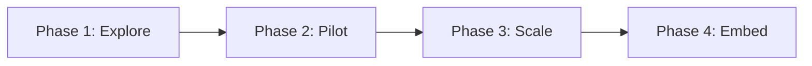

# Instructor Reference: Session 5.1 — Assessing Your Organisation's AI Maturity

Duration: 110 min teaching + 2 × 5-min breaks = 120 min
Domain: Conceptual with no-code hands-on | Tools: Google Sheets (free), a supplied maturity scorecard | Prior: Why AI Took Off | Next: Building the Business Case for AI | Visual load: Medium

**Goal:** Give learners a structured way to place an organisation on an AI maturity scale, diagnose readiness across data, process, skills, and governance, and recommend one action to close the weakest gap.

**Student profile:** Working professionals who understand how AI works and what it costs, and who are now asked to say where their own organisation stands and what to do next.

**Key outcome:** By the end, every learner can classify an organisation's AI activity into a maturity phase, apply a four-part readiness diagnostic with evidence, and recommend one action for the weakest dimension, justified by effort and effect.

| Block | Minutes |
|---|---|
| Segment 1 — Four maturity phases, and placing an organisation | 18 |
| Segment 2 — Why organisations stall | 18 |
| Break 1 | 5 |
| Segment 3 — Four readiness checks: data, process, skills, governance | 18 |
| Segment 4 — Warm-up: score a supplied case and pick one action | 18 |
| Break 2 | 5 |
| Segment 5 — Hands-on: score your own organisation | 18 |
| Segment 6 — Common Mistakes | 12 |
| Segment 7 — Session Recap | 8 |
| **Total** | **120** |

**Setup (before class):** Copy the scorecard in Segment 3 into a Google Sheet template and share it view-only so each learner makes their own copy. The two cases in Segment 4 are invented teaching cases written to resemble an online stock-broker and an HR-software company; they are not descriptions of any real firm, and learners should not treat any detail as fact about a real company. Remind learners to describe their own organisation without confidential figures or names of individuals.

---

## SEGMENT 1 — Four Maturity Phases, and Placing an Organisation `(18 min)`

> Instructor note: Sessions 1.1 to 4.2 built the understanding of AI. Name that; this session turns it on your organisation.

**Hook-in** `(30 sec)`

"For four weeks we looked at AI from the outside. Now the question becomes personal: where is your organisation, honestly, and what should it do next?"

**Concept** `(4 min)`

Analogy: A fitness journey. A beginner walks occasionally, an improver trains with a plan, an athlete trains for competitions, and a professional builds life around the sport. Each stage needs different habits, and pretending to be at a later stage than you are leads to injuries.

**An AI maturity scale describes how far an organisation has progressed, from first experiments to AI built into every process, and placing the organisation in the right phase tells you what to do next.**

Why it matters: Spending and plans that suit phase 4 will fail in a phase 1 organisation.

**Visual** `(visual only, no extra time)`



> **Say while pointing:** "Organisations move left to right, one phase at a time. Skipping a phase is how projects collapse."

**Implementation / Demonstration** `(8 min)`

Show the four phases and the evidence that places an organisation in each.

| Phase | Name | What it looks like | Typical evidence |
|---|---|---|---|
| 1 | Explore | Individuals experiment with chatbots; no team projects | Personal accounts; no owner; no budget |
| 2 | Pilot | A few teams run pilots on specific tasks | A named pilot, a small budget, results tracked loosely |
| 3 | Scale | Several AI uses run in production, with owners and reviews | Owners, monthly review, a standard route to approval |
| 4 | Embed | AI is part of most core processes, with measured value | Outcomes in business reports; AI in planning and budgets |

Then place four invented organisations. Learners vote after each.

| # | Description | Phase |
|---|---|---|
| 1 | A retail chain: some staff use free chatbots on their own; no team project exists | 1 Explore |
| 2 | An insurer: the claims team pilots reading claim forms in two branches, tracking time saved | 2 Pilot |
| 3 | A bank: six AI uses run in production with owners and monthly reviews, but not yet in the core lending process | 3 Scale |
| 4 | An online marketplace: AI in search, pricing, support, and logistics, each with measured outcomes in business reports | 4 Embed |

Expected:
```
Learners place the four as phases 1, 2, 3, and 4.
Where they disagree, the deciding question is "is it individual, team pilot, several owned uses, or embedded in core processes?"
```

Say: "Place an organisation by its weakest honest evidence, not by its best slide. One impressive pilot does not make phase 3; a single owned use in production with a review process starts to."

**Key point**

**Place an organisation in a phase using evidence: individual, pilot, scaled with owners, or embedded with measured value.**

**Room check** `(30 sec)`

> **Ask:** "A company has one successful pilot in one team and nothing else. Which phase?"
>
> **Answer:** Phase 2, Pilot.

**Student try** `(3 min)`

Write one or two sentences describing your organisation's AI activity, then place it in a phase.

Success: A description with at least one piece of evidence and a phase name.

---

## SEGMENT 2 — Why Organisations Stall `(18 min)`

**Hook-in** `(30 sec)`

"Most organisations reach phase 2 quickly. Far fewer reach phase 3. The pilot works, and then nothing happens. Why?"

**Concept** `(4 min)`

Analogy: A new restaurant dish that wins applause at the staff tasting but never reaches the menu, because nobody owns the recipe, the kitchen cannot make it in bulk, and the supplier is unreliable. The idea was good; the organisation was not ready to carry it.

**Organisations stall between pilot and scale because the pilot's success depends on conditions the wider organisation does not have, such as clean data, a named owner, agreed rules, trained people, and a budget for running it.**

Why it matters: Knowing the usual reasons lets you predict the stall and prevent it.

**Implementation / Demonstration** `(8 min)`

Present the five common reasons and match each to a symptom.

| Reason for stalling | Symptom you would hear |
|---|---|
| The data is not ready | "The pilot used a hand-cleaned spreadsheet; the real data is in three systems that do not match." |
| No owner | "Who runs this after the project team leaves?" |
| No rules or approvals | "Legal has not seen it, so we cannot go live." |
| Skills and trust are low | "Staff do not trust the output and ignore it." |
| No budget for running, only for building | "The pilot was funded; the monthly cost is nobody's." |

Then run a diagnosis game. Read each story and ask learners to name the reason.

1. "The assistant answers well in demos, but when we connected it to the live customer records, half the names did not match." (Data)
2. "The team that built the chatbot has moved on, and no one updates its answers." (No owner)
3. "We cannot publish it until compliance reviews how it uses customer information." (No rules or approvals)
4. "The support agents always rewrite the AI's replies from scratch." (Skills and trust)
5. "The finance team asks who pays the monthly fee after the free trial." (No running budget)

Expected:
```
The answers are: 1 data, 2 owner, 3 rules and approvals, 4 skills and trust, 5 running budget.
Stories often blend two reasons; accept a defended answer.
```

Say: "Each reason maps to one of the four readiness checks we apply in the next segment: data, process, skills, and governance. The maturity phase tells you where you are; the checks tell you why you are stuck there."

**Key point**

**Pilots stall because data, ownership, rules, skills, and running budget are not ready for scale.**

**Room check** `(30 sec)`

> **Ask:** "A pilot succeeded, but nobody owns it after the project team leaves. Which stall reason is this?"
>
> **Answer:** No owner.

**Student try** `(3 min)`

Recall an AI or technology pilot in your organisation that stalled, and name the likely reason from the list.

Success: One pilot named and one reason chosen with a one-line justification.

---

## Break 1 `(5 min)`

Re-entry hook: "After the break: a four-question diagnostic, with a scorecard you can fill in for any organisation."

---

## SEGMENT 3 — Four Readiness Checks: Data, Process, Skills, Governance `(18 min)`

**Hook-in** `(30 sec)`

"The phase tells you the stage. The four checks tell you the health of the foundations, and which one is weakest."

**Concept** `(4 min)`

Analogy: A pre-flight checklist. Before a plane takes off, the crew checks engines, fuel, instruments, and the weather. If one item fails, the plane does not fly, however good the others are. AI readiness is the same: four checks, and the weakest one limits the flight.

**The four readiness checks are data (is it there and usable), process (where AI fits into the work), skills (do people know how to use and oversee it), and governance (are there rules and accountability); the lowest-scoring dimension limits what the organisation can do.**

Why it matters: Money spent on the strongest area does little if the weakest one blocks progress.

**Implementation / Demonstration** `(8 min)`

Share the scorecard. Each dimension is scored from 1 to 4 using the descriptions, and every score needs evidence.

| Score | Data | Process | Skills | Governance |
|---|---|---|---|---|
| 1 | Scattered, nobody knows what exists | No AI use cases identified | No awareness | No rules |
| 2 | Exists but in separate systems that do not match | A few ad-hoc uses by individuals | A few enthusiasts | Informal advice only |
| 3 | Central, documented, mostly clean | AI in some mapped workflows with owners | Trained teams and a small core group | Written policy and an approval route |
| 4 | Trusted, with named owners and quality checks | AI embedded in core workflows with measured outcomes | Broad literacy plus specialists | Monitored, audited, with an accountable owner |

Scorecard sheet layout:

| Dimension | Score (1 to 4) | Evidence (one sentence) | Source of evidence |
|---|---|---|---|
| Data | | | |
| Process | | | |
| Skills | | | |
| Governance | | | |
| **Weakest dimension** | `=INDEX(A2:A5, MATCH(MIN(B2:B5), B2:B5, 0))` | | |

Expected:
```
The formula returns the name of the dimension with the lowest score (the first one if there is a tie).
Rule: no score is allowed without a one-sentence piece of evidence. "I think" is not evidence; "the customer list lives in three spreadsheets" is.
```

Say: "The weakest dimension is a bottleneck: with Data at 1 and the rest at 3, the organisation is a 1 where it counts. Averages hide this, so we use the minimum. And evidence keeps us honest: ask 'how do I know?' for every score."

**Key point**

**Score data, process, skills, and governance from 1 to 4 with evidence, and treat the lowest as the bottleneck.**

**Room check** `(30 sec)`

> **Ask:** "Data 3, process 4, skills 2, governance 3. Which dimension limits the organisation?"
>
> **Answer:** Skills, the lowest score at 2.

**Student try** `(3 min)`

Using the scorecard, write the score and evidence line for the "Data" dimension of an organisation you know.

Success: A score from 1 to 4 and a one-sentence piece of evidence that someone else could check.

---

## SEGMENT 4 — Warm-up: Score a Supplied Case and Pick One Action `(18 min)`

**Hook-in** `(30 sec)`

"Before scoring your own organisation, let us practise on a case where you cannot argue about the facts."

**Concept** `(4 min)`

Analogy: Practising a medical check-up on a model patient before seeing real ones. The facts are given, so the lesson is the method.

**Choosing one action means picking a step that lifts the weakest dimension, and comparing candidates by effort and by effect, so the best choice is high effect for low effort.**

Why it matters: A long wish list helps nobody; one well-chosen action can unblock the whole organisation.

**Implementation / Demonstration** `(8 min)`

Read the invented case aloud (it is not a real company).

> **Case: StockNest (invented).** StockNest is an online stock-broking firm with about 2 million client accounts. Client records are held in three systems that use different client IDs, so they cannot be joined without manual work. A chatbot answers common questions for about 20% of support chats, and the team is considering AI-written trade summaries. A four-person data team supports the whole firm. Staff are free to use public chatbots, and no written AI rule exists; a manager recently pasted a client's account details into one. Leadership calls the firm "AI-forward" but no budget line owns AI after launch.

Step 1: Place the phase.
Step 2: Score the four checks with evidence.
Step 3: Name the weakest dimension.
Step 4: Compare three candidate actions by effort and effect (1 low to 3 high) and compute a priority number: effect divided by effort.

Expected:
```
Phase: 2 Pilot (a chatbot answers 20% of chats, some experiments, but no owned, reviewed, scaled uses).
Scores and evidence:
  Data 2: records in three systems with different client IDs.
  Process 2: chatbot for part of support, other ideas not yet mapped to workflows.
  Skills 2: a four-person data team for the whole firm.
  Governance 1: no written AI rule, and a client's details were pasted into a public chatbot.
Weakest dimension: Governance (1).
```

| Candidate action | Targets | Effort (1 to 3) | Effect (1 to 3) | Priority = effect / effort |
|---|---|---|---|---|
| Write a one-page AI use rule (what may and may not be pasted) and name an owner | Governance | 1 | 3 | 3.0 |
| Build a single client ID across the three systems | Data | 3 | 3 | 1.0 |
| Train all support staff on safe AI use | Skills / Governance | 2 | 2 | 1.0 |

Expected:
```
Highest priority: the one-page AI use rule with a named owner (3.0), because it addresses the weakest dimension at low effort.
The data project has high effect but high effort, so it is next, not first.
```

Say: "Notice the order. We chose governance because it is the weakest and cheapest to fix, and it reduces real risk straight away, a client's details already left the building. The data project matters, but it is a longer investment. Justify with effort and effect, as we did, not with 'it feels important'."

**Key point**

**Fix the weakest dimension with the action that has the best effect for the least effort, and say why.**

**Room check** `(30 sec)`

> **Ask:** "Why choose the one-page AI use rule before the data project?"
>
> **Answer:** It targets the weakest dimension (governance 1) at low effort and quickly reduces risk.

**Student try** `(3 min)`

Imagine a second invented case, an HR-software firm with strong data (4), weak governance (2), and average skills (3). Choose its weakest dimension and one action.

Success: Governance is weakest, and the action is a policy-level step (such as an approval route), with a reason.

---

## Break 2 `(5 min)`

Re-entry hook: "After the break: your own organisation, scored honestly, with evidence."

---

## SEGMENT 5 — Hands-on: Score Your Own Organisation `(18 min)`

**Hook-in** `(30 sec)`

"You have the method and you have practised it. Now apply it where it matters."

**Concept** `(4 min)`

Analogy: A doctor examining a real patient after practising on a model. The method is the same, but now the facts must be gathered honestly, including the ones you would rather not see.

**An honest self-assessment cites evidence for each score, names the weakest dimension without softening it, and turns it into one action with a stated effort and effect.**

Why it matters: This scorecard becomes the starting point of your business case and your AI snapshot later in the course.

**Implementation / Demonstration** `(8 min)`

Use the scorecard from Segment 3 in your own copy. Work alone for 6 minutes, then pair up for 2 minutes to challenge each other's evidence.

Steps:

1. Write one or two sentences placing your organisation in a maturity phase, with evidence.
2. Score data, process, skills, and governance from 1 to 4, with one sentence of evidence each. Use only information you can share; leave out names and confidential figures.
3. Let the formula show the weakest dimension.
4. List three candidate actions for that dimension, with effort and effect, and compute priority = effect / effort.
5. Choose one action and write one sentence of justification.

Expected:
```
A completed scorecard: phase, four scored rows with evidence, the weakest dimension, three candidate actions with priority numbers, and one chosen action with a reason.
Typical findings: governance or data is weakest; the chosen action is often a short policy, an owner, or a data inventory.
Pairs challenge scores that lack evidence or look generous.
```

Say: "In your pair, ask 'how do you know?' about every score. If the answer is a feeling, lower the score or find the evidence. Remember the formula picks the minimum, so a generous score on the weakest dimension hides the problem. When you are done, write the sentence you would say to your manager: 'We are in phase X; our weakest area is Y because Z; I recommend doing A.'"

If a learner's organisation has no AI activity, they score 1 on process and governance, place themselves in phase 1, and the action is usually to identify one task, name an owner, and write a short safe-use rule.

**Key point**

**An honest scorecard has evidence for every score, a clear weakest dimension, and one justified action.**

**Room check** `(30 sec)`

> **Ask:** "A learner scored governance 3 with the evidence 'I think we have some policy'. What do you ask?"
>
> **Answer:** "Where is the policy written, and who approves AI use under it?" Without that evidence, the score should be lower.

**Student try** `(3 min)`

Write the manager sentence: "We are in phase ___; our weakest area is ___ because ___; I recommend ___."

Success: A complete sentence with phase, weakest dimension, evidence, and one action.

---

## SEGMENT 6 — Common Mistakes `(12 min)`

### Mistake 1: Scoring from the best slide, not the evidence

**Wrong:**
"We have a chatbot, so we are phase 4."

**Right:**
"We have one chatbot pilot, so we are phase 2 until more uses are owned and measured."

**Why it matters:** Over-claiming leads to plans the organisation cannot carry out.

### Mistake 2: Averaging the four scores

**Wrong:**
"Our average is 2.5, so we are fine."

**Right:**
"Our minimum is 1, in governance, and that is the bottleneck."

**Why it matters:** A strong score elsewhere does not compensate for a failing dimension.

### Mistake 3: Scores with no evidence

**Wrong:**
"Skills: 3, I think."

**Right:**
"Skills: 2, only three people have attended AI training."

**Why it matters:** Unverifiable scores cannot be defended or improved.

### Mistake 4: Choosing the most exciting action instead of the best

**Wrong:**
"Let us launch a big generative AI project."

**Right:**
"Fix the weakest dimension first, with the highest effect for the least effort."

**Why it matters:** Exciting projects built on weak foundations stall.

### Mistake 5: Treating readiness as a one-off

**Wrong:**
Scoring once and filing it away.

**Right:**
Rescoring every few months and noting changes.

**Why it matters:** Organisations change, and a stale score misleads.

**Live room check:**

> **Ask:** "Scores: data 4, process 3, skills 3, governance 1. A colleague says 'average 2.75, we are nearly ready'. What do you say?"
>
> **Answer:** Governance at 1 is the bottleneck; the average hides it, and the first action should target governance.

---

## SEGMENT 7 — Session Recap `(8 min)`

| Learning Outcome | What to Remember |
|---|---|
| Classify a described organisation's AI activity by its maturity phase | Explore (individual), Pilot (team trials), Scale (several owned uses), Embed (core processes with measured value). |
| Apply a four-part diagnostic covering data, process, skills and governance to a described organisation | Score each from 1 to 4 with evidence; the lowest score is the bottleneck. |
| Recommend one action to close an organisation's weakest AI readiness dimension, justifying by effort and effect | Compare candidate actions by effect divided by effort and pick the best for the weakest dimension. |

Quick fire (2 min, cold-call): "Name the four phases. Name the four checks. Why use the minimum, not the average? Why must every score have evidence?"

**Path forward:**
Building the Business Case for AI — You know where your organisation stands and what blocks it. Next, you turn an AI idea into numbers: the annual value of one use case, its break-even volume, and a funding ask you can defend.

---

## SECTION 11: Instructor Companion Appendix

### Instructor Notes

- The StockNest case is invented. Do not let learners assume it describes a real broker; if they want a case from a real firm, ask them to bring a sourced one.
- Learners may be reluctant to score their own organisation low. Reassure them that an honest low score is the useful kind, and that nothing is shared outside the class.
- The 1 to 4 scales and the effort and effect numbers are judgements, not measurements. The aim is a defended choice, not a precise number.

### Materials Checklist

- [ ] A Google Sheet scorecard template with the Segment 3 table and weakest-dimension formula
- [ ] The StockNest case text on a slide
- [ ] The four-phase table on a slide

### Timing Contingencies

- Running short: Place only two of the four organisations in Segment 1, and skip the diagnosis game's last three stories.
- Running ahead: Ask pairs to swap scorecards and each propose a different action for the other's weakest dimension.

### Answer Key

- S1 Student try: A description with evidence and a phase.
- S2 Student try: A named stalled pilot and one reason from the five.
- S3 Student try: A 1 to 4 score for data and a checkable sentence.
- S4 Student try: Governance is weakest; a policy-level step with a reason. StockNest: phase 2, governance 1, action a one-page AI use rule with an owner (priority 3.0).
- S5 Student try: "We are in phase X; our weakest area is Y because Z; I recommend A."

### Glossary

- **AI maturity:** How far an organisation has progressed in using AI.
- **Readiness check:** A scored review of data, process, skills, or governance.
- **Bottleneck:** The weakest dimension that limits progress.
- **Governance:** The rules, approvals, and accountability for AI use.
- **Effort and effect:** The cost to do an action and the benefit it brings.
- **Evidence:** A checkable fact supporting a score.
