# Assessing Your Organisation's AI Maturity

```mermaid
%%{init: {"flowchart": {"nodeSpacing": 45, "rankSpacing": 65, "diagramPadding": 20}} }%%
flowchart TB
  subgraph Foundation["Where You're Starting From"]
    P1(["Previous Session<br/><b>Why AI Took Off</b><br/><i>&#40;GPUs, Cloud&#41;</i><br/>You saw why data, computing power, and better designs made AI practical, and what it costs to train and run."])
  end
  CS{{Current Session<br/><b>Assessing Your Organisation's AI Maturity</b><br/><i>Place an organisation on an AI maturity scale and find the one gap that holds it back</i><br/>Maturity Phases &middot; Readiness Checks &middot; Weakest Gap &middot; One Action}}
  subgraph Value["Why This Matters"]
    CV(["Course Value<br/><b>Where Your Case Starts</b><br/>The scorecard you build here feeds the business case next session and the one-page AI snapshot at the end of the module."])
    RV(["Real-Life Value<br/><b>Stop Guessing Where You Stand</b><br/>A scored, evidence-backed view of readiness lets you tell leaders what to fix first instead of arguing from opinion."])
  end
  subgraph Future["Where This Leads Next"]
    F1(["Upcoming Session<br/><b>Building the Business Case for AI</b><br/><i>&#40;Value, Break-even&#41;</i><br/>Works out annual value and break-even for an AI use case."])
    F2(["Upcoming Session<br/><b>Lab: Write Your Organisation's AI Snapshot</b><br/><i>&#40;Memo, Scenarios&#41;</i><br/>Pulls your findings into a one-page snapshot with best, base, and worst cases."])
    F3(["Upcoming Module<br/><b>Module 2: Generative AI for the Enterprise</b><br/><i>&#40;Prompts, Documents&#41;</i><br/>Covers how large language models work and how to use them reliably at work."])
  end
  P1 ==>|&nbsp;Turn Inward&nbsp;| CS
  CS ==>|&nbsp;Course Path&nbsp;| CV
  CS ==>|&nbsp;Real-Life Use&nbsp;| RV
  CS ==>|&nbsp;Make the Case&nbsp;| F1
  F1 ==>|&nbsp;Write It Up&nbsp;| F2
  F2 ==>|&nbsp;Use GenAI&nbsp;| F3
  classDef previous fill:#eef4ff,stroke:#4f7ccf,color:#111827,stroke-width:2px;
  classDef current fill:#fff4d6,stroke:#d9a321,color:#111827,stroke-width:3px;
  classDef value fill:#eaf8ef,stroke:#3f9f63,color:#111827,stroke-width:2px;
  classDef future fill:#f4ecff,stroke:#8a61d1,color:#111827,stroke-width:2px;
  class P1 previous;
  class CS current;
  class CV,RV value;
  class F1,F2,F3 future;
  linkStyle default stroke-width:3px
```



---

## What You'll Learn

In this pre-read, you'll discover:

- A four-phase scale that tells you where an organisation honestly stands with AI
- The usual reasons AI pilots succeed and then go nowhere
- A four-part diagnostic, data, process, skills, and governance, and why the lowest score matters more than the average
- How to choose one action by comparing effort and effect, instead of chasing the most exciting project

---

## Detailed Explanation

### Four phases of AI maturity

Think of a fitness journey: a beginner walks occasionally, an improver follows a plan, an athlete trains for competitions, and a professional builds life around the sport. Each stage needs different habits, and pretending you are further along leads to injury. Organisations move through AI the same way.

```
Phase 1  Explore   individuals experiment with chatbots; no team projects
Phase 2  Pilot     a few teams run pilots on specific tasks
Phase 3  Scale     several AI uses run in production, with owners and reviews
Phase 4  Embed     AI is part of most core processes, with measured value
```

Four invented examples:

```
Retail chain, staff use free chatbots on their own                         Phase 1
Insurer, claims team pilots form-reading in two branches                   Phase 2
Bank, six owned AI uses in production, not yet in core lending             Phase 3
Marketplace, AI in search, pricing, support, logistics, with outcomes      Phase 4
```

Place an organisation by its weakest honest evidence, not its best slide. One impressive pilot does not make phase 3.

> **Key mental model:** The phase says where you are; it also says what to do next. Plans for phase 4 will fail in a phase 1 organisation.

---

### Why organisations stall

A new dish may win applause at a staff tasting and never reach the menu, because nobody owns the recipe, the kitchen cannot make it in bulk, and the supplier is unreliable. AI pilots stall for similar reasons: the pilot's success depended on conditions the rest of the organisation does not have.

```
Reason                    What you hear
Data not ready            "The pilot used a hand-cleaned file; real data sits in three systems."
No owner                  "Who runs this after the project team leaves?"
No rules or approvals     "Legal has not seen it."
Low skills and trust      "Staff rewrite every AI reply from scratch."
No running budget         "The pilot was funded; the monthly fee is nobody's."
```

These five reasons line up with the four readiness checks below, which is why the checks are a useful diagnostic.

> **Habit worth building:** When a pilot looks promising, ask early: where does the data live, who owns it afterwards, which rules apply, who will use it, and who pays each month?

---

### The four readiness checks

Before a plane takes off the crew checks engines, fuel, instruments, and weather, and one failed item grounds the flight. AI readiness has four checks:

```
Data         is it there, and usable?
Process      where does AI fit into the actual work?
Skills       do people know how to use and oversee it?
Governance   are there rules and accountability?
```

Each is scored from 1 to 4 with a sentence of evidence:

```
Score  Data                       Process                    Skills                 Governance
1      scattered, unknown         no use cases identified    no awareness           no rules
2      separate systems, no match a few ad-hoc uses          a few enthusiasts      informal advice only
3      central, documented        AI in mapped workflows     trained teams + core   written policy + approval route
4      trusted, owned, checked    embedded, measured         broad literacy + experts monitored, audited, owner
```

The lowest score is the **bottleneck**. Data 4, process 3, skills 3, and governance 1 averages 2.75 and sounds "nearly ready", yet governance at 1 limits everything. So look at the minimum. Every score needs evidence you could show someone: "the customer list lives in three spreadsheets" is evidence; "I think we are fine" is not.

> **Common misconception:** "A good average means we are ready." A single failing dimension can block the whole programme.

---

### Choosing one action

Once the weakest dimension is known, compare candidate actions by **effort** and **effect**, each from 1 (low) to 3 (high), and compute priority as effect divided by effort.

```
Action                                         Targets      Effort  Effect  Priority
Write a one-page AI use rule, name an owner    Governance   1       3       3.0
Build one client ID across three systems       Data         3       3       1.0
Train all support staff on safe AI use         Skills       2       2       1.0
```

The best first move is the one with high effect for low effort on the weakest dimension: here, the one-page rule and an owner. The bigger data project matters too, but it comes second. The scores are judgements, not measurements; the point is a choice you can defend aloud.

> **Rule of thumb:** Fix the weakest dimension first, with the cheapest action that makes a real difference.

---

### Bringing it together: your own scorecard

In the live session you will first score an invented case, an online stock-broker called StockNest, and then your own organisation.

```
1. Place the phase, with evidence
2. Score data, process, skills, governance (1 to 4), each with evidence
3. Find the weakest dimension (the minimum)
4. List three candidate actions, with effort, effect, and priority
5. Choose one, and write: "We are in phase X; our weakest area is Y because Z; I recommend A."
```

Describe your organisation without confidential figures or names of individuals.

> **Forward connection:** The weakest dimension and the action you pick become the starting point of next session's business case.

---

## Practice Exercises

**1. Pattern Recognition — Which phase?**

Place each description in a maturity phase:

- A. A few employees use a public chatbot to draft emails; nothing is organised
- B. Support runs a three-month pilot of a reply assistant and tracks handling time
- C. Five AI uses are in production, each with an owner and a monthly review
- D. AI features appear in every major process, and results show in business reports

---

**2. Spot The Error — The comforting average**

A report says: "Our readiness scores are data 4, process 4, skills 3, governance 1. The average is 3, so we are ready to scale." Explain what is wrong and what the report should say instead.

---

**3. Real-Life Application — Evidence for each score**

Pick one of the four dimensions for your organisation. Write the score, one sentence of evidence, and where someone could check that evidence. Then say what a score one point higher would require.

---

**4. Concept Detective — The pilot that vanished**

A document-reading pilot cut handling time by 40% in one branch, yet a year later it is not used anywhere. Using the five reasons organisations stall, give your two most likely causes and one question you would ask to confirm each.

---

**5. Planning Ahead — Choose one action**

Your weakest dimension is skills (score 2). List three possible actions, give each an effort and an effect from 1 to 3, compute its priority, and choose one with a one-sentence reason.
