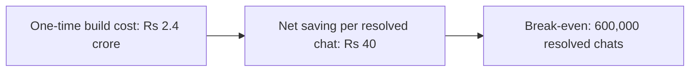

# Instructor Reference: Session 5.2 — Building the Business Case for AI

Duration: 110 min teaching + 2 × 5-min breaks = 120 min
Domain: Mixed (business arithmetic with no-code tools) | Tools: Google Sheets (free), ChatGPT (Free plan) | Prior: Assessing Your Organisation's AI Maturity | Next: Lab: Write Your Organisation's AI Snapshot | Visual load: Medium

**Goal:** Teach learners to link an AI use case to a business strategy goal, calculate its annual value and break-even volume, test it against its cost, anticipate role changes, and write a defensible funding ask.

**Student profile:** Working professionals who have placed their organisation on a maturity scale and now must persuade a finance or leadership audience to fund one AI use case.

**Key outcome:** By the end, every learner can describe how a use case supports a stated strategy goal, compute annual value and break-even volume from stated assumptions, justify a project against its build and running cost, name the talent and role changes it creates, and has drafted a funding ask from a worked sheet.

| Block | Minutes |
|---|---|
| Segment 1 — Use case and strategy: three cases | 18 |
| Segment 2 — Annual value of one use case | 18 |
| Break 1 | 5 |
| Segment 3 — Break-even volume, and the business case against cost | 18 |
| Segment 4 — Skill gaps, role changes, and the funding ask | 18 |
| Break 2 | 5 |
| Segment 5 — Hands-on: build the sheet and draft the funding ask | 18 |
| Segment 6 — Common Mistakes | 12 |
| Segment 7 — Session Recap | 8 |
| **Total** | **120** |

**Setup (before class):** Prepare a blank Google Sheet with the input cells in Segment 5. The supplied case, "TelcoCare", is invented: all figures are teaching numbers and describe no real company. Learners may use it or substitute a use case from their own function with their own assumptions; they must avoid confidential figures and instead use rounded or placeholder values. Tell learners that every number in a business case is an assumption until measured.

---

## SEGMENT 1 — Use Case and Strategy: Three Cases `(18 min)`

> Instructor note: 5.1 diagnosed readiness. Name the weakest-dimension action; today we build the case for a funded use case.

**Hook-in** `(30 sec)`

"A finance director never funds 'some AI'. They fund a specific use case that moves a goal they already care about. Our first task is to connect the two."

**Concept** `(4 min)`

Analogy: A shopping list for a dinner party. You do not buy random groceries, you decide the menu (the goal) and then buy exactly the ingredients (the use case) that make it. An AI use case is an ingredient that must serve a menu the business has already chosen.

**An AI use case supports a strategy goal when it changes one measurable driver of that goal, such as cost per support chat, fraud losses, or the time to process a document.**

Why it matters: A use case that cannot be traced to a goal and a measure will not get funded.

**Implementation / Demonstration** `(8 min)`

Work through three use cases. For each, fill in goal, driver, measure, and the reasoning.

| Use case | Strategy goal it could support | Driver it changes | How you would measure it |
|---|---|---|---|
| Support chatbot | Grow customers without growing support cost at the same rate | Share of chats resolved without an agent | Cost per chat; resolved-without-agent rate |
| Fraud detection | Protect margin and customer trust | Amount lost to fraud and false alarms | Rupees lost per month; false-alarm rate |
| Back-office document processing | Make operations faster and cheaper | Time to process an invoice or form | Minutes per document; error rate |

Expected:
```
Each row connects a use case to a goal through one measurable driver.
Learners can say, for each, "if the driver improves by X, the goal improves by Y".
A use case with no clear driver or measure is a warning sign.
```

Say: "Notice the structure: goal, then driver, then measure. We use the chatbot as our running example today, with the goal 'grow customers without growing support cost at the same rate', the driver 'share of chats resolved without an agent', and the measure 'cost per chat'. Remember the strategy test: if the owner of the goal would not recognise your measure, it is the wrong measure."

**Key point**

**Tie every use case to a goal through one driver and one measure the goal's owner recognises.**

**Room check** `(30 sec)`

> **Ask:** "A proposal says 'AI will transform our operations'. What is missing?"
>
> **Answer:** A specific goal, the driver the AI changes, and a measure.

**Student try** `(3 min)`

Write one use case from your function in the form: goal, driver, measure.

Success: Three linked statements, with a measure the goal's owner would accept.

---

## SEGMENT 2 — Annual Value of One Use Case `(18 min)`

**Hook-in** `(30 sec)`

"Value in a business case is not a feeling; it is arithmetic on stated assumptions. Let us do it for the chatbot."

**Concept** `(4 min)`

Analogy: Estimating the yearly revenue of a stall. You count customers per day, multiply by the average bill, and then by days open. Each number is an assumption you can check, and the answer is only as good as those assumptions.

**Annual value equals the number of uses per year, times the share that the AI handles successfully, times the net saving per successful use.**

Why it matters: Writing the value as a short formula makes every assumption visible and open to challenge.

**Implementation / Demonstration** `(8 min)`

Introduce the invented case.

> **TelcoCare (invented).** A telecom company's customer-care team handles about 500,000 chats a month. A chatbot could resolve some chats without an agent. An agent-handled chat costs about Rs 45 in staff time; running the chatbot costs about Rs 5 per chat it handles.

Assumptions, each written down:

| Assumption | Value |
|---|---|
| Chats per month | 500,000 |
| Chats per year | 500,000 × 12 = 6,000,000 |
| Share the chatbot resolves without an agent | 30% |
| Agent cost avoided per resolved chat | Rs 45 |
| Chatbot cost per resolved chat | Rs 5 |
| Net saving per resolved chat | 45 - 5 = Rs 40 |

Calculation:

```
Resolved chats per year = 6,000,000 × 0.30 = 1,800,000
Annual value = 1,800,000 × Rs 40 = Rs 72,000,000 = Rs 7.2 crore
```

Expected:
```
Resolved chats per year: 1,800,000.
Annual value: Rs 72,000,000 (Rs 7.2 crore).
```

Say: "Every number can be challenged: the 30% resolution rate is the shakiest. We will test it soon. Notice what we left out: the cost of building and maintaining the chatbot. Value is not profit. First we get the value, then we put the cost against it."

**Key point**

**Annual value is volume × success share × net saving per success, with every assumption written down.**

**Room check** `(30 sec)`

> **Ask:** "If the chatbot resolves 20% instead of 30%, what are the resolved chats a year?"
>
> **Answer:** 6,000,000 × 0.20 = 1,200,000.

**Student try** `(3 min)`

Compute the annual value if the share is 20% and the net saving per chat is Rs 40.

Success: 1,200,000 × 40 = Rs 48,000,000 (Rs 4.8 crore).

---

## Break 1 `(5 min)`

Re-entry hook: "After the break: how many uses before the project pays for itself, and whether the whole case survives its costs."

---

## SEGMENT 3 — Break-even Volume, and the Business Case Against Cost `(18 min)`

**Hook-in** `(30 sec)`

"A finance director asks two questions: how many uses before it pays back, and is it still worth it after all the costs?"

**Concept** `(4 min)`

Analogy: Buying a food truck. You pay a large amount once, then earn a small profit on each meal. The break-even point is the number of meals at which the profits have repaid the truck. After that, each meal is gain.

**Break-even volume is the one-time cost divided by the net saving per use, and a business case compares the annual value with the one-time build cost and the yearly running cost.**

Why it matters: Break-even tells you how soon the money comes back, and the full case tells you if the project is worth doing at all.

**Visual** `(visual only, no extra time)`



> **Say while pointing:** "Divide the up-front cost by the saving each use brings, and the answer is how many uses it takes to repay the build."

**Implementation / Demonstration** `(8 min)`

Add the costs of TelcoCare (invented):

| Cost | Amount |
|---|---|
| One-time build cost | Rs 2.4 crore (Rs 24,000,000) |
| Yearly running and upkeep (monitoring, fixed fees, updates) | Rs 0.6 crore (Rs 6,000,000) |

Calculate:

```
Break-even volume = 24,000,000 / 40 = 600,000 resolved chats
Resolved chats per month = 1,800,000 / 12 = 150,000
Time to reach break-even volume = 600,000 / 150,000 = 4 months

Year 1 net = value - running - build = 7.2 - 0.6 - 2.4 = Rs 4.2 crore
Year 2 net = 7.2 - 0.6 = Rs 6.6 crore
Year 1 return on spend = 4.2 / (2.4 + 0.6) = 1.4 = 140%
```

Expected:
```
Break-even volume: 600,000 resolved chats, reached in about 4 months of volume.
Year 1 net: Rs 4.2 crore. Year 2 net: Rs 6.6 crore. Year 1 return: 140%.
If the fixed yearly running cost is also counted against monthly savings, payback is about (24,000,000) / ((72,000,000 - 6,000,000) / 12) = 4.4 months.
```

Now test the assumption that worried us, the resolution rate:

| Share resolved | Annual value (Rs crore) | Year 1 net (Rs crore) |
|---|---|---|
| 10% | 2.4 | -0.6 |
| 12.5% | 3.0 | 0.0 |
| 15% | 3.6 | 0.6 |
| 20% | 4.8 | 1.8 |
| 30% | 7.2 | 4.2 |

Expected:
```
Year 1 break-even resolution rate: (2.4 + 0.6) / (6,000,000 × 40 / 10,000,000) = 3.0 / 24 = 12.5% of chats.
Below 12.5% the first year loses money; above it the project is positive.
```

Say: "This is called sensitivity: how the answer moves when an assumption moves. The case survives a resolution rate as low as 12.5% in year 1, which is far below the 30% assumption. That is a much stronger argument than one headline number. If the rate were only 10%, we would lose Rs 0.6 crore in year 1 and should say so."

**Key point**

**Break-even is one-time cost divided by net saving per use, and a sensitivity check shows how safe the case is.**

**Room check** `(30 sec)`

> **Ask:** "A tool costs Rs 12,00,000 once and saves Rs 30 per use. What is the break-even volume?"
>
> **Answer:** 1,200,000 / 30 = 40,000 uses.

**Student try** `(3 min)`

Compute the year 1 net at a 15% resolution rate, using the TelcoCare costs.

Success: 6,000,000 × 0.15 = 900,000 chats × 40 = Rs 3.6 crore; minus 0.6 and 2.4 gives Rs 0.6 crore.

---

## SEGMENT 4 — Skill Gaps, Role Changes, and the Funding Ask `(18 min)`

**Hook-in** `(30 sec)`

"The sheet shows the money. But a project that changes how 300 people work also changes their jobs. A good business case says so."

**Concept** `(4 min)`

Analogy: Introducing automatic teller machines in banks. Tellers did not vanish; many moved to advising customers, and the bank needed new people to maintain the machines. A good plan covers both.

**An AI initiative creates talent and role changes: some tasks shrink, some roles shift to supervising or handling harder cases, and new roles appear, such as AI quality reviewer or conversation designer.**

Why it matters: Ignoring people is a common cause of stalled projects, and naming role changes shows leadership you have thought it through.

**Implementation / Demonstration** `(8 min)`

For the TelcoCare chatbot, work through the people side.

| Group | What changes | What they need |
|---|---|---|
| Support agents | Fewer routine chats; more complex, upset, or high-value cases | Training in complex handling and in checking the chatbot's work |
| Team leads | Manage a mix of AI and human handling; monitor quality | Dashboards and review routines |
| New roles | AI quality reviewer; conversation designer; AI product owner | Hiring or retraining |
| Data and legal | Handle customer data rules and records | Clear policy and approvals |

Then present the funding-ask structure and match each part to the TelcoCare numbers.

| Part of the ask | TelcoCare content |
|---|---|
| The decision requested | Approve Rs 2.4 crore build plus Rs 0.6 crore a year |
| The goal | Grow customers without growing support cost at the same rate |
| The value | Rs 7.2 crore a year at a 30% resolution rate |
| The cost | Rs 2.4 crore once, Rs 0.6 crore a year |
| The payback | About 4 months of volume; year 1 net Rs 4.2 crore |
| The risk and the test | Break-even needs only 12.5% resolution; pilot first |
| The people plan | Retrain agents for complex cases; two new quality roles |

Expected:
```
Learners can state each part of the ask in one line and trace each number to the sheet.
They notice the ask names a decision, not just a topic.
```

Say: "A strong ask fits on one page, leads with the decision, and shows the shakiest assumption with its break-even. Do not claim jobs will not change; say how they change and who supports it. And never hide the cost of running it."

**Key point**

**A funding ask names the decision, the goal, the value, the cost, the payback, the risk, and the people plan.**

**Room check** `(30 sec)`

> **Ask:** "Name two role changes the chatbot creates for the support function."
>
> **Answer:** Agents shift to complex cases; new roles such as AI quality reviewer or conversation designer appear.

**Student try** `(3 min)`

Write the role changes (one shrinking, one shifting, one new) for an AI use case in your own function.

Success: Three named role changes, each with a short description.

---

## Break 2 `(5 min)`

Re-entry hook: "After the break: you build the sheet yourself and draft the ask with an AI assistant, checking every number it gives back."

---

## SEGMENT 5 — Hands-on: Build the Sheet and Draft the Funding Ask `(18 min)`

**Hook-in** `(30 sec)`

"Time to build. You will build the TelcoCare sheet, then ask an AI assistant to draft the funding ask, and check every number it uses."

**Concept** `(4 min)`

Analogy: A junior colleague drafts your report from your spreadsheet. They write well, but they might mis-copy a figure. You supply the numbers, then check the draft line by line against the sheet.

**An AI assistant can draft a funding ask quickly when you give it your sheet's numbers, but every figure in the draft must be checked against the sheet, because assistants can alter or invent numbers.**

Why it matters: It saves writing time while keeping the numbers under your control.

**Implementation / Demonstration** `(8 min)`

Step 1 (4 minutes): build the sheet. Use your own use case, or TelcoCare.

| Cell | Label | Value or formula |
|---|---|---|
| B1 | Chats per month | 500000 |
| B2 | Chats per year | `=B1*12` |
| B3 | Share resolved | 0.3 |
| B4 | Agent cost avoided (Rs) | 45 |
| B5 | Chatbot cost per chat (Rs) | 5 |
| B6 | Net saving per resolved chat (Rs) | `=B4-B5` |
| B7 | Resolved chats per year | `=B2*B3` |
| B8 | Annual value (Rs) | `=B7*B6` |
| B9 | One-time build cost (Rs) | 24000000 |
| B10 | Yearly running cost (Rs) | 6000000 |
| B11 | Break-even volume (resolved chats) | `=B9/B6` |
| B12 | Year 1 net (Rs) | `=B8-B10-B9` |
| B13 | Year 2 net (Rs) | `=B8-B10` |

Expected:
```
B2 = 6,000,000; B6 = 40; B7 = 1,800,000; B8 = 72,000,000; B11 = 600,000; B12 = 42,000,000; B13 = 66,000,000.
(Year 1 net is Rs 4.2 crore and year 2 net is Rs 6.6 crore.)
```

Step 2 (1 minute): add a sensitivity check. In a cell, compute year 1 net at 12.5% resolution: `=B2*0.125*B6-B10-B9`. It should be 0.

Step 3 (3 minutes): open ChatGPT, and send this prompt, pasting your sheet values:

```
Draft a one-page funding request for a customer-care chatbot, written for a finance director. Use ONLY these numbers and do not add any others: chats per year 6,000,000; share resolved without an agent 30%; net saving per resolved chat Rs 40; annual value Rs 7.2 crore; one-time build cost Rs 2.4 crore; yearly running cost Rs 0.6 crore; break-even volume 600,000 resolved chats (about 4 months); year 1 net Rs 4.2 crore; year 1 break-even resolution rate 12.5%. Include: the decision requested, the goal, value, cost, payback, the main risk, and a people plan. Keep it under 250 words.
```

Then check every number in the draft against your sheet and mark any that are changed, missing, or invented.

Expected:
```
A one-page draft with the seven parts. Typical problems to catch: a changed figure (for example 7.2 written as 72 crore), an invented statistic (such as an industry benchmark), a promise of "no job losses", or a missing running cost.
Each figure in the draft must match a cell in your sheet.
```

Say: "Check numbers one by one. If you find an invented benchmark, delete it, or find a source. Look also at the claims about people: the draft must not promise what the business cannot guarantee. Your final job is to read it as the finance director would and ask 'which assumption would I challenge?'. Then add that sensitivity line yourself."

**Key point**

**Let an assistant draft the ask from your sheet, then verify every number and remove anything invented.**

**Room check** `(30 sec)`

> **Ask:** "The assistant's draft says the chatbot will 'save industry-standard 40% of support costs', which is not in your sheet. What do you do?"
>
> **Answer:** Remove it or replace it with a sourced figure: only numbers from your sheet or a cited source belong in the ask.

**Student try** `(3 min)`

Mark every number in the draft as matching, changed, or invented, and correct them.

Success: A checked draft with zero invented numbers and all figures matching the sheet.

---

## SEGMENT 6 — Common Mistakes `(12 min)`

### Mistake 1: Presenting value as profit

**Wrong:**
"The chatbot makes Rs 7.2 crore a year."

**Right:**
"It creates Rs 7.2 crore of value; after Rs 0.6 crore running cost and Rs 2.4 crore build, year 1 net is Rs 4.2 crore."

**Why it matters:** Ignoring cost makes the case look better than it is, and finance will notice.

### Mistake 2: One headline number with no sensitivity

**Wrong:**
"At 30% resolution it pays back in four months."

**Right:**
"Even at 12.5% resolution, year 1 breaks even."

**Why it matters:** A single number is fragile; a range shows how safe the case is.

### Mistake 3: Forgetting the running cost

**Wrong:**
Counting only the build cost.

**Right:**
Including yearly upkeep, fees, monitoring, and updates.

**Why it matters:** Running costs recur every year and often exceed expectations.

### Mistake 4: Leaving out the people side

**Wrong:**
"Nobody's job will change."

**Right:**
"Agents move to complex cases; we add two quality roles and train the team."

**Why it matters:** Unaddressed role changes cause resistance and stalled projects.

### Mistake 5: Trusting AI-drafted numbers

**Wrong:**
Pasting the assistant's draft into the request unchecked.

**Right:**
Verifying each figure against the sheet.

**Why it matters:** An altered or invented number can sink your credibility with finance.

**Live room check:**

> **Ask:** "Your break-even volume is 600,000 resolved chats, and you resolve 150,000 a month. How long to break even?"
>
> **Answer:** 600,000 / 150,000 = 4 months.

---

## SEGMENT 7 — Session Recap `(8 min)`

| Learning Outcome | What to Remember |
|---|---|
| Describe how an AI use case supports one stated business strategy goal | Link goal, driver, and measure, such as support cost per chat. |
| Compute the annual value of a proposed solution from stated assumptions | Uses per year × share handled × net saving per use. |
| Compute the break-even volume at which per-use savings or costs match a one-time cost | One-time cost divided by net saving per use. |
| Justify a project's business case against the cost of building and running it | Year 1 net = value - running - build; test with a sensitivity check. |
| Identify the talent and role changes an AI initiative creates in a function | Routine tasks shrink, roles shift toward complex cases and oversight, and new quality and design roles appear. |

Quick fire (2 min, cold-call): "What is the annual value formula? What is break-even volume? What is year 1 net? Why run a sensitivity check?"

**Path forward:**
Lab: Write Your Organisation's AI Snapshot — You can now score your readiness and price an idea. In the lab, you pull both into a one-page snapshot: your phase, the type of AI company you are, a metric tree, and a best, base, and worst case.

---

## SECTION 11: Instructor Companion Appendix

### Instructor Notes

- TelcoCare is invented. Say so every time a number appears, and encourage learners with their own use case to use placeholders for confidential figures.
- The 30% resolution rate is deliberately the shaky assumption; keep returning to it.
- Learners often confuse break-even volume with payback time. The first is a count of uses, the second a duration; connect them through monthly volume.

### Materials Checklist

- [ ] Google Sheet template with the Segment 5 labels
- [ ] ChatGPT free account
- [ ] The Segment 5 prompt as shared text
- [ ] The TelcoCare facts and cost table on a slide

### Timing Contingencies

- Running short: Skip the sensitivity table beyond the 12.5% check, and the role-change table.
- Running ahead: Ask learners to compute year 3 cumulative net and plot cumulative cash over three years.

### Answer Key

- S1 Student try: Goal, driver, measure for a real use case.
- S2 Student try: 6,000,000 × 0.20 = 1,200,000; × 40 = Rs 4.8 crore.
- S3 Student try: 900,000 × 40 = Rs 3.6 crore; year 1 net 3.6 - 0.6 - 2.4 = Rs 0.6 crore.
- S4 Student try: Three role changes (shrinking, shifting, new).
- S5 Student try: A draft with every figure matching the sheet and no invented numbers.
- Sheet checks: B2 6,000,000; B6 40; B7 1,800,000; B8 72,000,000; B11 600,000; B12 42,000,000; B13 66,000,000.

### Glossary

- **Use case:** A specific task where AI is applied.
- **Driver:** A measurable factor that moves a business goal.
- **Annual value:** Yearly benefit before costs.
- **Break-even volume:** The number of uses at which savings repay a one-time cost.
- **Sensitivity check:** Testing how the result changes when an assumption changes.
- **Funding ask:** A request for approval to spend money on a project.
