# Building the Business Case for AI

```mermaid
%%{init: {"flowchart": {"nodeSpacing": 45, "rankSpacing": 65, "diagramPadding": 20}} }%%
flowchart TB
  subgraph Foundation["Where You're Starting From"]
    P1(["Previous Session<br/><b>Assessing Your Organisation's AI Maturity</b><br/><i>&#40;Maturity, Readiness&#41;</i><br/>You placed an organisation on a maturity scale and found its weakest readiness gap."])
  end
  CS{{Current Session<br/><b>Building the Business Case for AI</b><br/><i>Turn an AI idea into annual value, break-even volume, and a funding ask a finance director can test</i><br/>Strategy Fit &middot; Annual Value &middot; Break-even &middot; Funding Ask}}
  subgraph Value["Why This Matters"]
    CV(["Course Value<br/><b>The Skill Behind Every Project</b><br/>The vendor, ROI, and defend-your-case sessions later in the course all reuse this value, cost, and break-even arithmetic."])
    RV(["Real-Life Value<br/><b>Get Ideas Funded</b><br/>Finance teams fund numbers they can challenge, so a clear sheet with stated assumptions beats enthusiasm every time."])
  end
  subgraph Future["Where This Leads Next"]
    F1(["Upcoming Session<br/><b>Lab: Write Your Organisation's AI Snapshot</b><br/><i>&#40;Memo, Scenarios&#41;</i><br/>Pulls your findings into a one-page snapshot with best, base, and worst cases."])
    F2(["Upcoming Session<br/><b>How LLMs Work and Go Wrong</b><br/><i>&#40;Hallucination, Limits&#41;</i><br/>Opens the generative AI module by showing where language models fail."])
    F3(["Upcoming Module<br/><b>Module 3: Agentic AI for the Enterprise</b><br/><i>&#40;Agents, Workflows&#41;</i><br/>Covers AI systems that plan and act with tools under human approval."])
  end
  P1 ==>|&nbsp;Price the Idea&nbsp;| CS
  CS ==>|&nbsp;Course Path&nbsp;| CV
  CS ==>|&nbsp;Real-Life Use&nbsp;| RV
  CS ==>|&nbsp;Write It Up&nbsp;| F1
  F1 ==>|&nbsp;Use GenAI&nbsp;| F2
  F2 ==>|&nbsp;Let AI Act&nbsp;| F3
  classDef previous fill:#eef4ff,stroke:#4f7ccf,color:#111827,stroke-width:2px;
  classDef current fill:#fff4d6,stroke:#d9a321,color:#111827,stroke-width:3px;
  classDef value fill:#eaf8ef,stroke:#3f9f63,color:#111827,stroke-width:2px;
  classDef future fill:#f4ecff,stroke:#8a61d1,color:#111827,stroke-width:2px;
  class P1 previous;
  class CS current;
  class CV,RV value;
  class F1,F2,F3 future;
  linkStyle default stroke-width:3px
```



---

## What You'll Learn

In this pre-read, you'll discover:

- How to connect an AI idea to a business goal through one driver and one measure
- A three-factor formula for the yearly value of a use case, with every assumption visible
- What break-even volume means and how to calculate it from a one-time cost
- Why a single headline number is fragile, and how a simple sensitivity check makes a case safer
- What belongs in a funding ask, including the people side that is often forgotten

---

## Detailed Explanation

### From use case to goal, through a driver

A finance director never funds "some AI". They fund a specific use case that moves a goal they already care about. The link has three parts:

```
Use case                  Goal                               Driver                         Measure
Support chatbot           grow customers without growing     share of chats resolved        cost per chat
                          support cost at the same rate      without an agent
Fraud detection           protect margin and trust           money lost, false alarms       rupees lost a month
Document processing       make operations faster, cheaper    time to process a document     minutes per document
```

If the owner of the goal would not recognise your measure, it is the wrong measure.

> **Key mental model:** Goal, then driver, then measure. A proposal missing any of the three is a slogan.

---

### Annual value: a short formula

Estimating a stall's yearly revenue means counting customers, multiplying by the average bill, and by days open. Each number is an assumption you can check. Annual value works the same way:

```
Annual value = uses per year × share handled successfully × net saving per success
```

Take an invented case, "TelcoCare", a telecom's customer-care team:

```
Chats per month                          500,000
Chats per year                           500,000 × 12 = 6,000,000
Share the chatbot resolves alone         30%
Agent cost avoided per resolved chat     Rs 45
Chatbot cost per resolved chat           Rs 5
Net saving per resolved chat             45 - 5 = Rs 40

Resolved chats a year   = 6,000,000 × 0.30 = 1,800,000
Annual value            = 1,800,000 × 40   = Rs 72,000,000 = Rs 7.2 crore
```

All figures are invented teaching numbers. The 30% rate is the shakiest assumption, so keep an eye on it. Notice that value is not profit: costs have not been counted yet.

> **Common misconception:** "Value is the same as profit." Value is the benefit before the cost of building and running the solution.

---

### Break-even volume and the business case against cost

Buying a food truck means a large one-time payment, then a small profit on each meal. **Break-even volume** is the number of meals at which the profits have repaid the truck.

```
Break-even volume = one-time cost / net saving per use
                  = Rs 24,000,000 / Rs 40 = 600,000 resolved chats
Resolved chats a month = 1,800,000 / 12 = 150,000
Time to break even     = 600,000 / 150,000 = 4 months
```

Now put the full costs against the value. The build costs Rs 2.4 crore once and upkeep costs Rs 0.6 crore a year:

```
Year 1 net = 7.2 - 0.6 - 2.4 = Rs 4.2 crore
Year 2 net = 7.2 - 0.6       = Rs 6.6 crore
Year 1 return on spend = 4.2 / (2.4 + 0.6) = 140%
```

Then test the shaky assumption. How low can the resolution rate fall before year 1 loses money?

```
Share resolved   Annual value   Year 1 net
10%              Rs 2.4 crore   -Rs 0.6 crore
12.5%            Rs 3.0 crore    Rs 0.0 crore    <- year 1 break-even rate
15%              Rs 3.6 crore    Rs 0.6 crore
30%              Rs 7.2 crore    Rs 4.2 crore
```

This is a **sensitivity check**. The case survives a resolution rate far below the 30% assumed, which is a much stronger argument than one headline figure.

> **Rule of thumb:** Show the headline number, the cost, and the point at which the case fails. Finance will respect all three.

---

### People: skills and role changes

When automatic teller machines arrived, tellers did not vanish; many moved to advising customers, and banks needed new people to run the machines. An AI initiative has the same shape:

```
Support agents   fewer routine chats; more complex or upset cases     need training in complex handling and in checking the AI
Team leads       manage a mix of AI and human handling                need dashboards and review routines
New roles        AI quality reviewer, conversation designer, product owner
Data and legal   handle customer-data rules                           need policy and approvals
```

A funding ask that says "nobody's job changes" is not credible. Say how roles change and who supports the change.

> **Habit worth building:** For every AI use case, write three role lines: what shrinks, what shifts, and what is new.

---

### Writing the funding ask

A strong ask fits on one page and leads with the decision.

```
The decision requested   approve Rs 2.4 crore build plus Rs 0.6 crore a year
The goal                 grow customers without growing support cost at the same rate
The value                Rs 7.2 crore a year at a 30% resolution rate
The cost                 Rs 2.4 crore once, Rs 0.6 crore a year
The payback              about 4 months of volume; year 1 net Rs 4.2 crore
The risk and the test    break-even needs only 12.5% resolution; pilot first
The people plan          retrain agents for complex cases; two new quality roles
```

In the live session you will build the sheet, ask an AI assistant to draft the ask from your numbers, and check every figure it uses. Assistants can alter or invent numbers, so nothing goes in the final ask that is not in your sheet or backed by a source.

> **Forward connection:** Next session you pull your readiness scorecard and this kind of case into a one-page snapshot with best, base, and worst scenarios.

---

## Practice Exercises

**1. Pattern Recognition — Goal, driver, measure**

For each use case, name a plausible driver and measure: (a) a chatbot for HR queries, (b) a model that flags late invoices, (c) an AI tool that drafts sales proposals.

---

**2. Spot The Error — Profit or value?**

A slide says: "Annual value Rs 5 crore, so the project earns Rs 5 crore a year." The build cost is Rs 3 crore and running cost is Rs 1 crore a year. What is wrong, and what is the year 1 and year 2 net?

---

**3. Real-Life Application — Break-even**

A document tool costs Rs 12,00,000 to set up and saves Rs 30 per document processed. How many documents until it breaks even? If the team processes 8,000 a month, how many months is that?

---

**4. Concept Detective — The fragile headline**

A colleague presents a business case with one number: payback in four months at a 30% resolution rate. A director asks "what if it is 10%?". Explain why the question is fair and how you would prepare for it.

---

**5. Planning Ahead — Draft the people plan**

For an AI use case in your function, write three role lines (what shrinks, what shifts, what is new), and one training action that supports the biggest change.
