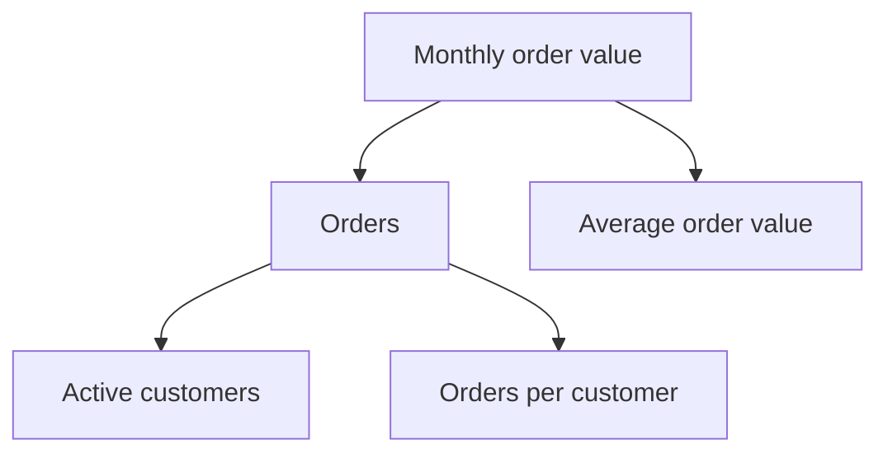

# Instructor Reference: Session 6.1 — Lab: Write Your Organisation's AI Snapshot

Duration: 110 min teaching + 2 × 5-min breaks = 120 min
Domain: Lab (business analysis and writing) | Tools: Google Sheets (free), Google Docs (free) | Prior: Building the Business Case for AI | Next: How LLMs Work and Go Wrong (Module 2) | Visual load: Medium

**Goal:** Guide learners to write a one-page AI snapshot of their organisation that names its phase and company type, shows on a metric tree where a funded opportunity moves revenue or cost, compares best, base, and worst cases, and ends with a clear recommendation.

**Student profile:** Working professionals who have scored their organisation's readiness and built a business case for one use case, and now must combine it into a short document for a decision-maker.

**Key outcome:** By the end, every learner has a one-page memo in context, insight, and recommendation form, containing a maturity phase, a company-type classification, a metric tree, a best, base, and worst scenario table, and a recommendation naming the action, the owner, and the expected effect.

| Block | Minutes |
|---|---|
| Segment 1 — Three kinds of AI company | 18 |
| Segment 2 — The metric tree: from a headline number to its drivers | 18 |
| Break 1 | 5 |
| Segment 3 — Best, base, and worst cases | 18 |
| Segment 4 — The memo: context, insight, recommendation, and a worked example | 18 |
| Break 2 | 5 |
| Segment 5 — Lab: write your organisation's one-page snapshot | 18 |
| Segment 6 — Common Mistakes | 12 |
| Segment 7 — Session Recap | 8 |
| **Total** | **120** |

**Setup (before class):** Share a Google Doc template with three headings (Context, Insight, Recommendation) and a Google Sheet with the scenario table from Segment 3. The worked example uses an invented company, "FoodNest", whose figures are teaching numbers. Learners describe their own organisation using rounded numbers or placeholders and no confidential data or individuals' names. The 120-minute session gives time for a first draft; ask learners to finish and polish the memo as a short take-home task.

---

## SEGMENT 1 — Three Kinds of AI Company `(18 min)`

> Instructor note: 5.1 placed an organisation on a maturity phase and 5.2 built a use-case case. Name them; today we classify the company and combine everything.

**Hook-in** `(30 sec)`

"Two companies can both say 'we use AI' and mean completely different things. Before you write about your organisation, you need to say which kind it is."

**Concept** `(4 min)`

Analogy: Three kinds of restaurants. One is a traditional restaurant that adds an online ordering app. One was built from day one as a cloud kitchen, with no dining room. One makes its own kitchen equipment and sells it to others. All three involve technology, but technology plays a very different role.

**An AI-enabled company adds AI to existing products and operations, an AI-native company is built around AI from the start so the product would not exist without it, and a frontier company builds new AI models.**

Why it matters: The type decides how much of the business depends on AI, which risks matter most, and what a realistic AI plan looks like.

**Implementation / Demonstration** `(8 min)`

Show the three types, then classify examples.

| Type | Role of AI | Without AI | Examples as used in this course |
|---|---|---|---|
| AI-enabled | Improves an existing business | The business still works, but less efficiently | A food-delivery platform such as Zomato |
| AI-native | The product is the AI | The product would not exist | An AI answer engine such as Perplexity |
| Frontier | Builds new foundation models | The company is its models | Organisations that train large general-purpose models |

Classify these invented companies:

| # | Description | Type |
|---|---|---|
| 1 | A regional bank adds an AI assistant for loan queries; it remains a bank | AI-enabled |
| 2 | A start-up whose only product is an AI tool that writes legal contracts from a conversation | AI-native |
| 3 | A research lab that trains a large language model and sells access | Frontier |
| 4 | A logistics firm using AI to plan routes | AI-enabled |

Expected:
```
1 AI-enabled, 2 AI-native, 3 Frontier, 4 AI-enabled.
The test: could the company still operate if the AI were switched off? Enabled: yes, less well. Native: no. Frontier: the AI is the company.
```

Say: "Most organisations in this class are AI-enabled, and that is perfectly fine. The mistake is to describe an AI-enabled company in AI-native language. Be precise. Check the course's own examples against current information before quoting them, as companies evolve."

**Key point**

**AI-enabled adds AI to an existing business, AI-native is built around AI, and frontier builds the models.**

**Room check** `(30 sec)`

> **Ask:** "If the AI is switched off, the bank still operates but slower. Which type?"
>
> **Answer:** AI-enabled.

**Student try** `(3 min)`

Classify your own organisation as AI-enabled, AI-native, or frontier, and give your reason in one sentence.

Success: A type, with a reason based on whether the business could run without AI.

---

## SEGMENT 2 — The Metric Tree: From a Headline Number to Its Drivers `(18 min)`

**Hook-in** `(30 sec)`

"Leaders talk about one big number: revenue, cost, margin. To show where AI moves that number, you break it into pieces until you reach something a team can change."

**Concept** `(4 min)`

Analogy: A family tree for a number. The top is the headline figure, each branch splits it into the parts that multiply or add up to it, and the leaves are the things people can actually act on.

**A metric tree decomposes a top-line KPI (key performance indicator) into its drivers by splitting it into multiplied or added parts, until the leaves are measures a team can influence.**

Why it matters: It shows precisely where an AI use case acts on the business, and stops claims like "AI will improve revenue" that point nowhere.

**Visual** `(visual only, no extra time)`



> **Say while pointing:** "The top number splits into orders times order value, and orders split again into customers times orders per customer. An AI recommender acts on the leaf called orders per customer."

**Implementation / Demonstration** `(8 min)`

Build the tree for an invented company, FoodNest (an AI-enabled food-delivery platform, invented figures).

| Node | Value |
|---|---|
| Active customers | 400,000 |
| Orders per customer per month | 5 |
| Orders per month | 400,000 × 5 = 2,000,000 |
| Average order value | Rs 400 |
| Monthly order value | 2,000,000 × 400 = Rs 800,000,000 = Rs 80 crore |

Now mark where AI acts: an AI recommendation feature raises orders per customer.

Expected:
```
Orders per month: 2,000,000. Monthly order value: Rs 80 crore.
The AI recommender acts on the leaf "orders per customer": raising it from 5.0 to 5.1 gives 2.04 million orders, 40,000 more.
40,000 extra orders × Rs 400 = Rs 16,000,000 = Rs 1.6 crore of extra monthly order value.
```

Say: "Do the multiplication aloud so the room sees the chain. Notice that the extra order value is not the company's profit: the platform keeps only a share of each order. We will use a contribution margin in the next segment. And notice how specific the claim is now: not 'AI improves revenue' but 'a recommender lifts orders per customer by 2%'."

**Key point**

**Break the headline KPI into drivers until you find the leaf where the AI use case acts.**

**Room check** `(30 sec)`

> **Ask:** "Orders rise from 2,000,000 to 2,040,000 at Rs 400 each. What is the extra monthly order value?"
>
> **Answer:** 40,000 × 400 = Rs 16,000,000, which is Rs 1.6 crore.

**Student try** `(3 min)`

Draw a metric tree for a KPI in your own function (two levels is enough) and mark the leaf your AI use case acts on.

Success: A tree with a top KPI, at least two drivers, and a marked leaf.

---

## Break 1 `(5 min)`

Re-entry hook: "After the break: one number is never enough. We show a range, a best, base, and worst case."

---

## SEGMENT 3 — Best, Base, and Worst Cases `(18 min)`

**Hook-in** `(30 sec)`

"A single forecast pretends to know the future. A decision-maker prefers to see how good it could be, how likely it is, and how bad it could get."

**Concept** `(4 min)`

Analogy: A weather forecast with a range. Saying "rain tomorrow, between 5 and 40 mm, most likely 15" is more useful than "20 mm", because you can decide whether to carry an umbrella and whether to cancel the picnic.

**A scenario comparison shows the outcome under best, base, and worst assumptions, changing the key assumptions one set at a time, so the reader sees both the upside and the risk.**

Why it matters: Leaders decide on risk as well as reward, and honest ranges build trust.

**Implementation / Demonstration** `(8 min)`

Continue the FoodNest case. The AI recommender's effect on orders per customer is uncertain. The platform keeps a contribution margin of 20% on extra order value, and the feature costs Rs 0.1 crore a month to run. All figures are invented.

| Assumption | Worst | Base | Best |
|---|---|---|---|
| Lift in orders | 0.5% | 2% | 4% |
| Extra orders per month | 2,000,000 × 0.005 = 10,000 | 40,000 | 80,000 |
| Extra order value (Rs crore a month) | 10,000 × 400 = 0.4 | 1.6 | 3.2 |
| Contribution at 20% (Rs crore) | 0.08 | 0.32 | 0.64 |
| Running cost (Rs crore) | 0.1 | 0.1 | 0.1 |
| Net per month (Rs crore) | -0.02 | 0.22 | 0.54 |
| Net per year (Rs crore) | -0.24 | 2.64 | 6.48 |

Expected:
```
Worst: net -0.02 crore a month (-0.24 a year).
Base: net 0.22 crore a month (2.64 a year).
Best: net 0.54 crore a month (6.48 a year).
```

Worked check for the base column: 40,000 × 400 = 16,000,000 (1.6 crore); × 0.20 = 0.32 crore; minus 0.1 gives 0.22 crore a month; × 12 = 2.64 crore a year.

Say: "Read the table as a story. Even the worst case barely loses money, and the base case earns about Rs 2.6 crore a year, so the risk is small compared with the upside. If the worst case lost a large amount, we would say so and propose a pilot. A table like this goes in the memo. Notice we changed only the lift in orders between columns; changing everything at once would hide what drives the result."

**Key point**

**Show worst, base, and best outcomes by varying the key assumption, and let the reader see the risk next to the reward.**

**Room check** `(30 sec)`

> **Ask:** "Why change only one key assumption between the three scenario columns?"
>
> **Answer:** So the reader can see exactly which assumption drives the difference.

**Student try** `(3 min)`

Compute the net per month if the lift is 1% (base cost and margin as above).

Success: Extra orders 20,000; extra value 0.8 crore; contribution 0.16 crore; net 0.06 crore a month.

---

## SEGMENT 4 — The Memo: Context, Insight, Recommendation, and a Worked Example `(18 min)`

**Hook-in** `(30 sec)`

"All the analysis in the world is wasted if the decision-maker will not read it. A memo has one page, one structure, and one ask."

**Concept** `(4 min)`

Analogy: A doctor's summary note: what the situation is (context), what the tests show (insight), and what to do (recommendation). A busy senior reads the note and knows what to approve in a minute.

**An analytical memo uses a context, insight, and recommendation structure, and its recommendation names the action, the owner, and the expected effect.**

Why it matters: A clear structure lets a decision-maker find the ask quickly and challenge the evidence.

**Implementation / Demonstration** `(8 min)`

Show what each part holds.

| Part | What it holds | Length |
|---|---|---|
| Context | Who we are, our AI phase and type, the goal | 2 to 3 lines |
| Insight | The metric tree leaf, the scenario table, the weakest readiness gap | 4 to 6 lines plus a small table |
| Recommendation | The action, the owner, the expected effect, and the next review | 2 to 3 lines |

Now read this finished one-page snapshot for FoodNest (invented figures).

> **Context.** FoodNest is an AI-enabled food-delivery platform with 400,000 active customers placing 5 orders each a month (Rs 80 crore of monthly order value). We are at maturity phase 2 (Pilot): a recommendation feature runs in two cities. Our weakest readiness dimension is governance (score 2), as no written AI rule exists. Our goal is to raise orders per customer without raising marketing spend.
>
> **Insight.** On the metric tree, the recommender acts on one leaf: orders per customer. A 2% lift (5.0 to 5.1) adds 40,000 orders a month, worth Rs 1.6 crore of order value and Rs 0.32 crore of contribution at 20% margin. After a running cost of Rs 0.1 crore, that is Rs 0.22 crore a month, or Rs 2.64 crore a year.
>
> | Case | Lift | Net per year (Rs crore) |
> |---|---|---|
> | Worst | 0.5% | -0.24 |
> | Base | 2% | 2.64 |
> | Best | 4% | 6.48 |
>
> The case is positive from a lift of 0.5% upward, the worst case loses only Rs 0.24 crore, and the main assumption (the lift) is untested outside two cities.
>
> **Recommendation.** Extend the recommender to all cities for six months, owned by the Head of Product, and measure orders per customer weekly. Expected effect: Rs 2.6 crore net a year at the base case. In parallel, the Head of Compliance will issue a one-page AI use rule within 30 days. Review the results in six months and stop if the lift is under 0.5%.

Expected:
```
Learners can point to the three headings, the metric-tree leaf, the scenario table, and the recommendation's action, owner, and expected effect.
They notice the memo states its weakest assumption and a stop condition.
```

Say: "Three things make this memo work. It names one action, not five. It names an owner, a person with a role, because an action without an owner does not happen. And it states the expected effect with a number and a stop rule. Compare with a weak recommendation: 'We should explore AI more'. That names no action, owner, or effect."

**Key point**

**A memo has context, insight, and recommendation, and the recommendation names an action, an owner, and an expected effect.**

**Room check** `(30 sec)`

> **Ask:** "Which of these is a complete recommendation: 'We should invest in AI' or 'The Head of Support will pilot the chatbot for 3 months, expecting a 10% cut in cost per chat'?"
>
> **Answer:** The second: it names the action, the owner, and the expected effect.

**Student try** `(3 min)`

Rewrite this weak line into a complete one: "We should look at AI for customer support."

Success: A line naming an action, an owner by role, and an expected effect with a number.

---

## Break 2 `(5 min)`

Re-entry hook: "After the break: your turn. Write your own one-page snapshot, using everything from the module so far."

---

## SEGMENT 5 — Lab: Write Your Organisation's One-Page Snapshot `(18 min)`

**Hook-in** `(30 sec)`

"You have every ingredient: your phase and weakest gap from 5.1, your use case and numbers from 5.2, and today's tree, scenarios, and memo shape. Now assemble them."

**Concept** `(4 min)`

Analogy: A chef assembling a plate from prepared components. The components are ready; the skill is putting them together in the right order so the diner understands the dish at a glance.

**The snapshot assembles your earlier work into one page: the context from your maturity and company type, the insight from a metric tree and a scenario table, and a single recommendation.**

Why it matters: This one page is something you can actually give to a decision-maker, and it shows the module's work in use.

**Implementation / Demonstration** `(8 min)`

Steps (use rounded numbers or placeholders for anything confidential):

1. **Context (3 minutes).** Write 2 to 3 lines: your organisation, its type (AI-enabled, AI-native, or frontier), its maturity phase, its weakest readiness dimension, and the goal.
2. **Metric tree (3 minutes).** Sketch two levels in the sheet or on paper: the headline KPI, its drivers, and the leaf your use case acts on. Write the numbers.
3. **Scenarios (4 minutes).** Fill the worst, base, and best columns by changing the one key assumption. Compute the net.
4. **Insight (2 minutes).** Write 4 to 6 lines that state the leaf, the base-case result, and how much the worst case could lose.
5. **Recommendation (3 minutes).** Write the action, owner, expected effect, review date, and stop condition.
6. **Check (3 minutes).** Swap with a partner. The partner marks, line by line, whether each of these is present.

Peer checklist:

- [ ] Type and maturity phase are named, with a reason
- [ ] The metric tree shows the headline KPI and the leaf the AI acts on
- [ ] Worst, base, and best cases differ by one clear assumption
- [ ] Every number can be traced to the sheet or a stated assumption
- [ ] The weakest assumption and a stop condition are stated
- [ ] The recommendation names one action, one owner, and an expected effect with a number
- [ ] The memo fits on one page

Expected:
```
A one-page draft in three parts: Context, Insight (with a small scenario table), and Recommendation.
Typical weak points to catch: an effect with no number, an owner given as "the team", a worst case that is just the base with a smaller number, or a missing stop condition.
Learners should leave with a draft and a list of what to fix.
```

Say: "If you get stuck on numbers, use placeholders such as 'about 10,000 orders' and mark them clearly as assumptions. A memo with honest assumptions beats one with false precision. Use an AI assistant only to tidy wording, and only with placeholder numbers and no confidential detail; check that it does not change any figure."

Finish with two volunteers reading their recommendation line aloud for the room to assess against the checklist.

**Key point**

**A good snapshot names the type and phase, locates the opportunity on a metric tree, shows a range, and ends with one owned action.**

**Room check** `(30 sec)`

> **Ask:** "Your recommendation says 'the team will explore options'. What two things are missing?"
>
> **Answer:** A named owner and an expected effect with a number (and a clear action).

**Student try** `(3 min)`

Finish your recommendation so that it names the action, the owner by role, the expected effect, the review date, and a stop condition.

Success: One to three lines containing all five elements.

---

## SEGMENT 6 — Common Mistakes `(12 min)`

### Mistake 1: Claiming AI-native status for an AI-enabled company

**Wrong:**
"We are an AI-native bank."

**Right:**
"We are an AI-enabled bank: AI improves loan handling, and the bank works without it."

**Why it matters:** Over-claiming misleads leaders about risk and dependence.

### Mistake 2: A metric tree that stops at the headline

**Wrong:**
"AI will increase revenue."

**Right:**
"AI raises orders per customer, which raises orders, which raises order value."

**Why it matters:** Without a leaf, nobody can say what the AI changes or measure it.

### Mistake 3: Mixing up order value, revenue, and profit

**Wrong:**
Treating Rs 1.6 crore of extra order value as profit.

**Right:**
Applying the contribution margin and the running cost.

**Why it matters:** The platform keeps only part of each order, and the feature has a cost.

### Mistake 4: A best case that is the only case

**Wrong:**
A memo showing only the optimistic number.

**Right:**
Showing worst, base, and best, with the worst case's loss.

**Why it matters:** Decision-makers distrust one-sided forecasts.

### Mistake 5: A recommendation without an owner

**Wrong:**
"We recommend a pilot."

**Right:**
"The Head of Product will pilot it for six months, expecting Rs 2.6 crore net a year."

**Why it matters:** Actions without owners and numbers do not get done or reviewed.

**Live room check:**

> **Ask:** "Your base case nets Rs 2.64 crore a year and your worst case loses Rs 0.24 crore. A director asks 'how bad can it get?' What is your answer?"
>
> **Answer:** "In the worst case we lose about Rs 0.24 crore a year, and we have a stop condition if the lift stays under 0.5%."

---

## SEGMENT 7 — Session Recap `(8 min)`

| Learning Outcome | What to Remember |
|---|---|
| Compare AI-enabled, AI-native and frontier AI companies by how central AI is to their products and operations | Enabled adds AI to an existing business, native is built around AI, frontier builds the models. |
| Construct a metric tree decomposing a top-line KPI into its drivers | Split the headline into multiplied or added parts until you reach the leaf the AI acts on. |
| Construct a scenario comparison showing an outcome under best, base and worst assumptions | Vary the key assumption, compute net for each, and show the downside. |
| Construct an analytical memo using a context, insight and recommendation structure | Context in 2 to 3 lines, insight with a metric-tree leaf and scenario table, recommendation last. |
| Write a recommendation naming the action, the owner and the expected effect | One action, an owner by role, an expected effect with a number, a review date, and a stop condition. |

Quick fire (2 min, cold-call): "What are the three types of AI company? What is a leaf in a metric tree? Why show a worst case? What three things must a recommendation name?"

**Path forward:**
How LLMs Work and Go Wrong — Module 1 gave you the vocabulary, the engine, and the business logic of AI. Module 2 turns to generative AI at work, beginning with where language models make things up and how to spot and manage their mistakes.

---

## SECTION 11: Instructor Companion Appendix

### Instructor Notes

- Zomato and Perplexity appear as the course's examples of AI-enabled and AI-native companies. Ask learners to check a current source before quoting them, as companies change.
- FoodNest is invented. The scenario figures are teaching numbers and describe no real firm.
- Time is tight for a full memo. Aim for a complete first draft and a peer review in class, and set the polish as take-home work.
- Protect confidentiality: learners should never paste their organisation's sensitive figures into public AI tools to tidy the memo.

### Materials Checklist

- [ ] Google Doc template (Context, Insight, Recommendation)
- [ ] Google Sheet for the metric tree and scenario table
- [ ] The FoodNest snapshot on a slide
- [ ] The peer checklist printed or shared

### Timing Contingencies

- Running short: Skip the insight table in the lab and write the scenarios as three bullet lines.
- Running ahead: Ask pairs to rewrite each other's recommendation for a sceptical CFO, adding the single biggest risk.

### Answer Key

- S1 Student try: A type with a reason based on whether the business could run without AI.
- S2 Student try: A two-level tree with a marked leaf.
- S3 Student try: 1% lift gives 20,000 extra orders, 0.8 crore, contribution 0.16 crore, net 0.06 crore a month.
- S4 Student try: For example, "The Head of Support will pilot a chatbot for three months, expecting cost per chat to fall by 10%."
- S5 Student try: Action, owner by role, expected effect with a number, review date, and stop condition.
- FoodNest numbers: orders 2,000,000; order value Rs 80 crore; base 40,000 extra orders, Rs 1.6 crore, contribution Rs 0.32 crore, net Rs 0.22 crore a month, Rs 2.64 crore a year; worst -0.24; best 6.48.

### Glossary

- **AI-enabled:** A company that uses AI to improve an existing business.
- **AI-native:** A company built around AI from the start.
- **Frontier company:** A company that builds new foundation models.
- **KPI:** Key performance indicator, a headline measure.
- **Metric tree:** A breakdown of a KPI into its drivers.
- **Scenario:** A set of assumptions and the outcome they imply.
- **Contribution margin:** The share of extra revenue left after variable costs.
- **Memo:** A short document structured as context, insight, and recommendation.
