# Lab: Write Your Organisation's AI Snapshot

```mermaid
%%{init: {"flowchart": {"nodeSpacing": 45, "rankSpacing": 65, "diagramPadding": 20}} }%%
flowchart TB
  subgraph Foundation["Where You're Starting From"]
    P1(["Previous Session<br/><b>Building the Business Case for AI</b><br/><i>&#40;Value, Break-even&#41;</i><br/>You calculated annual value and break-even for a use case and drafted a funding ask."])
  end
  CS{{Current Session<br/><b>Lab: Write Your Organisation's AI Snapshot</b><br/><i>Combine your findings into a one-page memo with a range of outcomes and one owned recommendation</i><br/>Company Types &middot; Metric Tree &middot; Scenarios &middot; Memo}}
  subgraph Value["Why This Matters"]
    CV(["Course Value<br/><b>The Module 1 Capstone</b><br/>This lab closes the module by combining your maturity score, your business case, and clear writing into one usable document."])
    RV(["Real-Life Value<br/><b>Something You Can Hand to a Decision-Maker</b><br/>A one-page snapshot with a range of outcomes and a named owner is the kind of document that actually gets a decision made."])
  end
  subgraph Future["Where This Leads Next"]
    F1(["Upcoming Session<br/><b>How LLMs Work and Go Wrong</b><br/><i>&#40;Hallucination, Limits&#41;</i><br/>Opens the generative AI module by showing where language models fail."])
    F2(["Upcoming Session<br/><b>Writing Prompts That Get Reliable Answers</b><br/><i>&#40;Prompts, Structure&#41;</i><br/>Teaches prompt structures that make AI answers more reliable."])
    F3(["Upcoming Module<br/><b>Module 3: Agentic AI for the Enterprise</b><br/><i>&#40;Agents, Workflows&#41;</i><br/>Covers AI systems that plan and act with tools under human approval."])
  end
  P1 ==>|&nbsp;Pull It Together&nbsp;| CS
  CS ==>|&nbsp;Course Path&nbsp;| CV
  CS ==>|&nbsp;Real-Life Use&nbsp;| RV
  CS ==>|&nbsp;Use GenAI&nbsp;| F1
  F1 ==>|&nbsp;Get Reliable&nbsp;| F2
  F2 ==>|&nbsp;Let AI Act&nbsp;| F3
  classDef previous fill:#eef4ff,stroke:#4f7ccf,color:#111827,stroke-width:2px;
  classDef current fill:#fff4d6,stroke:#d9a321,color:#111827,stroke-width:3px;
  classDef value fill:#eaf8ef,stroke:#3f9f63,color:#111827,stroke-width:2px;
  classDef future fill:#f4ecff,stroke:#8a61d1,color:#111827,stroke-width:2px;
  class P1 previous;
  class CS current;
  class CV,RV value;
  class F1,F2,F3 future;
  linkStyle default stroke-width:3px
```



---

## What You'll Learn

In this pre-read, you'll discover:

- Three kinds of AI company, and a one-question test to tell which one yours is
- How to break a headline number into drivers until you find exactly where an AI feature acts
- Why a best, base, and worst case is more honest, and more persuasive, than a single forecast
- The context, insight, and recommendation structure of a one-page memo, and what makes a recommendation complete

---

## Detailed Explanation

### Three kinds of AI company

Think of three restaurants: a traditional one that adds an online ordering app, a cloud kitchen built from day one with no dining room, and a company that makes the kitchen equipment itself. All use technology, but its role differs.

```
AI-enabled   adds AI to an existing business       the business still works without it, just less well
AI-native    built around AI from the start         the product would not exist without it
Frontier     builds new foundation models           the company is its models
```

The course's examples are a food-delivery platform such as Zomato (AI-enabled) and an AI answer engine such as Perplexity (AI-native); check current information before quoting either, since companies evolve. The test is simple: could the company still operate if the AI were switched off? An AI-enabled company can, a little worse; an AI-native one cannot; for a frontier company the AI is the company.

> **Common misconception:** "Everyone using AI is AI-native." Most organisations are AI-enabled, which is perfectly fine; the error is describing them in AI-native language.

---

### The metric tree

Leaders speak of one big number: revenue, cost, margin. A **metric tree** breaks a headline KPI (key performance indicator) into parts that multiply or add up to it, until you reach leaves a team can influence. Here is an invented company, FoodNest, an AI-enabled food-delivery platform:

```
Monthly order value = Orders × Average order value
Orders              = Active customers × Orders per customer

Active customers          400,000
Orders per customer       5
Orders per month          400,000 × 5 = 2,000,000
Average order value       Rs 400
Monthly order value       2,000,000 × 400 = Rs 800,000,000 = Rs 80 crore
```

An AI recommender acts on one leaf: orders per customer. Raising it from 5.0 to 5.1 gives 2,040,000 orders, 40,000 more, worth 40,000 × 400 = Rs 1.6 crore of extra monthly order value. That is a far sharper claim than "AI will improve revenue".

> **Key mental model:** Name the leaf. If you cannot say which leaf the AI moves, you cannot measure its effect.

---

### Best, base, and worst cases

A forecast saying "rain between 5 and 40 mm, most likely 15" is more useful than "20 mm", because you can plan around the range. A **scenario comparison** shows outcomes under three sets of assumptions, changing the key one at a time. FoodNest keeps 20% of extra order value as contribution, and the feature costs Rs 0.1 crore a month to run:

```
                          Worst     Base      Best
Lift in orders            0.5%      2%        4%
Extra orders / month      10,000    40,000    80,000
Extra order value (cr)    0.4       1.6       3.2
Contribution at 20% (cr)  0.08      0.32      0.64
Running cost (cr)         0.1       0.1       0.1
Net per month (cr)       -0.02      0.22      0.54
Net per year (cr)        -0.24      2.64      6.48
```

Note that extra order value is not profit: the platform keeps only part of it, and the feature has a cost. In the worst case the project barely loses money, which is itself a reassuring finding. Changing only one assumption between columns lets the reader see what drives the result.

> **Rule of thumb:** Show the downside next to the upside. Decision-makers trust a range more than a single hopeful number.

---

### The one-page memo

A doctor's summary note says what the situation is, what the tests show, and what to do. A memo for a decision-maker has the same three parts:

```
Context          who we are, AI phase and company type, weakest gap, the goal     2-3 lines
Insight          the metric-tree leaf, the scenario table                          4-6 lines + table
Recommendation   the action, the owner, the expected effect, the review point      2-3 lines
```

A weak recommendation: "We should explore AI more." It names no action, owner, or effect. A complete one:

```
The Head of Product will extend the recommender to all cities for six months and
track orders per customer weekly. Expected effect: Rs 2.6 crore net a year at the
base case. Review in six months; stop if the lift is under 0.5%.
```

It contains one action, an owner by role, an expected effect with a number, a review date, and a stop condition.

> **Habit worth building:** Read your recommendation aloud and ask three questions: what exactly will happen, who does it, and how will we know it worked?

---

### Bringing it together: your lab

In the session you will assemble your own one-page snapshot from earlier work:

```
Context     your company type, maturity phase (5.1), weakest readiness gap, and goal
Insight     a metric tree with the leaf your use case (5.2) acts on, and a worst/base/best table
Recommendation   one action, one owner, one expected effect, a review date, a stop condition
```

Use rounded numbers or placeholders and no confidential details. If you use an AI assistant to tidy the wording, give it only placeholder numbers and check that it changes no figure. A partner will review your draft against a seven-point checklist.

> **Forward connection:** Module 1 ends here. Module 2 starts with the other side of the language models you have been using: where they go wrong, and how to manage that in daily work.

---

## Practice Exercises

**1. Pattern Recognition — Which type of company?**

Classify each as AI-enabled, AI-native, or frontier:

- A. A bank that adds an AI assistant to answer loan questions
- B. A start-up whose only product is an AI tool that writes contracts from a chat
- C. A lab that trains general-purpose language models and sells access
- D. A courier firm that uses AI to plan routes

---

**2. Spot The Error — The vague claim**

A slide says: "Our AI will boost revenue by 10%." Explain what is missing, and rewrite it using a metric tree: name the headline KPI, two drivers, and the leaf the AI acts on.

---

**3. Real-Life Application — Your scenarios**

For an AI use case in your function, write the one assumption you are least sure of. Give a worst, base, and best value for it, and state the direction each takes the result (without needing exact money figures if confidential).

---

**4. Concept Detective — The tempting extra order value**

A colleague claims: "Our recommender adds Rs 1.6 crore a month, so profit rises by Rs 1.6 crore." In FoodNest's case the contribution margin is 20% and the feature costs Rs 0.1 crore a month. What is the real monthly gain, and why was the claim wrong?

---

**5. Planning Ahead — Rewrite the recommendation**

Rewrite this into a complete recommendation: "We recommend investing in AI for customer support." Include the action, an owner by role, an expected effect with a number, a review date, and a stop condition.
